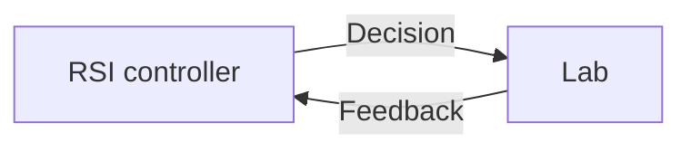

# RSISys

[中文](README_zh.md)

A reusable RSI framework with registered implementations of existing algorithms
and ready-to-configure LLM benchmark recipes: ReST^EM, RRSI, SEAL, TTRL and AIDE.
FT-Agent is available as an explicitly partial adaptation.

**RSI controller → Lab execution → feedback → RSI controller**.
The library owns method implementations and shared execution; `rsisys.algorithms` contains each method's controller, specialized Lab and
configuration; shared engines and execution services stay in framework modules.
Harnesses, memory, verifiers and training engines remain replaceable components.

Early research release. CPU examples need no GPU, API key or model service.
Real-model recipes require their own models, data and optional environments.
A completed loop does not establish improvement or reproduce a paper's gains.

## Quickstart

Python **3.12 or 3.13**, Linux or macOS. From a checkout:

```sh
git clone https://github.com/satsuki2486441738/RSISys.git
cd RSISys
python3.12 -m venv .venv
. .venv/bin/activate
python -m pip install -e .
rsisys catalog
rsisys run --config src/rsisys/algorithms/rest_em/configs/cpu/rest_em.json
```

This runs ReST^EM against a **simulated arithmetic Lab**, with no LLM training.
Inspect `runs/rest-em-quickstart/result.json` and its operation receipts.
Use a fresh directory for another run: `--data-dir runs/another-run`.
Installation uses a checkout or locally built wheel; no PyPI release is assumed.

## Architecture



The controller owns strategy, candidate selection and stopping decisions. Labs
own domain execution and return structured metrics, artifacts and log references.
The host provides registration, configuration, operation authorization, routing,
receipts, evidence references, lifecycle management and owned resource cleanup.
It does not choose an algorithm's winner from scores.

New algorithms normally need only external registration. Changes to shared
scheduling, delivery, cancellation or recovery semantics belong in the core.
Built-in methods live in `src/rsisys/algorithms/<method>/`: `controller.py`
implements decisions, `lab.py` implements method-specific execution, and `configs/`
selects the registered combination. SEAL/TTRL share schedule machinery in
`algorithms/_weight.py`; method-specific workers, graders and upstream bridges
stay in their method package. Reusable mathematical Labs and shared engines remain
in `rsisys.labs`. Method packages reuse this infrastructure instead of copying it.
Server launchers, historical reports, benchmark scripts and domain demos are
maintained privately. Public imports use [rsisys.api](src/rsisys/api.py).

## Register your own method

Keep a complete method in one package directory:

```text
my_method/
  __init__.py       # register(registry): register controller and Labs
  controller.py    # decisions and method state
  lab.py           # execution and feedback
  config.json      # complete controller/Lab selection
```

Only the package entry `register(registry)` is prescribed; the internal file
layout is yours. Small methods can put the entire implementation in `__init__.py`.
`__init__.py` can also import `.controller` and `.lab` and register both in one
`register(registry)` function. Keep custom memory, harnesses and backend adapters
in this directory as needed; reuse framework components through imports.
Run `rsisys run --plugin ./my_method --config ./my_method/config.json`.
No core registry edit is needed. Built-in directories under `rsisys.algorithms`
use the same entry function and are discovered automatically. Directory plugins
record a hash of their local package files. Plugins execute trusted host code.


Existing methods run without custom plugins. To develop a new method, save the
following public-interface implementation as `plugin.py`:

```python
from rsisys.api import Decision, LabRequest, LabFeedback, OperationSpec

class Controller:
    def __init__(self, context, config):
        pass

    def decide(self, window):
        if window.feedback is not None:
            return Decision("finish", reason="Received Lab result")
        return Decision("invoke", operation=LabRequest("demo.step", {}))

class Lab:
    def __init__(self, context, config):
        pass

    def describe(self):
        return (OperationSpec("step", "Run one experiment", {
            "type": "object", "properties": {}, "additionalProperties": False
        }),)

    def execute(self, call):
        return LabFeedback("Example completed", (), False, data={"score": 1})

def register(registry):
    registry.register_controller("custom", Controller, version="1")
    registry.register_lab("custom", Lab, version="1")
```

Save as `plugin.py`, and select it with `experiment.json`:

```json
{
  "objective": "Run my RSI method",
  "data_dir": "runs/custom",
  "max_decision_steps": 8,
  "framework": {
    "controller": {"name": "custom", "config": {}},
    "labs": {"demo": {"name": "custom", "config": {}}}
  }
}
```

Run `rsisys run --config experiment.json --plugin plugin.py`.
`config` is passed to each factory alongside its assembly context. Optional
`validate_config` callbacks reject bad parameters before construction.
Multiple Labs use `alias.operation` names; each Lab receives its native name.
`DecisionInput` includes `objective`, latest `feedback`, `last_operation`,
`capabilities`, `context` and `references`. Decisions are `invoke`, `wait` or
`finish`. Domain arguments must be validated before side effects.

A Lab with background resources should implement idempotent `close()` and
`shutdown(mode) -> bool`, returning true only after its own work has stopped.
For async jobs, expose start/poll/result/cancel operations and deliver the final
receipt; registration does not automatically poll arbitrary external jobs.
Optional `required_operations()` checks operation availability, and `report()`
adds JSON method state to `result.json.controller_report`.

## Components

- `single_loop` provides fixed iteration; `meta_agent` uses the configured model
  with `harness=default|dsh`; set actual backend, role and model identities
  in your own JSON configuration. DSH also needs its native home/workspace/session
  configuration and `python -m pip install -e '.[dsh]'`.
- Memory, engines and scorers are injected inside module factories.
  Default memory is explicit/literal. Optional ReMe BM25 retrieval uses
  `python -m pip install -r requirements/reme.txt` and
  `ResearchAssembly.reme()` from `rsisys.research`; it adds no embedding service
  or autonomous memory agent. LangMem is a separate optional extra.
- Whole-assembly integrations can register a `MethodDefinition` through
  `registry.register_method`; select `framework.method` instead of
  `framework.controller/labs` when custom state adapters are needed.

## Methods and evidence

| Controller / Lab | Scope | Configuration / evidence |
| --- | --- | --- |
| `rest_em` / `math` | Generate, filter, retrain from the initial model; lightweight LoRA adaptation | [GSM8K](src/rsisys/algorithms/rest_em/configs/gsm8k-8gpu.json), [MATH](src/rsisys/algorithms/rest_em/configs/math-8gpu.json) |
| `rrsi` / `harness_math` | Fixed-model harness evolution; MATH port with regularization and critic | [Config](src/rsisys/algorithms/rrsi/configs/math.json) |
| `seal` / `seal` | Self-edits, inner adaptation, selection, outer SFT; reference and paper profiles | [Reference](src/rsisys/algorithms/seal/configs/8gpu.json), [paper](src/rsisys/algorithms/seal/configs/paper.json) |
| `ttrl` / `ttrl` | Majority rewards with independent LoRA GRPO | [Config](src/rsisys/algorithms/ttrl/configs/8gpu.json) |
| `ttrl_verl` / `ttrl_verl` | Pinned official full-parameter backend with continuous optimizer/reference state | [Config](src/rsisys/algorithms/ttrl/configs/paper.json) |
| `ft_agent` / `llm_finetune` | Partial native RD-Agent policy with local GSM8K/LLaMA-Factory execution | [Config](src/rsisys/algorithms/ft_agent/configs/gsm8k.json) |
| `aide` / `aide_program` | Native Agent/search/review/Journal, adapted to fixed-model LLM inference programs | [Config](src/rsisys/algorithms/aide/configs/gsm8k.json) |

SEAL and reference TTRL completed two-round, eight-GPU Qwen2.5-7B Base runs;
**neither reproduced paper gains**. SEAL's paper profile has small native-training
validation using a lexical smoke scorer, not an accepted GPT-4.1/full-paper run.
Native TTRL has a 32-target-question, one-epoch GPU check, not the full 500-question,
10-epoch experiment; its target metric is transductive.

FT-Agent completed three native SFT experiments; heldout accuracy fell from
48/64 to 45/64. It omits the full CoSTEER debugging/knowledge pipeline.
AIDE completed three search nodes; heldout accuracy rose from 28/64 to 34/64
with more calls (29 → 67) and tokens. This is not an equal-compute comparison or
AIDE's original benchmark. Neither adapter trains meta-agent weights.
These pilots validate integration; they do not justify blaming the papers for
unreproduced gains. Detailed historical run and failure records are maintained privately.

## Run an adapted method

Choose a configuration from the method table, obtain the required model and data,
and set its paths, Python interpreters, endpoints and disjoint GPU allocation.
JSON dataset schemas and validation are defined by each Lab. Start from the
repository root, for example:

```sh
rsisys run --config src/rsisys/algorithms/rest_em/configs/math-8gpu.json
```

GPU training requires separately installed PyTorch/Transformers/PEFT and, where
configured, vLLM. SEAL/TTRL paper backends use
[requirements/seal-ttrl.txt](requirements/seal-ttrl.txt) in an isolated environment;
SEAL semantic grading additionally requires the configured GPT-4.1 service.
FT-Agent and AIDE need Linux bubblewrap, model services, their pinned clean
upstream checkouts and [FT-Agent](requirements/ft_agent.txt) /
[AIDE](requirements/aide.txt) dependencies. Pins and allowed execution parameters
are enforced in the implementation. These dependencies and services are not
installed or started by registration. Configuration-ready does not mean that
external models, datasets or optional training stacks are bundled.

## Monitor

Optional, independent of the core package and GPU stack:

```sh
python -m pip install ./src/rsimonitor
rsimonitor --runs-dir runs
```

The viewer is read-only and binds to loopback by default. It has no authentication
or multi-tenant isolation; external exposure needs access control.

## Limits and security

0.x APIs may change; pin commits, model/data revisions and dependencies for long
experiments. Snapshots require explicit state/recovery adapters. Ordinary
registration does not restore arbitrary controller memory or external jobs;
FT-Agent/AIDE native searches and synchronous training recipes need fresh runs.
There is no global GPU lease across Labs/runs or complete long-job cost/budget
integration. Assign non-overlapping devices yourself. Snapshot metadata does not
freeze the installed dependency environment.

Plugins execute trusted host Python. Ordinary local-process Labs are not OS
sandboxes; use an explicit isolated executor for untrusted generated programs.
Custom Labs own network access, external billing and resource termination.
Supply credentials through environment variables. Saved prompts, logs and
artifacts can contain private data; review them before sharing.
`finished` describes host lifecycle, not training success or quality improvement.
Check method reports, receipts, optimizer/weight evidence and fixed heldout metrics.

For vulnerabilities, use GitHub's private reporting facility when available;
otherwise request a private channel without posting exploit details or secrets.

## Development

```sh
python -m pip install -e '.[dev]'
ruff check --select E9,F63,F7,F82 src
python -m build --outdir dist/core .
python -m build --outdir dist/monitor src/rsimonitor
python -m twine check --strict dist/core/* dist/monitor/*
```

Regression suites and validation scripts are maintained privately;
this repository has no GitHub Actions workflows.
PRs should describe behavior, relevant validation and method deviations; use
synthetic fixtures, preserve attribution and keep weights, datasets and logs out
of Git. Contributions use Apache-2.0; keep discussion respectful and specific.

## License

Copyright 2026 RSISys contributors. Licensed under [Apache-2.0](LICENSE).
Third-party origins are linked in the
corresponding adapters; adapted SEAL code retains its MIT text in
[seal/lab.py](src/rsisys/algorithms/seal/lab.py). External dependencies, weights and datasets
are obtained separately under their own terms.
