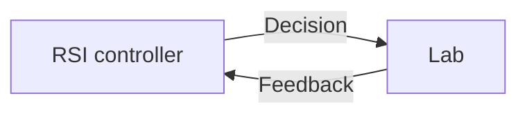

# RSISys

[中文](README_zh.md)

A reusable RSI framework with registered implementations of existing algorithms
and ready-to-configure LLM benchmark recipes: ReST^EM, RRSI, SEAL, TTRL and AIDE.
FT-Agent is available as an explicitly partial adaptation.

**RSI controller → Lab execution → feedback → RSI controller**.
The library owns method implementations and shared execution; `rsisys.algorithms` contains each method's controller, specialized Lab and
configuration; shared engines and execution services stay in framework modules.
Harnesses, memory, verifiers and training engines remain replaceable components.

Early research release. CPU examples need no GPU, API key or model service.
Real-model recipes require their own models, data and optional environments.
A completed loop does not establish improvement or reproduce a paper's gains.

## Quickstart

Python **3.12 or 3.13**, Linux or macOS. From a checkout:

```sh
git clone https://github.com/satsuki2486441738/RSISys.git
cd RSISys
python3.12 -m venv .venv
. .venv/bin/activate
python -m pip install -e .
rsisys catalog
rsisys run --config src/rsisys/algorithms/rest_em/configs/cpu/rest_em.json
```

This runs ReST^EM against a **simulated arithmetic Lab**, with no LLM training.
Inspect `runs/rest-em-quickstart/result.json` and its operation receipts.
Use a fresh directory for another run: `--data-dir runs/another-run`.
Installation uses a checkout or locally built wheel; no PyPI release is assumed.

## Architecture



The controller owns strategy, candidate selection and stopping decisions. Labs
own domain execution and return structured metrics, artifacts and log references.
The host provides registration, configuration, operation authorization, routing,
receipts, evidence references, lifecycle management and owned resource cleanup.
It does not choose an algorithm's winner from scores.

New algorithms normally need only external registration. Changes to shared
scheduling, delivery, cancellation or recovery semantics belong in the core.
The files directly under `src/rsisys/` are the stable framework surface, not run output:

```text
api.py          # public import facade
application.py  # application and run lifecycle
assembly.py     # controller/Lab/harness/backend composition
registry.py     # algorithm and component registration
methods.py      # method declarations and method catalogs
components.py   # component graph and state ports
config.py       # configuration-to-application builders
research.py     # optional research-component assembly
cli.py          # command-line entry point
```

These modules intentionally remain at the package root so existing integrations can
import stable paths such as `rsisys.api`, `rsisys.config` and `rsisys.application`.
The concrete implementation layers live below `algorithms/`, `harnesses/`, `labs/`, `backends/`,
`runtime/` and `snapshot/`.

The implementation layer has two roles: **controllers** process feedback and
choose actions; **Labs** execute experiments and return evidence. A controller
may be a state machine, search policy, LLM meta-agent or a hybrid. Neither side
is required to use a harness, memory or an LLM.

```text
algorithms/
  <method>/
    __init__.py                 # register the complete method
    controller.py  lab.py       # private strategy and experiment implementation
    configs/                    # method configurations and task assets
  _template/                    # self-contained development example
  shared/                       # components reused by multiple methods
loops/                          # contracts, lifecycle, authorization and delivery
harnesses/
  decision/                     # optional decision execution, memory and feedback learning
  actor/                        # optional policy/environment execution
  python_step/                  # isolated executable program harness
  defaults.py                   # explicit bundled-harness composition
labs/
  scenes/
    math/                       # reusable answer parsing and verification
    self_reflection/            # long-horizon improvement scaffold
  local_process/                # generic process Lab
backends/                       # reusable training and serving engines
runtime/                        # host orchestration, state and evidence
snapshot/                       # snapshot capture and restore mechanisms
```

Built-in method packages declare and register their complete method assembly.
Method-private implementations live beside the registration entry; reusable scenes
and components are imported from `harnesses/`, `labs/` and `backends/` when shared.
Configurations select `framework.method`. Method-private controllers and Labs
are not registered globally; older split selections must migrate to the method
configuration or explicitly register their own factories. Each method chooses its controller,
Labs, harnesses and memory through its single `register(registry)` entry; the
core registry has no algorithm-specific branches. Independent research-worker
transport lives in `runtime/execution/research_bridge.py`.

Within `harnesses/decision/feedback/`, `learning.py` owns the journal and job
lifecycle, `evidence_packet.py` builds bounded evidence views,
`proposal_validation.py` validates derived products, `model_gateway.py` owns
model-call admission and serialization, and `legacy.py` isolates the older
interpretation workflow. These optional harness services do not implement the
long-horizon Self-Reflection Lab.

External methods may keep private implementations beside their registration
entry, as shown by `_template`, without modifying the core or installing their
components into the library. Promote components into the shared implementation
layer when they are intended for reuse. Harnesses support context/model/tool
interaction; a method's controller owns strategy, candidate selection and stopping.

`rsisys.labs` exports generic Lab contracts without importing any scene.
Scenes supply reusable domain capabilities or Lab implementations. A future coding scene can live in
`labs/scenes/coding/` or an external method package. A method imports a shared
scene or wraps it with its own execution logic; training and serving engines
come from `backends/`. The `local_process` registration provides generic process
execution. Method-specific Labs stay under `algorithms/<method>/`.
ReST EM owns its training Lab; RRSI and meta-agent share fixed-model harness
measurement in `algorithms/shared/harness_lab.py`. Math verifiers remain in the scene; prepared-prompt LoRA execution lives in
`backends/training/lora/`. Methods own prompt formatting, training-data selection
and model lineage; the backend does not know the dataset, verifier or RSI algorithm.

Server launchers, historical reports, benchmark scripts and domain demos are
maintained privately. Public imports use [rsisys.api](src/rsisys/api.py).

The remaining internal boundaries are:

- The default harness owns its public-policy bridge in
  `harnesses/decision/public_policy.py` and Lab tool bindings in
  `harnesses/decision/tools/lab.py`. The inactive exploration endpoint
  lives in `loops/exploration/operation_only.py`.
- `adapters/exploration/` bridges the older exploration endpoint to the Lab task
  contract; `adapters/langchain_model.py` bridges the optional LangChain API.
  Implementation-specific integration belongs with its owning implementation.
- `backends/training/` and `backends/serving/` own training processes, inference
  transports and deployments. These are execution providers; Labs only select them and translate their
  results into method feedback.
- `runtime/orchestration/lab_group.py` owns namespaced routing and Lab lifecycle aggregation.
  Backend record writes and locks live in `runtime/storage/process_store.py`, so serving
  does not depend on a training implementation for persistence.
- `assembly.py` manages ports and resource ownership. Bundled default construction
  is loaded on demand from `harnesses/defaults.py`; supplying independent factories
  does not construct the default agents. Loop endpoint protocols live in
  `loops/contracts/harness.py` and import no concrete harness.

`runtime/` contains host mechanisms, grouped by responsibility:

```text
runtime/
  orchestration/  # run policies, loop scheduling, Lab routing and jobs
  state/          # recovery, identities and version activation
  execution/      # isolation, processes, workers and resource reservations
  storage/        # artifacts, file access, canonical JSON and process records
  models/         # model transport, credential broker and usage accounting
  evaluation/     # evaluation admission and derived diagnostics
  evidence/       # shared evidence records and persistence
  capabilities.py # optional component method discovery
```

Workspace candidate operations live in `labs/local_process/evolution.py`;
binding activation and its state adapter live in `runtime/state/bindings.py`.
The default decision harness owns knowledge continuation in
`harnesses/decision/continuation.py`. Built-in harness recovery lives in
`snapshot/builtin_recovery.py`; the runtime handles the generic recovery journal. Evaluation
admission tracks campaigns and budgets; task scorers remain in Labs.

Shared records, provenance, in-memory/SQLite persistence and basic queries live
in `runtime/evidence/`. Controller-side feedback selection lives in
`harnesses/decision/memory/`; it determines which evidence enters decision context.
The Self-Reflection Lab owns future long-term experience curation, candidate
construction and validation. Ordinary RSI runs use shared evidence without
enabling that Lab. Existing record formats and `experience.sqlite3` files are
unchanged.

### Self-Reflection Lab — architecture direction

**Self-reflection means improving the meta-agent's own decision-making from its
accumulated decision–Lab feedback experience.** A Self-Reflection Lab is an
optional Lab specialization, registered through the same method entry point;
it does not introduce a third top-level module. Its improvement targets may
include the controller's harness, memory strategy, training data and model weights.
The [code scaffold](src/rsisys/labs/scenes/self_reflection/__init__.py) provides an opt-in
`self_reflection` Lab registration at version `0-placeholder`. It is not a working
backend; existing reflection tools do not implement this complete lifecycle.

The Lab is designed to maintain experience across runs and support three stages:

1. **Accumulate experience:** retain multi-step research episodes, task context,
   controller/model/harness versions, decisions, Lab receipts, cost and eventual
   outcomes. Keep unfinished outcomes pending; immediate experiment failure is
   not automatically evidence of a poor research decision.
2. **Construct candidates:** use accumulated experience to produce candidate
   harnesses, datasets or trained versions. Candidate construction completing
   does not mean an improvement has been verified.
3. **Validate over time:** bind each validation run to a fixed candidate and
   return progress and measured outcomes. Use inexpensive screening before
   longer research rollouts, with comparable budgets and baseline conditions.
   Historical logs support learning but cannot establish how a changed policy's
   subsequent trajectory would perform. Keep candidate-construction evidence
   separate from validation evidence, and use fresh tasks or rotating validation
   windows to limit repeated selection on the same tasks.

Experience collection, candidate construction and validation can run at different
cadences. A method defines their triggers, validation horizon, budgets, metrics
and adoption rules. The controller decides whether to adopt, reject or continue
validation; the runtime applies an explicitly selected version at a defined
switch boundary. The Lab must not overwrite the active controller when a
candidate is produced. Evaluation may finish with insufficient evidence; longer
history does not guarantee that every update improves performance.

The framework boundary is version-linked evidence, task identity, progress and
terminal receipts, persistence, cancellation and resource ownership. Long
validation may use explicit start/poll/result/cancel operations. Complete
cross-run self-improvement, candidate validation and controller switching still
require implementation; registration alone provides none of these semantics.

The package contains draft version/episode/candidate/validation records, a backend
protocol, and the Lab operation surface (`record_episode`, `build_candidate`,
`start`, `poll`, `result`, `cancel`). Methods can import its `register` function
inside their own registration entry, or register a concrete replacement Lab.
Inspect the scaffold with
`rsisys catalog --plugin src/rsisys/labs/scenes/self_reflection`.
Every valid invocation currently returns a failed receipt with
`error_code=self_reflection_not_implemented`; no experience is persisted, jobs
started, candidates created or controller versions switched.

## Register your own method

Use the runnable [_template](src/rsisys/algorithms/_template/__init__.py) as a starting point:

```text
algorithms/_template/
  __init__.py       # register the whole method and bind its private factories
  controller.py     # choose the next prompt from Lab feedback; decide when to stop
  lab.py            # execute checks and return a structured receipt
  configs/run.json  # select one method and configure its controller and Labs
```

Run it from a checkout, without GPUs, models or external services:

```sh
rsisys run --plugin src/rsisys/algorithms/_template \
  --config src/rsisys/algorithms/_template/configs/run.json \
  --data-dir runs/custom-prompt
```

The controller evaluates a prompt, reads missing instructions from the Lab, and
adds one instruction per round. After three evaluations its literal instruction
coverage is `0 → 0.5 → 1`. This is **synthetic wiring validation**, not measured
LLM quality or training. See `runs/custom-prompt/result.json` for the controller
report and inspect operation receipts for feedback. Use a fresh `--data-dir` on reruns.

To create your own method:

1. Copy `_template` to `src/rsisys/algorithms/my_method/`. Rename the method
   `custom_prompt` and its matching config selection. A package
   without a leading underscore is discovered automatically; run its config without
   `--plugin`. No changes to the core registry or `api.py` are needed.
2. Implement your policy in `controller.py` and execution in `lab.py`. Keep method
   memory, harnesses and backend adapters in the same directory, importing shared
   framework components where useful.
3. Or keep the entire directory **outside the library**, such as `./my_method/`,
   and run `rsisys run --plugin ./my_method --config ./my_method/configs/run.json --data-dir runs/my-method`.

`_template` is deliberately excluded from automatic discovery so it does not
appear as a supported research algorithm. Explicit `--plugin` loading runs it.
Only `register(registry)` is prescribed; the internal layout is yours. Small
methods may put everything in `__init__.py`. Directory plugins hash their local
package files and execute trusted host code.

`config` is passed to each factory alongside its assembly context. Optional
`validate_config` callbacks reject bad parameters before construction.
Multiple Labs use `alias.operation` names; each Lab receives its native name.
`DecisionInput` includes `objective`, latest `feedback`, `last_operation`,
`capabilities`, `context` and `references`. Decisions are `invoke`, `wait` or
`finish`. Domain arguments must be validated before side effects.

Register a complete method with private factories, as the template does:

```python
from rsisys.api import MethodDefinition

registry.register_method("my_method", MethodDefinition.from_factories(
    controller=MyController,
    labs={"experiment": MyLab},
    version="1",
))
```

Select it with `framework.method.name`. Controller parameters go in
`framework.method.config.controller`; Lab parameters go in
`framework.method.config.labs.experiment`. Lab aliases are defined by the method.
`validate_controller` and `validate_labs` provide validation before construction.
For custom composition, implement `RSIMethod.build(config)` and register with
`MethodDefinition.from_method(...)`, or provide a `MethodDefinition` factory
returning `ModuleAssembly` directly.

Shared `harness`, `memory`, `backend`, `scene` and `verifier` factories may use
`register_component` and `resolve_component`. The method's Python assembly owns
resolution and overrides; there is no automatic declarative override layer.
Private components need no separate registration. Existing shared implementations
can also be imported directly. Separate controller/Lab APIs support explicit custom composition.
Only the generic `single_loop` controller and `local_process` Lab are registered
separately by default. Method classes are imported from their method packages,
not from `rsisys.api`.

`rsisys catalog` lists these built-in component IDs without loading ML runtimes:

| Role | IDs | Resolved implementation |
| --- | --- | --- |
| `harness` | `python_step` | Callable `(harness_path, problem, history)` with configurable `timeout`; requires bubblewrap at execution |
| `backend` | `chat_pool`, `lora` | Shared chat endpoint pool or prepared-input LoRA engine |
| `memory` | `agent_memory` | Agent-owned notes and research tasks; the method binds it to its harness |
| `verifier` | `strict_numeric`, `math_verify` | Final-answer checking; `math_verify` requires `rsisys[math]` |

Resolve components inside your method factory; pass the returned objects to your
own controller or Lab and manage their lifecycle there. For example:

```python
verifier = registry.resolve_component("verifier", "strict_numeric", context)
backend = registry.resolve_component("backend", "chat_pool", context, {
    "endpoints": ["http://127.0.0.1:8000/v1"], "model": "my-model",
})
```

No `scene` is registered just to fill a catalog category; methods can import
existing scene capabilities or register a complete reusable scene of their own.

Advanced integrations that already assemble their decision endpoint can register
with `endpoint=True`; their factory receives `(context, execution, config)`.
An optional `research_factory(config)` supplies method-owned research/memory
integration. Ordinary policy factories remain `(context, config)` and need neither.

A Lab with background resources should implement idempotent `close()` and
`shutdown(mode) -> bool`, returning true only after its own work has stopped.
For async jobs, expose start/poll/result/cancel operations and deliver the final
receipt; registration does not automatically poll arbitrary external jobs.
Optional `required_operations()` checks operation availability, and `report()`
adds JSON method state to `result.json.controller_report`.

All run outputs are disposable local state. `runs/` and `runtime-output/` are ignored by Git and store results, logs, artifacts, workspaces, databases and snapshots. The repository keeps only the snapshot/evidence contracts and small deterministic fixtures. Pass `--data-dir` to choose a run directory outside the source tree or under `runtime-output/`.

## Components

`meta_agent` is also a complete registered harness-research method. Its
[configuration](src/rsisys/algorithms/meta_agent/configs/math.json) binds the
model-driven controller, optional research memory and a bounded math Lab. The
controller inspects the baseline, proposes immutable Python harnesses, measures
search feedback and chooses when and what to finalize. The Lab reuses the shared
fixed-model measurement engine; it does not run RRSI's search policy. Heldout
access seals selection and closes further search. Baseline and selected harness
receive equal final evaluation budgets. This is a runnable meta-agent scaffold,
not an implementation or validation of long-horizon self-reflection. Supply the
research-model endpoint (`rsisys-research`), fixed task-model endpoints
(`rsisys-fixed`) and frozen, disjoint datasets before running the configuration.
The complete harness-research method currently uses `harness=default`;
custom assemblies may bind the reusable DSH harness directly.
The example selects the existing vLLM transport for native JSON schemas, measured
token counts, bounded response recovery and archived model-call accounting.
`run_control.decision_steps` exposes the host's remaining decision budget;
the controller decides how to allocate it. A text-only finish cannot replace the
Lab's finalization receipt.

- `single_loop` provides fixed iteration for custom composition. For DSH,
  explicitly bind `rsisys.harnesses.decision.dsh.dsh_decision_factory` in your
  assembly; supply native home/workspace/session configuration and install
  `python -m pip install -e '.[dsh]'`.
- Memory, engines and scorers are injected inside module factories.
  Default memory is explicit/literal. Optional ReMe BM25 retrieval uses
  `python -m pip install -r requirements/reme.txt` and
  `ResearchAssembly.reme()` from `rsisys.research`; it adds no embedding service
  or autonomous memory agent. LangMem is a separate optional extra.
- Whole-assembly integrations can register a `MethodDefinition` through
  `registry.register_method`; select `framework.method` instead of
  `framework.controller/labs` when custom state adapters are needed.

## Methods and evidence

| Method | Scope | Configuration / evidence |
| --- | --- | --- |
| `rest_em` | Generate, filter, retrain from the initial model; lightweight LoRA adaptation | [GSM8K](src/rsisys/algorithms/rest_em/configs/gsm8k-8gpu.json), [MATH](src/rsisys/algorithms/rest_em/configs/math-8gpu.json) |
| `rrsi` | Fixed-model harness evolution; MATH port with regularization and critic | [Config](src/rsisys/algorithms/rrsi/configs/math.json) |
| `seal` | Self-edits, inner adaptation, selection, outer SFT; reference and paper profiles | [Reference](src/rsisys/algorithms/seal/configs/8gpu.json), [paper](src/rsisys/algorithms/seal/configs/paper.json) |
| `ttrl` | Majority rewards with independent LoRA GRPO | [Config](src/rsisys/algorithms/ttrl/configs/8gpu.json) |
| `ttrl_verl` | Pinned official full-parameter backend with continuous optimizer/reference state | [Config](src/rsisys/algorithms/ttrl/configs/paper.json) |
| `ft_agent` | Partial native RD-Agent policy with local GSM8K/LLaMA-Factory execution | [Config](src/rsisys/algorithms/ft_agent/configs/gsm8k.json) |
| `aide` | Native Agent/search/review/Journal, adapted to fixed-model LLM inference programs | [Config](src/rsisys/algorithms/aide/configs/gsm8k.json) |
| `meta_agent` | Model-driven harness proposals, search feedback and sealed heldout selection; no weight training or implemented self-reflection | [Config](src/rsisys/algorithms/meta_agent/configs/math.json) |

On November 9, 2026, SEAL and reference TTRL completed two-round, eight-GPU Qwen2.5-7B Base runs;
**neither reproduced paper gains**. SEAL's paper profile has small native-training
validation using a lexical smoke scorer, not an accepted GPT-4.1/full-paper run.
Native TTRL has a 32-target-question, one-epoch GPU check, not the full 500-question,
10-epoch experiment; its target metric is transductive.

FT-Agent completed three native SFT experiments; heldout accuracy fell from
48/64 to 45/64. It omits the full CoSTEER debugging/knowledge pipeline.
AIDE completed three search nodes; heldout accuracy rose from 28/64 to 34/64
with more calls (29 → 67) and tokens. This is not an equal-compute comparison or
AIDE's original benchmark. Neither adapter trains meta-agent weights.
These pilots validate integration; they do not justify blaming the papers for
unreproduced gains. Detailed historical run and failure records are maintained privately.

On November 10, 2026, the registered methods were rerun after the refactor,
using disjoint four-GPU lanes where possible. These are single-seed integration
pilots with local task adaptations, not paper-scale score reproductions.
Weight runs use Qwen2.5-7B Base; RRSI/AIDE use a fixed Qwen3.5-9B.

| Method | Evaluation | Before → after |
| --- | --- | --- |
| ReST^EM | MATH, 500 heldout questions | 239/500 → 255/500 |
| ReST^EM | GSM8K, complete 1,319-question test | 1073/1319 → 1070/1319 |
| RRSI | MATH, 128 heldout questions × 2 trials | 80.47% → 88.67% |
| SEAL reference | 45 heldout QA pairs, adapted F1 | 0.2399 → 0.3533 |
| TTRL reference | 32 target / 128 disjoint transfer questions | Target 71.88% → 71.88%; transfer 71.88% → 71.09% |
| AIDE adaptation | GSM8K, 64 heldout questions | 32/64 → 31/64 |
| FT-Agent partial adaptation | GSM8K, 64 heldout questions; three native SFT experiments | 48/64 → 51/64 |
| Meta-agent scaffold | MATH, 128 heldout questions × 2 trials; model retained baseline | 78.91% → 78.91% |

RRSI's average recorded token cost increased from 1,176 to 2,287; this is not an
equal-compute improvement. SEAL's no-adaptation F1 fell from 0.3756 to 0.3282.
ReST^EM improved GSM8K dev accuracy (106/128 → 111/128) without improving its
complete test set. FT-Agent uses Qwen3.8-27B for research and selected experiment 2;
its native Trainer checkpoint-state race was fixed by synchronizing the writer's
existing best-checkpoint choice across ranks. None of these observations establishes
statistically reliable gains or attributes a failed reproduction to the paper.
The meta-agent uses a Qwen3.8-27B controller and fixed Qwen3.5-9B task model.
It completed 14 decisions/model calls, measured a candidate on search, chose to
retain baseline, executed finalization, then finished. Earlier 9B/27B attempts
exhausted the 32-decision budget without finalization; one final 27B run completed
after remaining-budget feedback was exposed. This validates a runnable closed
loop, not a demonstrated improvement or meta-agent weight training. Long-horizon
self-reflection remains a placeholder. Runtime artifacts, checkpoints and failed
attempts remain private.

## Run an adapted method

Choose a configuration from the method table, obtain the required model and data,
and set its paths, Python interpreters, endpoints and disjoint GPU allocation.
JSON dataset schemas and validation are defined by each Lab. Start from the
repository root, for example:

```sh
rsisys run --config src/rsisys/algorithms/rest_em/configs/math-8gpu.json
```

GPU training requires separately installed PyTorch/Transformers/PEFT and, where
configured, vLLM. SEAL/TTRL paper backends use
[requirements/seal-ttrl.txt](requirements/seal-ttrl.txt) in an isolated environment;
SEAL semantic grading additionally requires the configured GPT-4.1 service.
FT-Agent and AIDE need Linux bubblewrap, model services, their pinned clean
upstream checkouts and [FT-Agent](requirements/ft_agent.txt) /
[AIDE](requirements/aide.txt) dependencies. Pins and allowed execution parameters
are enforced in the implementation. These dependencies and services are not
installed or started by registration. Configuration-ready does not mean that
external models, datasets or optional training stacks are bundled.

## Monitor

Optional, independent of the core package and GPU stack:

```sh
python -m pip install ./src/rsimonitor
rsimonitor --runs-dir runs
```

The viewer is read-only and binds to loopback by default. It has no authentication
or multi-tenant isolation; external exposure needs access control.

## Limits and security

0.x APIs may change; pin commits, model/data revisions and dependencies for long
experiments. Snapshots require explicit state/recovery adapters. Ordinary
registration does not restore arbitrary controller memory or external jobs;
FT-Agent/AIDE native searches and synchronous training recipes need fresh runs.
There is no global GPU lease across Labs/runs or complete long-job cost/budget
integration. Assign non-overlapping devices yourself. Snapshot metadata does not
freeze the installed dependency environment.

Plugins execute trusted host Python. Ordinary local-process Labs are not OS
sandboxes; use an explicit isolated executor for untrusted generated programs.
Custom Labs own network access, external billing and resource termination.
Supply credentials through environment variables. Saved prompts, logs and
artifacts can contain private data; review them before sharing.
`finished` describes host lifecycle, not training success or quality improvement.
Check method reports, receipts, optimizer/weight evidence and fixed heldout metrics.

For vulnerabilities, use GitHub's private reporting facility when available;
otherwise request a private channel without posting exploit details or secrets.

## Development

```sh
python -m pip install -e '.[dev]'
ruff check --select E9,F63,F7,F82 src
python -m build --outdir dist/core .
python -m build --outdir dist/monitor src/rsimonitor
python -m twine check --strict dist/core/* dist/monitor/*
```

Regression suites and validation scripts are maintained privately;
this repository has no GitHub Actions workflows.
PRs should describe behavior, relevant validation and method deviations; use
synthetic fixtures, preserve attribution and keep weights, datasets and logs out
of Git. Contributions use Apache-2.0; keep discussion respectful and specific.

## License

Copyright 2026 RSISys contributors. Licensed under [Apache-2.0](LICENSE).
Third-party origins are linked in the
corresponding adapters; adapted SEAL code retains its MIT text in
[seal/lab.py](src/rsisys/algorithms/seal/lab.py). External dependencies, weights and datasets
are obtained separately under their own terms.
