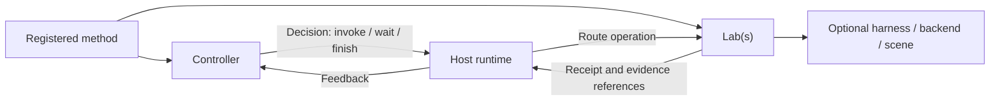

# RSISys

**A runtime for recursive self-improvement research methods.**

[中文](README_zh.md) · [Quickstart](#quickstart) · [Methods](#available-methods) · [Build your method](#register-your-own-method)

Register a complete RSI method, keep its controller and Labs together, and run
it through a shared execution and feedback loop:

**Controller → Lab execution → feedback → Controller**

A method can search over inference harnesses, update model weights with SFT or
RL, or use an LLM meta-agent to choose experiments. The method owns its strategy;
RSISys supplies the execution lifecycle, operation routing and evidence records.

Early research release, **0.1.0**, under [Apache-2.0](LICENSE). The CPU quickstart
requires no GPU, API key or model service. Real-model runs need separately
prepared models, datasets and execution environments.

## Why RSISys

- **Register the complete method.** Keep its controller, Labs, workers and configs
  in one method package, inside or outside the library. Method-private components
  need no separate global registration. Adding a method uses `register(registry)`;
  it does not require adding algorithm branches to the core runner.
- **Keep research decisions in the method.** A controller can be a state machine,
  search policy, LLM meta-agent or hybrid. It determines experiments, candidate
  selection and stopping; the framework does not impose a fixed
  propose–train–evaluate–adopt sequence.
- **Use the same host for different improvement mechanisms.** Existing adapters
  exercise harness search, SFT and RL through the same controller/Lab boundary.
  A Lab exposes domain operations and can call native training or serving stacks.
  Shared harnesses, memory, backends and verifiers are optional building blocks.
- **Inspect what actually happened.** Method identities, operation receipts,
  artifact references and method reports keep execution outcomes traceable.
  `finished` means the host loop ended; real training, validation and gains must
  be established from the method's evidence.

The extension contract is **register a complete method and execute its loop**.
Methods choose their internal structure and dependency injection; arbitrary
components are not required to be interchangeable across every method.

[FlashRSI](https://github.com/RUC-NLPIR/FlashRSI) is related work emphasizing
configurable RSI experiments across algorithms, target harnesses and benchmarks,
with versioned agent resources. RSISys emphasizes complete method packages and
the controller/Lab execution contract, including methods that invoke weight
training. These are differences in emphasis and abstraction, not a claim of
exclusive features or superior benchmark results.

## Quickstart

Python **3.12 or 3.13**, Linux or macOS. From a checkout:

```sh
git clone https://github.com/satsuki2486441738/RSISys.git
cd RSISys
python3.12 -m venv .venv
. .venv/bin/activate
python -m pip install -e .
rsisys catalog
rsisys run --config src/rsisys/algorithms/rest_em/configs/cpu/rest_em.json
```

This executes ReST^EM's schedule against a **simulated arithmetic Lab**, without
LLM training. Inspect `runs/rest-em-quickstart/result.json` and its operation
receipts. Use a fresh output directory for another run:
`--data-dir runs/another-run`. Installation uses a checkout or built wheel;
no PyPI release is assumed.

## Available methods

The catalog lists **8 complete method registrations**. `ttrl` and `ttrl_verl` are
two execution profiles of TTRL; `meta_agent` is our framework scaffold, not a
paper reproduction. Adaptation scope is part of each method's description.

| Method | Scope | Configuration |
| --- | --- | --- |
| `rest_em` | Generate, filter, retrain from the initial model; lightweight LoRA adaptation | [GSM8K](src/rsisys/algorithms/rest_em/configs/gsm8k-8gpu.json), [MATH](src/rsisys/algorithms/rest_em/configs/math-8gpu.json) |
| `rrsi` | Fixed-model harness evolution; MATH port with regularization and critic | [Config](src/rsisys/algorithms/rrsi/configs/math.json) |
| `seal` | Self-edits, inner adaptation, selection, outer SFT; reference and paper profiles | [Reference](src/rsisys/algorithms/seal/configs/8gpu.json), [paper](src/rsisys/algorithms/seal/configs/paper.json) |
| `ttrl` | Majority rewards with independent LoRA GRPO | [Config](src/rsisys/algorithms/ttrl/configs/8gpu.json) |
| `ttrl_verl` | Pinned official full-parameter backend with continuous optimizer/reference state | [Config](src/rsisys/algorithms/ttrl/configs/paper.json) |
| `ft_agent` | Partial native RD-Agent policy with local GSM8K/LLaMA-Factory execution; full CoSTEER pipeline excluded | [Config](src/rsisys/algorithms/ft_agent/configs/gsm8k.json) |
| `aide` | Native Agent/search/review/Journal, adapted to fixed-model LLM inference programs | [Config](src/rsisys/algorithms/aide/configs/gsm8k.json) |
| `meta_agent` | Model-driven harness proposals, search feedback and sealed heldout selection; no weight training or implemented self-reflection | [Config](src/rsisys/algorithms/meta_agent/configs/math.json) |

To run a real-model configuration, prepare its model/data paths, Python
interpreters, model-service endpoints and GPU assignment, then use the same CLI:

```sh
rsisys run --config src/rsisys/algorithms/rest_em/configs/math-8gpu.json
```

Training requires its own PyTorch/Transformers/PEFT environment and vLLM where
configured. SEAL/TTRL paper backends use [requirements/seal-ttrl.txt](requirements/seal-ttrl.txt);
SEAL semantic grading also requires the configured GPT-4.1 service. FT-Agent
and AIDE require Linux bubblewrap, model services, pinned clean upstream
checkouts and their [FT-Agent](requirements/ft_agent.txt) / [AIDE](requirements/aide.txt)
dependencies. Data formats and accepted parameters are defined by each method's
Lab. Registration does not download models/data or start external services.

## Register your own method

Start from the runnable [_template](src/rsisys/algorithms/_template/__init__.py):

```text
my_method/
  __init__.py       # register(registry): bind the complete method
  controller.py     # decide what to do from feedback
  lab.py            # execute experiments and return receipts
  configs/run.json  # select the method and provide parameters
```

The package layout is yours; small methods may use one file. A conventional
registration binds private factories accepting `(context, config)`:

```python
from rsisys.api import MethodDefinition
from .controller import MyController
from .lab import MyLab

def register(registry):
    registry.register_method("my_method", MethodDefinition.from_factories(
        controller=MyController,
        labs={"experiment": MyLab},
        version="1",
    ))
```

Select the method as a unit. Controller and Lab parameters remain separate:

```json
{
  "framework": {
    "method": {
      "name": "my_method",
      "config": {
        "controller": {},
        "labs": {"experiment": {}}
      }
    }
  }
}
```

This snippet shows only the method selection; use the template's full run config
for the objective, output path and run budget. Run the bundled template without
GPUs or services:

```sh
rsisys run --plugin src/rsisys/algorithms/_template \
  --config src/rsisys/algorithms/_template/configs/run.json \
  --data-dir runs/custom-prompt
```

It checks literal prompt instructions to demonstrate feedback delivery and
method execution. This is an interface example without LLM inference or training.

Copy the template outside the library and run with `--plugin ./my_method`, or
copy it to `src/rsisys/algorithms/my_method/` for built-in discovery. Rename
`custom_prompt` in the registration and config. No core registry or `api.py`
edit is needed. `_template` itself is excluded from automatic discovery.

The controller implements `decide(DecisionInput)` and returns `invoke`, `wait`
or `finish`. The Lab implements `describe()` and `execute(call)`, returning
`OperationResult` with status, data and evidence references. Multiple Labs use
`alias.operation` routing. Optional config validators reject parameters before
construction. For custom assembly, implement `RSIMethod.build(config)` with
`MethodDefinition.from_method(...)` or supply a `ModuleAssembly` factory.
See [rsisys.api](src/rsisys/api.py) for the public contracts.

### Components

A method may import shared code directly or resolve registered components in
its factory. Method-private components need no additional registration.

| Role | Built-in IDs | Implementation |
| --- | --- | --- |
| `harness` | `python_step` | Isolated `(harness_path, problem, history)` execution; configurable timeout, requires bubblewrap |
| `backend` | `chat_pool`, `lora` | Chat endpoint pool or prepared-input LoRA engine |
| `memory` | `agent_memory` | Agent-owned notes and research tasks; method binds the harness |
| `verifier` | `strict_numeric`, `math_verify` | Final-answer checking; the latter needs `rsisys[math]` |

Use `registry.resolve_component(kind, name, context, config)`; resolution does
not install dependencies or bind the component to a method automatically.
Custom shared components use `register_component`. DSH can be explicitly bound
with `rsisys.harnesses.decision.dsh.dsh_decision_factory` and the `rsisys[dsh]`
extra. Optional ReMe retrieval uses [requirements/reme.txt](requirements/reme.txt)
and `ResearchAssembly.reme()`; LangMem is a separate optional extra.

Independent controller/Lab registration APIs remain available for explicit
custom composition. Default standalone registrations are only `single_loop`
and `local_process`. Built-in method-private names are not globally registered;
older split configs must select `framework.method` or register their own factories.
Concrete method classes are imported from their packages, not `rsisys.api`.

## Architecture and boundaries



| Owner | Responsibility |
| --- | --- |
| Method | Controller strategy, Lab operations, candidate selection, stopping and adoption rules |
| Lab | Domain validation, training/inference execution, metrics and artifacts |
| Host | Registration, run lifecycle, authorization, routing, receipt delivery, resource ownership and explicit recovery integration |

```text
src/rsisys/
  algorithms/       # complete method packages, template and proven shared code
  loops/            # contracts and loop mechanics
  harnesses/        # optional decision/actor execution, memory and feedback services
  labs/             # generic process Lab and reusable scenes
  backends/         # training and serving engines
  runtime/          # host scheduling, execution, evidence and storage
  snapshot/         # capture and explicit recovery integration
  api.py            # public framework imports
  methods.py        # method definitions
  registry.py       # catalogs and trusted plugin loading
```

Controllers and Labs need not use an LLM or a bundled harness. Shared components
are optional; the core owns lifecycle semantics, not the method's science.
A Lab with background resources should implement idempotent `close()` and
`shutdown(mode) -> bool`. Async Labs can expose start/poll/result/cancel; each
method drives its own protocol. Registering a Lab does not poll it automatically.

`runs/` and `runtime-output/` hold local outputs and are ignored by Git. The
`runtime/` and `snapshot/` source packages implement mechanisms, not saved runs.

### Self-reflection: planned extension

[Self-Reflection Lab](src/rsisys/labs/scenes/self_reflection/__init__.py) is an
opt-in architecture scaffold (`0-placeholder`) for improving the meta-agent's
own decision-making from accumulated decision–Lab feedback. Its intended
lifecycle is experience accumulation → candidate construction → long-horizon
validation; the controller would decide whether to adopt a validated version.
Validation can remain pending or inconclusive. The code currently returns
`self_reflection_not_implemented` for valid operations and performs no
experience persistence, training, validation or controller switching.
The runnable `meta_agent` method searches task harnesses; it does not implement
this self-improvement lifecycle. Self-reflection is a future direction, not a
release feature or demonstrated gain.

## Monitor

Optional read-only viewer, installed independently from the core:

```sh
python -m pip install ./src/rsimonitor
rsimonitor --runs-dir runs
```

It binds to loopback by default and has no authentication or multi-tenant isolation.

## Release scope and limits

- This is an early research release; 0.x APIs may change. Pin commits and
  model/data/dependency revisions for experiments.
- Snapshot recovery needs explicit state adapters. Method registration alone
  does not restore arbitrary controller state or external jobs. Native FT-Agent/
  AIDE searches and synchronous training recipes need fresh run directories.
- GPU devices are assigned by the operator. There is no global GPU lease across
  Labs/runs or complete long-job billing and budget handoff.
- Plugins are trusted host Python code. A normal local-process Lab is not an OS
  sandbox; generated untrusted code requires an explicitly isolated executor.
  Custom Labs own external access, charges and resource termination. Credentials
  belong in environment variables; review saved prompts/artifacts before sharing.
- The public checkout includes executable CPU fixtures and a method template.
  Regression suites are maintained separately; no GitHub Actions workflows are included.

## Development and license

```sh
python -m pip install -e '.[dev]'
ruff check --select E9,F63,F7,F82 src
python -m build --outdir dist/core .
python -m build --outdir dist/monitor src/rsimonitor
python -m twine check --strict dist/core/* dist/monitor/*
```

Contributions should explain behavior changes, validation and method deviations.
Keep downloaded data, weights, credentials and raw run logs out of Git.
Use GitHub private vulnerability reporting when available; otherwise request a
private contact channel without publishing exploit details or secrets.

Copyright 2026 RSISys contributors. Licensed under [Apache-2.0](LICENSE).
Third-party attribution stays beside the relevant adapters; SEAL's adapted code
retains its MIT text in [seal/lab.py](src/rsisys/algorithms/seal/lab.py).
Dependencies, model weights and datasets are obtained under their own terms.
