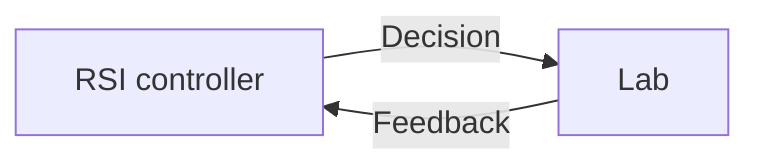

# RSISys

[中文](README_zh.md)

A reusable RSI framework with registered implementations of existing algorithms
and ready-to-configure LLM benchmark recipes: ReST^EM, RRSI, SEAL, TTRL and AIDE.
FT-Agent is available as an explicitly partial adaptation.

**RSI controller → Lab execution → feedback → RSI controller**.
The library owns method implementations and shared execution; `rsisys.algorithms` contains each method's controller, specialized Lab and
configuration; shared engines and execution services stay in framework modules.
Harnesses, memory, verifiers and training engines remain replaceable components.

Early research release. CPU examples need no GPU, API key or model service.
Real-model recipes require their own models, data and optional environments.
A completed loop does not establish improvement or reproduce a paper's gains.

## Quickstart

Python **3.12 or 3.13**, Linux or macOS. From a checkout:

```sh
git clone https://github.com/satsuki2486441738/RSISys.git
cd RSISys
python3.12 -m venv .venv
. .venv/bin/activate
python -m pip install -e .
rsisys catalog
rsisys run --config src/rsisys/algorithms/rest_em/configs/cpu/rest_em.json
```

This runs ReST^EM against a **simulated arithmetic Lab**, with no LLM training.
Inspect `runs/rest-em-quickstart/result.json` and its operation receipts.
Use a fresh directory for another run: `--data-dir runs/another-run`.
Installation uses a checkout or locally built wheel; no PyPI release is assumed.

## Architecture



The controller owns strategy, candidate selection and stopping decisions. Labs
own domain execution and return structured metrics, artifacts and log references.
The host provides registration, configuration, operation authorization, routing,
receipts, evidence references, lifecycle management and owned resource cleanup.
It does not choose an algorithm's winner from scores.

New algorithms normally need only external registration. Changes to shared
scheduling, delivery, cancellation or recovery semantics belong in the core.
The files directly under `src/rsisys/` are the stable framework surface, not run output:

```text
api.py          # public import facade
application.py  # application and run lifecycle
assembly.py     # controller/Lab/harness/backend composition
registry.py     # algorithm and component registration
methods.py      # method declarations and method catalogs
components.py   # component graph and state ports
config.py       # configuration-to-application builders
research.py     # optional research-component assembly
cli.py          # command-line entry point
```

These modules intentionally remain at the package root so existing integrations can
import stable paths such as `rsisys.api`, `rsisys.config` and `rsisys.application`.
The concrete implementation layers live below `controllers/`, `labs/`, `backends/`,
`runtime/` and `snapshot/`.

The implementation layer has two roles: **controllers** process feedback and
choose actions; **Labs** execute experiments and return evidence. A controller
may be a state machine, search policy, LLM meta-agent or a hybrid. Neither side
is required to use a harness, memory or an LLM.

```text
controllers/
  single_loop/ meta_agent/       # reusable rule/model-driven controllers
  rest_em/ rrsi/ seal/ ttrl/ aide/ ft_agent/  # method-specific policies
  training_schedule.py          # shared staged-training controller
labs/
  math/ local_process/          # task/execution scenes
  seal/ ttrl/ aide/ ft_agent/    # method-specific experiment execution
  harness/ training/            # reusable execution components
  self_reflection/              # optional scaffold
algorithms/
  <method>/__init__.py           # method declaration, component wiring, registration
  <method>/configs/             # configuration and declarative task assets
  _template/                    # self-contained development example
```

Built-in method packages declare and register their complete method assembly.
Method-private implementations live beside the registration entry; reusable scenes
and components are imported from `labs/`, `backends/` and `controllers/` only when
shared. Their registered
names and configurations remain stable. Each method chooses its controller,
Labs, harnesses and memory through its single `register(registry)` entry; the
core registry has no algorithm-specific branches. Independent research-worker
transport lives in `runtime/execution/research_bridge.py`.

External methods may keep private implementations beside their registration
entry, as shown by `_template`, without modifying the core or installing their
components into the library. Promote components into the shared implementation
layer when they are intended for reuse. Harnesses support context/model/tool
interaction; a method's controller owns strategy, candidate selection and stopping.

`rsisys.labs` exports the generic Lab contracts, without importing a scene:

```text
labs/
  __init__.py       # Lab, LabRequest, LabFeedback and lifecycle interfaces
  local_process/    # generic process Lab and optional state/feedback components
  policy_improvement/ # existing dataset/training bridges, not full self-reflection
  math/             # math scene: Labs, verifiers and mathematical backends
  harness/          # reusable harness execution and sandbox components
  training/         # reusable training engines, workers and artifact handling
  self_reflection/  # optional self-improvement Lab scaffold
```

Scenes are pluggable Lab implementations, not required base classes. A future
coding scene can live in `labs/coding/` or an external method package and register
through the same interface. Built-in execution components live in their Lab package; shared components do
not depend on a particular scene. The existing
`local_process` registration provides generic process execution.

Server launchers, historical reports, benchmark scripts and domain demos are
maintained privately. Public imports use [rsisys.api](src/rsisys/api.py).

The remaining internal boundaries are:

- The default harness owns its public-policy bridge in
  `loops/decision_making/harness/public_policy.py` and Lab tool bindings in
  `loops/decision_making/harness/tools/lab.py`. The inactive exploration endpoint
  lives in `loops/exploration/operation_only.py`.
- `adapters/exploration/` bridges the older exploration endpoint to the Lab task
  contract; `adapters/langchain_model.py` bridges the optional LangChain API.
  Implementation-specific integration belongs with its owning implementation.
- `backends/training/` and `backends/serving/` own training processes, inference
  transports and deployments. These are execution providers; `labs/training/`
  contains reusable Lab-side orchestration and artifact components.
- `runtime/orchestration/lab_group.py` owns namespaced routing and Lab lifecycle aggregation.
  Backend record writes and locks live in `runtime/storage/process_store.py`, so serving
  does not depend on a training implementation for persistence.

`runtime/` contains host mechanisms, grouped by responsibility:

```text
runtime/
  orchestration/  # run policies, loop scheduling, Lab routing and jobs
  state/          # recovery, continuation, identities and version activation
  execution/      # isolation, processes, workers and resource reservations
  storage/        # artifacts, file access, canonical JSON and process records
  models/         # model transport, credential broker and usage accounting
  evaluation/     # evaluation admission and derived diagnostics
  evidence/       # shared evidence records and persistence
  capabilities.py # optional component method discovery
```

Candidate-improvement Lab operations live in `labs/policy_improvement/evolution.py`;
the generic version activation machinery stays in `runtime/state/`. Evaluation
admission tracks campaigns and budgets; task scorers remain in Labs.

Shared records, provenance, in-memory/SQLite persistence and basic queries live
in `runtime/evidence/`. Controller-side feedback selection lives in
`controllers/memory/`; it determines which evidence enters decision context.
The Self-Reflection Lab owns future long-term experience curation, candidate
construction and validation. Ordinary RSI runs use shared evidence without
enabling that Lab. Existing record formats and `experience.sqlite3` files are
unchanged.

### Self-Reflection Lab — architecture direction

**Self-reflection means improving the meta-agent's own decision-making from its
accumulated decision–Lab feedback experience.** A Self-Reflection Lab is an
optional Lab specialization, registered through the same method entry point;
it does not introduce a third top-level module. Its improvement targets may
include the controller's harness, memory strategy, training data and model weights.
The [code scaffold](src/rsisys/labs/self_reflection/__init__.py) provides an opt-in
`self_reflection` Lab registration at version `0-placeholder`. It is not a working
backend; existing reflection tools do not implement this complete lifecycle.

The Lab is designed to maintain experience across runs and support three stages:

1. **Accumulate experience:** retain multi-step research episodes, task context,
   controller/model/harness versions, decisions, Lab receipts, cost and eventual
   outcomes. Keep unfinished outcomes pending; immediate experiment failure is
   not automatically evidence of a poor research decision.
2. **Construct candidates:** use accumulated experience to produce candidate
   harnesses, datasets or trained versions. Candidate construction completing
   does not mean an improvement has been verified.
3. **Validate over time:** bind each validation run to a fixed candidate and
   return progress and measured outcomes. Use inexpensive screening before
   longer research rollouts, with comparable budgets and baseline conditions.
   Historical logs support learning but cannot establish how a changed policy's
   subsequent trajectory would perform. Keep candidate-construction evidence
   separate from validation evidence, and use fresh tasks or rotating validation
   windows to limit repeated selection on the same tasks.

Experience collection, candidate construction and validation can run at different
cadences. A method defines their triggers, validation horizon, budgets, metrics
and adoption rules. The controller decides whether to adopt, reject or continue
validation; the runtime applies an explicitly selected version at a defined
switch boundary. The Lab must not overwrite the active controller when a
candidate is produced. Evaluation may finish with insufficient evidence; longer
history does not guarantee that every update improves performance.

The framework boundary is version-linked evidence, task identity, progress and
terminal receipts, persistence, cancellation and resource ownership. Long
validation may use explicit start/poll/result/cancel operations. Complete
cross-run self-improvement, candidate validation and controller switching still
require implementation; registration alone provides none of these semantics.

The package contains draft version/episode/candidate/validation records, a backend
protocol, and the Lab operation surface (`record_episode`, `build_candidate`,
`start`, `poll`, `result`, `cancel`). Methods can import its `register` function
inside their own registration entry, or register a concrete replacement Lab.
Inspect the scaffold with
`rsisys catalog --plugin src/rsisys/labs/self_reflection`.
Every valid invocation currently returns a failed receipt with
`error_code=self_reflection_not_implemented`; no experience is persisted, jobs
started, candidates created or controller versions switched.

## Register your own method

Use the runnable [_template](src/rsisys/algorithms/_template/__init__.py) as a starting point:

```text
algorithms/_template/
  __init__.py       # one register(registry) entry for controller and Lab
  controller.py     # choose the next prompt from Lab feedback; decide when to stop
  lab.py            # execute checks and return a structured receipt
  configs/run.json  # select registered names, parameters and Lab aliases
```

Run it from a checkout, without GPUs, models or external services:

```sh
rsisys run --plugin src/rsisys/algorithms/_template \
  --config src/rsisys/algorithms/_template/configs/run.json \
  --data-dir runs/custom-prompt
```

The controller evaluates a prompt, reads missing instructions from the Lab, and
adds one instruction per round. After three evaluations its literal instruction
coverage is `0 → 0.5 → 1`. This is **synthetic wiring validation**, not measured
LLM quality or training. See `runs/custom-prompt/result.json` for the controller
report and inspect operation receipts for feedback. Use a fresh `--data-dir` on reruns.

To create your own method:

1. Copy `_template` to `src/rsisys/algorithms/my_method/`. Rename its registrations
   (`custom_prompt`, `custom_prompt_check`) and matching config selections. A package
   without a leading underscore is discovered automatically; run its config without
   `--plugin`. No changes to the core registry or `api.py` are needed.
2. Implement your policy in `controller.py` and execution in `lab.py`. Keep method
   memory, harnesses and backend adapters in the same directory, importing shared
   framework components where useful.
3. Or keep the entire directory **outside the library**, such as `./my_method/`,
   and run `rsisys run --plugin ./my_method --config ./my_method/configs/run.json --data-dir runs/my-method`.

`_template` is deliberately excluded from automatic discovery so it does not
appear as a supported research algorithm. Explicit `--plugin` loading runs it.
Only `register(registry)` is prescribed; the internal layout is yours. Small
methods may put everything in `__init__.py`. Directory plugins hash their local
package files and execute trusted host code.

`config` is passed to each factory alongside its assembly context. Optional
`validate_config` callbacks reject bad parameters before construction.
Multiple Labs use `alias.operation` names; each Lab receives its native name.
`DecisionInput` includes `objective`, latest `feedback`, `last_operation`,
`capabilities`, `context` and `references`. Decisions are `invoke`, `wait` or
`finish`. Domain arguments must be validated before side effects.

Reusable method components can be registered independently by role: `harness`,
`memory`, `backend`, `scene` and `verifier`. A method assembly resolves these
names and can replace any one with a local override. Controller and Lab remain
first-class registrations; the method is the layer that binds the complete pair.

A method-level assembly can implement `RSIMethod.build(config)` and enter the catalog
with `MethodDefinition.from_method(...)`. It binds the controller and Lab together;
harness, memory, scene, verifier and backend components remain injectable. The lower-level
controller/Lab registration APIs remain available for reusable components and compatibility.

Advanced integrations that already assemble their decision endpoint can register
with `endpoint=True`; their factory receives `(context, execution, config)`.
An optional `research_factory(config)` supplies method-owned research/memory
integration. Ordinary policy factories remain `(context, config)` and need neither.

A Lab with background resources should implement idempotent `close()` and
`shutdown(mode) -> bool`, returning true only after its own work has stopped.
For async jobs, expose start/poll/result/cancel operations and deliver the final
receipt; registration does not automatically poll arbitrary external jobs.
Optional `required_operations()` checks operation availability, and `report()`
adds JSON method state to `result.json.controller_report`.

All run outputs are disposable local state. `runs/` and `runtime-output/` are ignored by Git and store results, logs, artifacts, workspaces, databases and snapshots. The repository keeps only the snapshot/evidence contracts and small deterministic fixtures. Pass `--data-dir` to choose a run directory outside the source tree or under `runtime-output/`.

## Components

- `single_loop` provides fixed iteration; `meta_agent` uses the configured model
  with `harness=default|dsh`; set actual backend, role and model identities
  in your own JSON configuration. DSH also needs its native home/workspace/session
  configuration and `python -m pip install -e '.[dsh]'`.
- Memory, engines and scorers are injected inside module factories.
  Default memory is explicit/literal. Optional ReMe BM25 retrieval uses
  `python -m pip install -r requirements/reme.txt` and
  `ResearchAssembly.reme()` from `rsisys.research`; it adds no embedding service
  or autonomous memory agent. LangMem is a separate optional extra.
- Whole-assembly integrations can register a `MethodDefinition` through
  `registry.register_method`; select `framework.method` instead of
  `framework.controller/labs` when custom state adapters are needed.

## Methods and evidence

| Controller / Lab | Scope | Configuration / evidence |
| --- | --- | --- |
| `rest_em` / `math` | Generate, filter, retrain from the initial model; lightweight LoRA adaptation | [GSM8K](src/rsisys/algorithms/rest_em/configs/gsm8k-8gpu.json), [MATH](src/rsisys/algorithms/rest_em/configs/math-8gpu.json) |
| `rrsi` / `harness_math` | Fixed-model harness evolution; MATH port with regularization and critic | [Config](src/rsisys/algorithms/rrsi/configs/math.json) |
| `seal` / `seal` | Self-edits, inner adaptation, selection, outer SFT; reference and paper profiles | [Reference](src/rsisys/algorithms/seal/configs/8gpu.json), [paper](src/rsisys/algorithms/seal/configs/paper.json) |
| `ttrl` / `ttrl` | Majority rewards with independent LoRA GRPO | [Config](src/rsisys/algorithms/ttrl/configs/8gpu.json) |
| `ttrl_verl` / `ttrl_verl` | Pinned official full-parameter backend with continuous optimizer/reference state | [Config](src/rsisys/algorithms/ttrl/configs/paper.json) |
| `ft_agent` / `llm_finetune` | Partial native RD-Agent policy with local GSM8K/LLaMA-Factory execution | [Config](src/rsisys/algorithms/ft_agent/configs/gsm8k.json) |
| `aide` / `aide_program` | Native Agent/search/review/Journal, adapted to fixed-model LLM inference programs | [Config](src/rsisys/algorithms/aide/configs/gsm8k.json) |

SEAL and reference TTRL completed two-round, eight-GPU Qwen2.5-7B Base runs;
**neither reproduced paper gains**. SEAL's paper profile has small native-training
validation using a lexical smoke scorer, not an accepted GPT-4.1/full-paper run.
Native TTRL has a 32-target-question, one-epoch GPU check, not the full 500-question,
10-epoch experiment; its target metric is transductive.

FT-Agent completed three native SFT experiments; heldout accuracy fell from
48/64 to 45/64. It omits the full CoSTEER debugging/knowledge pipeline.
AIDE completed three search nodes; heldout accuracy rose from 28/64 to 34/64
with more calls (29 → 67) and tokens. This is not an equal-compute comparison or
AIDE's original benchmark. Neither adapter trains meta-agent weights.
These pilots validate integration; they do not justify blaming the papers for
unreproduced gains. Detailed historical run and failure records are maintained privately.

## Run an adapted method

Choose a configuration from the method table, obtain the required model and data,
and set its paths, Python interpreters, endpoints and disjoint GPU allocation.
JSON dataset schemas and validation are defined by each Lab. Start from the
repository root, for example:

```sh
rsisys run --config src/rsisys/algorithms/rest_em/configs/math-8gpu.json
```

GPU training requires separately installed PyTorch/Transformers/PEFT and, where
configured, vLLM. SEAL/TTRL paper backends use
[requirements/seal-ttrl.txt](requirements/seal-ttrl.txt) in an isolated environment;
SEAL semantic grading additionally requires the configured GPT-4.1 service.
FT-Agent and AIDE need Linux bubblewrap, model services, their pinned clean
upstream checkouts and [FT-Agent](requirements/ft_agent.txt) /
[AIDE](requirements/aide.txt) dependencies. Pins and allowed execution parameters
are enforced in the implementation. These dependencies and services are not
installed or started by registration. Configuration-ready does not mean that
external models, datasets or optional training stacks are bundled.

## Monitor

Optional, independent of the core package and GPU stack:

```sh
python -m pip install ./src/rsimonitor
rsimonitor --runs-dir runs
```

The viewer is read-only and binds to loopback by default. It has no authentication
or multi-tenant isolation; external exposure needs access control.

## Limits and security

0.x APIs may change; pin commits, model/data revisions and dependencies for long
experiments. Snapshots require explicit state/recovery adapters. Ordinary
registration does not restore arbitrary controller memory or external jobs;
FT-Agent/AIDE native searches and synchronous training recipes need fresh runs.
There is no global GPU lease across Labs/runs or complete long-job cost/budget
integration. Assign non-overlapping devices yourself. Snapshot metadata does not
freeze the installed dependency environment.

Plugins execute trusted host Python. Ordinary local-process Labs are not OS
sandboxes; use an explicit isolated executor for untrusted generated programs.
Custom Labs own network access, external billing and resource termination.
Supply credentials through environment variables. Saved prompts, logs and
artifacts can contain private data; review them before sharing.
`finished` describes host lifecycle, not training success or quality improvement.
Check method reports, receipts, optimizer/weight evidence and fixed heldout metrics.

For vulnerabilities, use GitHub's private reporting facility when available;
otherwise request a private channel without posting exploit details or secrets.

## Development

```sh
python -m pip install -e '.[dev]'
ruff check --select E9,F63,F7,F82 src
python -m build --outdir dist/core .
python -m build --outdir dist/monitor src/rsimonitor
python -m twine check --strict dist/core/* dist/monitor/*
```

Regression suites and validation scripts are maintained privately;
this repository has no GitHub Actions workflows.
PRs should describe behavior, relevant validation and method deviations; use
synthetic fixtures, preserve attribution and keep weights, datasets and logs out
of Git. Contributions use Apache-2.0; keep discussion respectful and specific.

## License

Copyright 2026 RSISys contributors. Licensed under [Apache-2.0](LICENSE).
Third-party origins are linked in the
corresponding adapters; adapted SEAL code retains its MIT text in
[seal/lab.py](src/rsisys/algorithms/seal/lab.py). External dependencies, weights and datasets
are obtained separately under their own terms.
