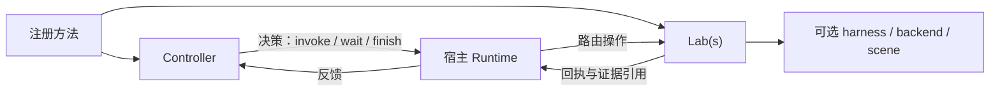

# RSISys

**以完整方法为接入单元的递归自改进（RSI）实验运行框架。**

[English](README.md) · [快速开始](#快速开始) · [已接入方法](#已接入方法) · [注册自己的方法](#注册自己的方法)

在一个方法包中定义决策器与 Labs，注册后通过同一个实验闭环运行：

**Controller → Lab 执行 → 反馈 → Controller**

方法可以搜索推理 harness、通过 SFT/RL 更新模型权重，也可以由 LLM meta-agent
决定下一项实验。方法拥有自己的研究策略；RSISys 提供执行生命周期、操作路由与证据记录。

首版研究框架 **0.1.0**，采用 [Apache-2.0](LICENSE)。CPU 入门流程无需 GPU、API key
或模型服务；真实模型实验需要另外准备模型、数据与执行环境。

## 为什么使用 RSISys

- **完整方法一次注册。** 决策器、Labs、workers 和配置放在同一个方法包，支持库内
  或库外开发；方法私有组件无需分别全局注册。通过 `register(registry)` 接入新方法，
  无需在核心 runner 中添加算法专属分支。
- **研究决策归方法所有。** Controller 可以是状态机、搜索策略、LLM meta-agent
  或混合实现，由它决定实验、候选选择和停止。框架不要求所有方法遵循固定的
  propose–train–evaluate–adopt 流程。
- **不同改进机制共用执行框架。** 已接入的 harness 搜索、SFT、RL 方法都通过
  controller/Lab 边界执行。Lab 自定义领域操作，调用原生训推栈；共享 harness、memory、
  backend 和 verifier 按需使用。
- **用证据区分运行与收益。** 方法身份、操作回执、产物引用和方法报告记录实际发生的
  执行过程。`finished` 表示宿主循环结束；训练是否发生、候选是否有效、收益是否成立，
  需要结合方法证据判断。

框架的扩展要求是：**注册完整方法，并运行其决策—实验—反馈闭环**。内部如何拆分与
注入依赖由方法作者决定，不要求任意组件在所有方法之间自由互换。

[FlashRSI](https://github.com/RUC-NLPIR/FlashRSI) 是相关工作，重点包括算法、目标 harness、
benchmark 的可配置组合与 agent 资源版本管理。RSISys 强调完整方法包及 controller/Lab
执行契约，也接入实际调用权重训练的方法。这里表达的是抽象与建设重点的区别，
不声称这些功能独有，也不据此宣称 benchmark 更优。

## 快速开始

Python **3.12 或 3.13**，Linux 或 macOS。在仓库根目录执行：

```sh
git clone https://github.com/satsuki2486441738/RSISys.git
cd RSISys
python3.12 -m venv .venv
. .venv/bin/activate
python -m pip install -e .
rsisys catalog
rsisys run --config src/rsisys/algorithms/rest_em/configs/cpu/rest_em.json
```

这会运行 ReST^EM 的调度流程，使用**模拟算术 Lab**，不进行 LLM 训练。
查看 `runs/rest-em-quickstart/result.json` 与操作回执；再次运行时使用新的输出路径：
`--data-dir runs/another-run`。目前从源码或本地构建的 wheel 安装，不假定已经发布到 PyPI。

## 已接入方法

当前 catalog 包含 **8 个完整方法注册项**。`ttrl` 与 `ttrl_verl` 是 TTRL 的两种执行
profile；`meta_agent` 是本框架的方案骨架，不属于论文复现。各方法的适配范围如下。

| 方法 | 接入范围 | 配置 / 证据 |
| --- | --- | --- |
| `rest_em` | 生成、筛选、每轮从初始模型重新训练；轻量 LoRA 实现 | [GSM8K](src/rsisys/algorithms/rest_em/configs/gsm8k-8gpu.json)、[MATH](src/rsisys/algorithms/rest_em/configs/math-8gpu.json) |
| `rrsi` | 固定权重的 harness 进化；保留正则化与 critic，移植到 MATH | [配置](src/rsisys/algorithms/rrsi/configs/math.json) |
| `seal` | self-edit、内层适配、选择、外层 SFT；reference/paper 两种 profile | [参考配置](src/rsisys/algorithms/seal/configs/8gpu.json)、[论文配置](src/rsisys/algorithms/seal/configs/paper.json) |
| `ttrl` | 多数奖励与独立 LoRA GRPO 参考后端 | [配置](src/rsisys/algorithms/ttrl/configs/8gpu.json) |
| `ttrl_verl` | 固定官方全参数后端，连续保持优化器与 reference 状态 | [配置](src/rsisys/algorithms/ttrl/configs/paper.json) |
| `ft_agent` | 部分原生 RD-Agent 策略，本地 GSM8K/LLaMA-Factory 执行适配 | [配置](src/rsisys/algorithms/ft_agent/configs/gsm8k.json) |
| `aide` | 原生 Agent/search/review/Journal，任务改为固定模型推理程序搜索 | [配置](src/rsisys/algorithms/aide/configs/gsm8k.json) |
| `meta_agent` | 模型提出 harness、读取搜索反馈并锁定最终留出选择；不训练权重，self-reflection 尚未实现 | [配置](src/rsisys/algorithms/meta_agent/configs/math.json) |


真实实验需要配置模型/数据路径、Python 解释器、模型服务端点和 GPU 分配，仍通过统一入口运行：

```sh
rsisys run --config src/rsisys/algorithms/rest_em/configs/math-8gpu.json
```

训练需另装 PyTorch/Transformers/PEFT；配置使用 vLLM 时另备推理环境。
SEAL/TTRL 论文后端使用独立环境与 [requirements/seal-ttrl.txt](requirements/seal-ttrl.txt)，
SEAL 语义判分另需配置的 GPT-4.1 服务。FT-Agent/AIDE 需要 Linux bubblewrap、模型服务、
固定 revision 的干净上游 checkout，以及 [FT-Agent](requirements/ft_agent.txt) /
[AIDE](requirements/aide.txt) 依赖。数据格式与参数以各方法 Lab 定义为准。
注册不会自动下载模型和数据，也不会启动外部服务。

<details>
<summary>集成结果与复现边界</summary>

以下为 2026 年 11 月 10 日的单种子集成实跑与任务适配，未达到论文规模，也不构成
跨方法排名。权重训练使用 Qwen2.5-7B Base；RRSI/AIDE 使用固定 Qwen3.5-9B。

| 方法 | 评测范围 | 初始 → 最终 |
| --- | --- | --- |
| ReST^EM | MATH，500 道留出题 | 239/500 → 255/500 |
| ReST^EM | GSM8K，完整 1,319 道测试题 | 1073/1319 → 1070/1319 |
| RRSI | MATH，128 道留出题 × 2 次采样 | 80.47% → 88.67% |
| SEAL reference | 45 道留出 QA，适配后 F1 | 0.2399 → 0.3533 |
| TTRL reference | 32 道目标题 / 128 道独立迁移题 | 目标 71.88% → 71.88%；迁移 71.88% → 71.09% |
| AIDE 任务适配 | GSM8K，64 道留出题 | 32/64 → 31/64 |
| FT-Agent 部分适配 | GSM8K，64 道留出题；三轮原生 SFT | 48/64 → 51/64 |
| Meta-agent 骨架 | MATH，128 道留出题 × 2 次采样；模型保留 baseline | 78.91% → 78.91% |


RRSI 平均记录 token 成本从 1,176 增至 2,287，不能视作等算力收益。
SEAL 不进行内层适配时的 F1 从 0.3756 降至 0.3282。ReST^EM 的 GSM8K 开发集从
106/128 提升至 111/128，完整测试集未提升。FT-Agent 使用 Qwen3.8-27B 研究模型，
原生策略选择第 2 轮。Meta-agent 同样使用 Qwen3.8-27B 控制器和固定 Qwen3.5-9B
任务模型：测量候选后选择 baseline，执行最终评测，再结束，共 14 次决策/模型调用；
此前尝试曾在 32 步预算内未完成 finalize。

SEAL paper profile 仅完成词面判分下的小规模原生训练验证，GPT-4.1 语义服务与完整论文
实验尚未验收。原生 TTRL 完成 32 道目标题、1 epoch 的 GPU 验证，未达到
500 题 × 10 epochs；目标题指标属于 transductive 评估。FT-Agent 未接完整 CoSTEER
知识/调试链，AIDE 使用适配任务，两者均未训练 meta-agent 自身权重。

详细运行产物与失败记录私有维护，未作为公开复现证据随仓库发布。这些单次观察不能证明
稳定收益，也不足以将未复现的收益归咎于论文。长程 self-reflection 仍未实现。

</details>

## 注册自己的方法

从可运行的 [_template](src/rsisys/algorithms/_template/__init__.py) 开始：

```text
my_method/
  __init__.py       # register(registry)：绑定完整方法
  controller.py     # 根据反馈决定下一步
  lab.py            # 执行实验并返回回执
  configs/run.json  # 选择方法并设置参数
```

内部布局由方法作者决定，简单方法也可只用一个文件。常规注册直接绑定接收
`(context, config)` 的私有工厂：

```python
from rsisys.api import MethodDefinition
from .controller import MyController
from .lab import MyLab


def register(registry):
    registry.register_method("my_method", MethodDefinition.from_factories(
        controller=MyController,
        labs={"experiment": MyLab},
        version="1",
    ))
```

配置选择完整方法，controller 与 Lab 参数仍分别设置：

```json
{
  "framework": {
    "method": {
      "name": "my_method",
      "config": {
        "controller": {},
        "labs": {"experiment": {}}
      }
    }
  }
}
```

这里仅展示方法选择片段；目标、输出目录和预算等请参考模板的完整运行配置。
可以先运行内置模板，无需 GPU 或服务：

```sh
rsisys run --plugin src/rsisys/algorithms/_template \
  --config src/rsisys/algorithms/_template/configs/run.json \
  --data-dir runs/custom-prompt
```

模板通过字面 prompt 指令覆盖率（`0 → 0.5 → 1`）展示反馈交付和完整闭环，不代表 LLM 能力提升。

复制到库外，用 `--plugin ./my_method` 加载；或复制到
`src/rsisys/algorithms/my_method/`，由内置发现机制加载。修改注册与配置中的
`custom_prompt` 方法名即可，无需改核心注册表或 `api.py`。
`_template` 本身不参与自动发现。

Controller 实现 `decide(DecisionInput)`，返回 `invoke`、`wait` 或 `finish`。
Lab 实现 `describe()` 与 `execute(call)`，返回包含状态、数据和证据引用的
`OperationResult`。多个 Lab 通过 `别名.操作名` 路由；可选配置校验器在构造前拒绝错误参数。
需要自定义装配时，实现 `RSIMethod.build(config)` 并使用
`MethodDefinition.from_method(...)`，或提供返回 `ModuleAssembly` 的工厂。
公共契约见 [rsisys.api](src/rsisys/api.py)。

### 按需复用组件

方法可直接引用共享代码，也可以在自己的工厂内解析已注册组件；私有组件无需额外注册。

| 角色 | 内置注册名 | 实现 |
| --- | --- | --- |
| `harness` | `python_step` | 隔离执行 `(harness_path, problem, history)`；可配置 timeout，需要 bubblewrap |
| `backend` | `chat_pool`、`lora` | 推理服务池、接受已准备输入的 LoRA 引擎 |
| `memory` | `agent_memory` | agent 自己维护的记忆与研究任务，由方法绑定 harness |
| `verifier` | `strict_numeric`、`math_verify` | 最终答案验证；后者需要安装 `rsisys[math]` |

通过 `registry.resolve_component(kind, name, context, config)` 解析；解析不会自动安装
依赖或把组件绑定到方法。自定义共享组件使用 `register_component`。
DSH 可通过 `rsisys.harnesses.decision.dsh.dsh_decision_factory` 和 `rsisys[dsh]`
显式接入；ReMe 检索使用 [requirements/reme.txt](requirements/reme.txt) 与
`ResearchAssembly.reme()`，LangMem 是独立可选 extra。

独立 controller/Lab 注册 API 保留供显式自定义组合使用，默认仅独立注册
`single_loop` 与 `local_process`。内置方法的私有组件不再全局注册，旧拆分配置需改用
`framework.method` 或显式注册自己的工厂。具体方法类从各自包导入，不从 `rsisys.api` 导入。

## 架构与职责



| 归属 | 职责 |
| --- | --- |
| 方法 | Controller 策略、Lab 操作、候选选择、停止与采纳规则 |
| Lab | 领域校验、训推执行、指标与产物 |
| 宿主 | 注册、运行生命周期、授权、路由、回执交付、资源归属与显式恢复集成 |

```text
src/rsisys/
  algorithms/       # 完整方法包、开发模板和已有实际复用的共享实现
  loops/            # 契约与循环机制
  harnesses/        # 可选决策/actor 执行、记忆与反馈服务
  labs/             # 通用进程 Lab 和可复用场景
  backends/         # 训推引擎
  runtime/          # 宿主调度、执行、证据与存储
  snapshot/         # 捕获与显式恢复集成
  api.py            # 公共框架入口
  methods.py        # 方法声明
  registry.py       # 注册目录与受信任插件加载
```

Controller 与 Lab 不必使用 LLM 或内置 harness。共享组件可选，核心负责生命周期语义，
研究策略由方法决定。有后台资源的 Lab 应提供幂等 `close()` 与 `shutdown(mode) -> bool`；
异步 Lab 可暴露 start/poll/result/cancel，由方法驱动其协议，注册不会自动轮询。

`runs/` 与 `runtime-output/` 保存本地输出并由 Git 忽略。
源码中的 `runtime/`、`snapshot/` 是运行机制，不是已保存的实验产物。

### Self-reflection：后续方向

[Self-Reflection Lab](src/rsisys/labs/scenes/self_reflection/__init__.py) 是可选架构占位
（`0-placeholder`），目标是通过积累的决策—Lab 反馈提升 meta-agent 自己的决策能力。
预期流程为经验积累 → 候选构建 → 长程验证，再由 Controller 决定是否采纳；
验证可以保持待完成或证据不足。当前合法操作返回 `self_reflection_not_implemented`，
不实现经验持久化、训练、验证或决策器切换。
可运行的 `meta_agent` 方法搜索的是任务 harness，尚未实现上述自身改进闭环。
Self-reflection 是后续研究方向，不作为当前已实现功能或收益卖点。

## 监控

可选只读查看器，与核心包独立安装：

```sh
python -m pip install ./src/rsimonitor
rsimonitor --runs-dir runs
```

默认仅监听本机，不提供鉴权或多租户隔离。

## 发布范围与限制

- 当前是首版研究框架，0.x 接口可能调整；实验需固定 commit、模型/数据 revision 与依赖。
- 快照恢复需要显式状态适配。注册方法不会自动恢复任意 controller 内存或外部任务。
  FT-Agent/AIDE 原生搜索和同步训练配方需要新的运行目录。
- GPU 由操作者分配；目前没有跨 Lab/run 的全局 GPU lease，长作业计费与预算接管尚不完整。
- 插件是受信任宿主 Python。普通 local-process Lab 不是 OS 沙箱；不可信生成程序需显式
  隔离执行器。自定义 Lab 负责外部访问、计费与资源退出。凭据放环境变量，分享前检查
  提示与产物中的私有内容。
- 回归测试与实验记录目前私有维护；公开仓库提供可执行 CPU fixture 和方法模板，
  不包含 GitHub Actions 工作流。

## 开发与许可

```sh
python -m pip install -e '.[dev]'
ruff check --select E9,F63,F7,F82 src
python -m build --outdir dist/core .
python -m build --outdir dist/monitor src/rsimonitor
python -m twine check --strict dist/core/* dist/monitor/*
```

贡献请说明行为变化、验证与方法偏差，不提交下载数据、权重、凭据或原始运行日志。
漏洞优先使用 GitHub 私密报告；不可用时请求私密联系渠道，不公开漏洞细节或凭据。

Copyright 2026 RSISys contributors，采用 [Apache-2.0](LICENSE)。
第三方来源在对应适配代码旁标注；SEAL 改编代码的 MIT 文本保留在
[seal/lab.py](src/rsisys/algorithms/seal/lab.py)。依赖、模型权重与数据集分别遵循其条款。
