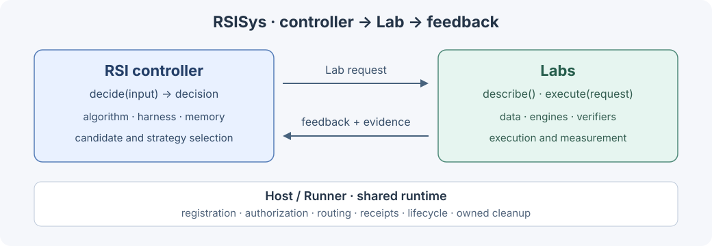

# RSISys

[English](README.md)

可复用的递归自改进（RSI）研究框架：
**RSI 决策器 → Lab 执行 → 反馈 → RSI 决策器**。

在库外实现并注册决策器和 Lab，用独立 JSON 配置选择运行。
Harness、memory、验证器、训推引擎是两大模块内部可替换的组件。

当前是早期研究版本。CPU 入门不需要 GPU、API key 或模型服务。
真实模型实验需要自行准备模型、数据和可选环境。流程跑通、真实训练完成、
效果提升和论文收益复现是不同结论。

## 快速开始

支持 Linux/macOS、Python **3.12 或 3.13**，从源码安装：

```sh
git clone https://github.com/satsuki2486441738/RSISys.git
cd RSISys
python3.12 -m venv .venv
. .venv/bin/activate
python -m pip install -e .
rsisys catalog
rsisys run --config examples/quickstart/rest_em.json
```

这里运行 ReST^EM 决策器与**模拟算术 Lab**，不训练 LLM。
结果在 `runs/rest-em-quickstart/result.json` 及操作回执中。
再次运行需用新目录，例如追加 `--data-dir runs/another-run`。
当前安装方式为源码或本地构建的 wheel，不假定 PyPI 已发布。

## 框架职责



决策器负责算法策略、候选选择与停止；Lab 负责领域执行，返回指标、产物和日志引用。
公共运行时负责注册装配、配置、操作授权、路由、回执、证据引用、生命周期和自有资源清理。
宿主不会根据分数替算法选择赢家。

新增算法通常只需库外注册；修改共享调度、反馈交付、取消或恢复语义时，应扩展底层库。
`examples/` 放教程，`experiments/` 放模型/数据配方与结果 JSON，`tests/` 放长期回归测试。
正式协议在[源码](src/rsisys/loops/contracts/rsi.py)，统一公开导入入口为
[rsisys.api](src/rsisys/api.py)。

## 注册自己的算法

先复制可直接运行的[注册示例](examples/registered)：

```sh
rsisys run --config examples/registered/custom-controller.json \
  --plugin examples/registered/plugin.py
rsisys catalog --plugin examples/registered/plugin.py
```

最小接口如下，保存为 `plugin.py`：

```python
from rsisys.api import Decision, LabRequest, LabFeedback, OperationSpec

class Controller:
    def __init__(self, context, config):
        pass

    def decide(self, window):
        if window.feedback is not None:
            return Decision("finish", reason="已收到 Lab 结果")
        return Decision("invoke", operation=LabRequest("demo.step", {}))

class Lab:
    def __init__(self, context, config):
        pass

    def describe(self):
        return (OperationSpec("step", "运行一次实验", {
            "type": "object", "properties": {}, "additionalProperties": False
        }),)

    def execute(self, call):
        return LabFeedback("示例完成", (), False, data={"score": 1})

def register(registry):
    registry.register_controller("custom", Controller, version="1")
    registry.register_lab("custom", Lab, version="1")
```

独立配置 `experiment.json`：

```json
{
  "objective": "运行自己的 RSI 方法",
  "data_dir": "runs/custom",
  "max_decision_steps": 8,
  "framework": {
    "controller": {"name": "custom", "config": {}},
    "labs": {"demo": {"name": "custom", "config": {}}}
  }
}
```

执行 `rsisys run --config experiment.json --plugin plugin.py`。
工厂接收装配上下文与 `config`；可在注册时传 `validate_config`，于构造前校验参数。
多个 Lab 通过 `别名.操作名` 路由，Lab 收到自己的原生操作名。
决策输入包含目标、最新回执、上次操作、能力目录、上下文和证据引用；
输出为 `invoke`、`wait` 或 `finish`。领域参数需在产生副作用前校验。

有后台资源的 Lab 应提供幂等 `close()` 与 `shutdown(mode) -> bool`，确认资源停止后才返回 true。
异步任务建议暴露 start/poll/result/cancel 操作，并交付终态回执；注册不会自动轮询任意外部作业。
决策器可选提供 `required_operations()` 检查操作是否存在，或 `report()` 输出 JSON 方法状态，
保存到 `result.json.controller_report`。

## 组件组合

- `single_loop` 是固定迭代模板；`meta_agent` 使用配置的模型，支持 `harness=default|dsh`。
  参考 [meta-agent.json](examples/registered/meta-agent.json)，填入实际后端、角色与模型身份。
  DSH 需安装 `python -m pip install -e '.[dsh]'`，并设置原生 home/workspace/session 配置。
- Memory、engine、scorer 在模块工厂内注入；底层装配参考[组件示例](examples/components)。
  默认 memory 为显式 literal 后端。ReMe BM25 检索可通过
  `python -m pip install -r requirements/reme.txt` 与 `rsisys.research.ResearchAssembly.reme()` 使用，
  不引入 embedding 服务或自主 memory agent；LangMem 是独立可选 extra。
- 需要整套状态适配时，可用 `registry.register_method` 注册 `MethodDefinition`，
  配置 `framework.method`，不同时指定 `framework.controller/labs`。

## 方法与验证范围

| 决策器 / Lab | 接入范围 | 配置 / 证据 |
| --- | --- | --- |
| `rest_em` / `math` | 生成、筛选、每轮从初始模型重新训练；轻量 LoRA 实现 | [GSM8K](experiments/rest_em/configs/gsm8k-8gpu.json)、[MATH](experiments/rest_em/configs/math-8gpu.json) |
| `rrsi` / `harness_math` | 固定权重的 harness 进化；保留正则化与 critic，移植到 MATH | [配置](experiments/rrsi/math.json)、[结果](experiments/rrsi/results-20261108.json) |
| `seal` / `seal` | self-edit、内层适配、选择、外层 SFT；reference/paper 两种 profile | [参考配置](experiments/seal/8gpu.json)、[论文配置](experiments/seal/paper.json)、[结果](experiments/seal/results-20261109.json) |
| `ttrl` / `ttrl` | 多数奖励与独立 LoRA GRPO 参考后端 | [配置](experiments/ttrl/8gpu.json)、[结果](experiments/ttrl/results-20261109.json) |
| `ttrl_verl` / `ttrl_verl` | 固定官方全参数后端，连续保持优化器与 reference 状态 | [配置](experiments/ttrl/paper.json)、[归因记录](experiments/weight-reproduction-diagnosis.json) |
| `ft_agent` / `llm_finetune` | 部分原生 RD-Agent 策略，本地 GSM8K/LLaMA-Factory 执行适配 | [配置](experiments/ft_agent/gsm8k.json)、[验证](experiments/ft_agent/validation-20261109.json) |
| `aide` / `aide_program` | 原生 Agent/search/review/Journal，任务改为固定模型推理程序搜索 | [配置](experiments/aide/gsm8k.json)、[验证](experiments/aide/validation-20261109.json) |

SEAL 与 reference TTRL 完成 Qwen2.5-7B Base 两轮八卡真实训练，**均未复现论文收益**。
SEAL paper profile 只完成使用词面 smoke scorer 的小规模原生训练验证，未验收 GPT-4.1
语义服务或完整论文实验。原生 TTRL 完成 32 道目标题、1 epoch 的 GPU 验证，
未完成 500 题 × 10 epochs；其目标题指标属于 transductive 评估。

FT-Agent 完成三次原生 SFT，留出准确率从 48/64 降到 45/64，未接完整 CoSTEER 知识/调试链。
AIDE 完成三个搜索节点，留出准确率从 28/64 升到 34/64，但调用次数从 29 增到 67，
token 也增加，不是等算力比较或原始 benchmark 复现。两者均未训练 meta-agent 自身权重。
这些结果验证接入边界，不能据此把论文收益未复现归咎于论文；结果 JSON 保留实跑范围与失败证据。

## 真实模型实验

命令从仓库根目录执行。准备新的数据/运行目录，修改配置中的模型、解释器、端点与 GPU 分配。
框架不默认安装 ML 依赖，各可选 GPU 后端使用独立环境。

Qwen2.5-7B Base ReST^EM 需在兼容 CUDA 环境安装 PyTorch、Transformers、PEFT、
pyarrow、huggingface-hub；八卡推理配方另需 vLLM，MATH 判分需 math extra：

```sh
python -m pip install -e '.[math]'
python experiments/rest_em/prepare_gsm8k.py \
  --model-dir models/Qwen2.5-7B-d1497293 --data-dir runs/gsm8k-data
python experiments/rest_em/prepare_math.py --data-dir runs/math-data
rsisys run --config experiments/rest_em/configs/math-8gpu.json
```

准备脚本下载固定 revision 的模型/数据并记录哈希；配置中的路径须与输出对应。
八卡配置通过多副本并行推理、DDP 训练；同目录也提供较小配置。

SEAL/TTRL paper profile 使用独立 Python 3.12 环境与
[paper-requirements.txt](experiments/paper-requirements.txt)。已验证组合为 torch 2.7.0+cu128、
Transformers 4.52.4、TRL 0.18.1、PEFT 0.15.2、vLLM 0.9.1；原生 TTRL 另需 ABI 兼容的
flash-attn。不要与参考后端的训练环境混装。

```sh
python experiments/seal/prepare.py --paper --output runs/seal-paper-data
python experiments/ttrl/prepare.py --paper --output runs/ttrl-paper-data
# 安装对应依赖并设置真实路径后再运行：
rsisys run --config experiments/seal/paper.json
rsisys run --config experiments/ttrl/paper.json
```

原生 TTRL 另需干净的 `PRIME-RL/TTRL@5806e119789132fcb43552beaf2532d7d0447213` checkout。
SEAL 语义评分需通过环境变量提供 `OPENAI_API_KEY`，并有可用的 GPT-4.1 兼容服务。

RRSI、FT-Agent、AIDE 需要 Linux bubblewrap/user namespaces 和 OpenAI-compatible 模型服务；
其 `prepare.py`、`serve.py` 入口提供 `--help`。FT-Agent 需分别安装干净的
`microsoft/RD-Agent@484776c211e4fbbeef03e0ec00d6bbee7362a4f4`、LLaMA-Factory v0.9.3
（`ca75f1edf3cb50343ed1c98605141c3e22075b5f`），并安装
[worker 依赖](experiments/ft_agent/requirements.txt)、PyYAML 与 Math-Verify。
LLaMA-Factory 训练环境须与 SEAL 的 TRL 环境分开。AIDE 需安装
`WecoAI/aideml@ad73d227af481bea3de06f884f41b2993dd6453a` 及其
[worker 依赖](experiments/aide/requirements.txt)。搜索与审查由原生方法决定，宿主负责执行和反馈。
两种方法均需先固定互不重叠的公开输入与私有开发/留出标签。

## 监控

监控是独立可选包，不依赖核心包或 GPU：

```sh
python -m pip install ./src/rsimonitor
rsimonitor --runs-dir runs
```

默认只监听本机，只读，无鉴权或多租户隔离；对外提供服务需自行配置访问控制。

## 限制与安全

0.x 接口仍可能调整，长实验需固定 commit、模型/数据 revision 与依赖。
快照恢复需显式状态适配；普通注册不会自动恢复决策器内存与外部任务。
FT-Agent/AIDE 原生搜索与同步训练配方重跑需新目录；快照元数据不冻结实际依赖环境。
目前没有跨 Lab/run 的全局 GPU lease，长作业计费与预算接管尚不完整，设备需由操作者分配。

插件是受信任宿主 Python 代码；普通 local-process Lab 不是 OS 沙箱。
不可信生成程序需显式隔离执行器。自定义 Lab 负责网络访问、外部计费与资源退出。
凭据放环境变量，分享前检查日志、提示与产物中的私有内容。
`finished` 仅描述宿主生命周期，训练和收益需结合方法报告、回执、优化器/权重证据与固定留出评测判断。
漏洞优先通过 GitHub 私密报告；未启用时只公开请求私密联系渠道，不发布漏洞细节或凭据。

## 开发与验证

```sh
python -m pip install -e '.[dev]'
PYTHONPATH=src python -m unittest discover -s tests -t . -q
node --test tests/monitor/frontend/*.test.js
ruff check --select E9,F63,F7,F82 src tests examples experiments tools
python tools/check_docs.py
python -m build --outdir dist/core .
python -m build --outdir dist/monitor src/rsimonitor
python -m twine check --strict dist/core/* dist/monitor/*
```

默认测试不需 GPU、下载权重或模型服务；可选依赖缺失会显式 skip。CI 使用 Node 22。
当前私有仓库免费额度已耗尽，Actions 仅保留手动触发 `workflow_dispatch`。
PR 说明行为变化、验证与算法偏差；使用合成 fixture，不提交权重、下载数据、凭据或原始运行日志。
贡献按 Apache-2.0 接收，讨论保持尊重与具体。

## 许可

[Apache-2.0](LICENSE)，见 [NOTICE](NOTICE)。第三方来源在对应适配代码中标注，
改编 SEAL 代码的 MIT 文本保留在 [seal.py](src/rsisys/labs/seal.py)。
外部依赖、模型权重和数据集另行获取，遵循各自条款。
