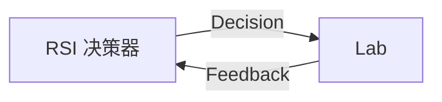

# RSISys

[English](README.md)

面向已有 RSI 算法的可复用框架，提供注册实现与可直接配置运行的 LLM benchmark 配方。
当前接入 ReST^EM、RRSI、SEAL、TTRL、AIDE；FT-Agent 明确标为部分适配。

**RSI 决策器 → Lab 执行 → 反馈 → RSI 决策器**。
`rsisys.algorithms` 收纳决策器、专属 Lab 和配置；共享训练引擎与执行服务留在框架组件层。
Harness、memory、验证器、训推引擎仍是两大模块内部可替换的组件。

当前是早期研究版本。CPU 入门不需要 GPU、API key 或模型服务。
真实模型实验需要自行准备模型、数据和可选环境。流程跑通、真实训练完成、
效果提升和论文收益复现是不同结论。

## 快速开始

支持 Linux/macOS、Python **3.12 或 3.13**，从源码安装：

```sh
git clone https://github.com/satsuki2486441738/RSISys.git
cd RSISys
python3.12 -m venv .venv
. .venv/bin/activate
python -m pip install -e .
rsisys catalog
rsisys run --config src/rsisys/algorithms/rest_em/configs/cpu/rest_em.json
```

这里运行 ReST^EM 决策器与**模拟算术 Lab**，不训练 LLM。
结果在 `runs/rest-em-quickstart/result.json` 及操作回执中。
再次运行需用新目录，例如追加 `--data-dir runs/another-run`。
当前安装方式为源码或本地构建的 wheel，不假定 PyPI 已发布。

## 框架职责



决策器负责算法策略、候选选择与停止；Lab 负责领域执行，返回指标、产物和日志引用。
公共运行时负责注册装配、配置、操作授权、路由、回执、证据引用、生命周期和自有资源清理。
宿主不会根据分数替算法选择赢家。

新增算法通常只需库外注册；修改共享调度、反馈交付、取消或恢复语义时，应扩展底层库。
实现层分为两种角色：**Controller** 处理反馈并决定行动，**Lab** 执行实验并返回证据。
Controller 可以是状态机、搜索策略、LLM meta-agent 或混合实现；两侧都不强制使用
harness、memory 或 LLM。

```text
controllers/
  single_loop/ meta_agent/       # 可复用的规则/模型驱动控制器
  rest_em/ rrsi/ seal/ ttrl/ aide/ ft_agent/  # 方法专属决策策略
  training_schedule.py          # 共享的分阶段训练控制器
labs/
  math/ local_process/          # 任务/执行场景
  seal/ ttrl/ aide/ ft_agent/    # 方法专属实验执行
  harness/ training/            # 可复用执行组件
  self_reflection/              # 可选骨架
algorithms/
  <方法>/__init__.py             # 方法声明、组件组合和接口注册
  <方法>/configs/               # 配置与声明式任务资源
  _template/                   # 完整的用户开发示例
```

内置方法包从 `controllers/`、`labs/` 引用实现，只保留声明、装配和注册，不重复放执行代码。
原有注册名和配置保持兼容。每个方法通过唯一的 `register(registry)` 入口选择控制器、Labs、
harness 与 memory，核心注册表不增加算法专属分支。独立研究 worker 的通信归
`runtime/research_bridge.py`。

库外开发仍可像 `_template` 一样，在注册入口旁携带私有实现，无需改核心库或把组件分别
安装进库中。需要供其他方法复用的能力，再纳入公共实现层。harness 支撑上下文、模型和工具
交互，具体策略、候选选择及停止由方法的 Controller 决定。

`rsisys.labs` 顶层只导出通用 Lab 契约，不导入任何场景：

```text
labs/
  __init__.py       # Lab、请求、反馈和生命周期接口
  local_process/    # 通用进程 Lab 及可选状态、反馈组件
  policy_improvement/ # 已有数据/训练桥接，不等于完整 self-reflection
  math/             # 数学场景：Lab、验证器与数学后端
  harness/          # 可复用 harness 执行与沙箱组件
  training/         # 可复用训练引擎、worker 和产物管理
  self_reflection/  # 可选的自身改进 Lab 骨架
```

场景是可插拔实现，不要求继承特定基类。后续 coding 场景可以放在 `labs/coding/`，
也可以完全放在库外的方法包内，通过同一接口注册。内置方法的执行实现放在对应 Lab 包中；
共享组件不依赖具体场景。已有 `local_process` 注册提供通用进程执行。

服务启动、历史报告、benchmark 脚本和领域演示私有维护，公开入口为
[rsisys.api](src/rsisys/api.py)。

其他内部目录的职责如下：

- 默认 harness 自己维护 `loops/decision_making/harness/public_policy.py` 中的决策器接入，
  以及 `harness/tools/lab.py` 中的 Lab 工具绑定；无探索任务时的空端点放在
  `loops/exploration/operation_only.py`。
- `adapters/exploration/` 兼容旧 exploration 端点与 Lab 任务契约，
  `adapters/langchain_model.py` 适配可选 LangChain 接口。
  某个实现专属的接入逻辑归该实现维护，不集中堆进 adapters。
- `backends/training/`、`backends/serving/` 负责训练进程、推理传输与部署；
  `labs/training/` 则提供 Lab 侧可复用的调用与产物管理组件。
- `runtime/lab_group.py` 负责操作命名空间路由和 Lab 生命周期聚合；
  后端的记录写入、文件锁放在 `runtime/process_store.py`，推理后端不再借用训练实现做持久化。

### Self-Reflection Lab：架构方向

**Self-reflection 指 meta-agent 利用长期积累的 decision–Lab feedback 经验，
改进自身决策能力的过程。** Self-Reflection Lab 是可选的 Lab 类型，通过方法的同一个
注册入口接入，不新增第三类顶层模块。改进对象可以包括决策器的 harness、memory 策略、
训练数据和模型权重。[代码骨架](src/rsisys/labs/self_reflection/__init__.py) 提供显式加载的
`self_reflection` Lab 注册入口，版本为 `0-placeholder`，尚无可执行后端；
现有 reflect 工具不等于已经实现这一完整生命周期。

它应跨多次 run 持续维护经验，并支持三个阶段：

1. **长期经验积累**：以多步研究过程为单位，记录任务背景、决策器/模型/harness 版本、
   决策序列、Lab 回执、成本及后续结果。未结束过程保留待确认状态；一次实验即时失败，
   不直接等同于研究决策无效。
2. **候选构造**：从积累的经验中修改 harness、构造训练数据或训练候选版本。
   候选构造完成不等于能力提升已验证。
3. **分阶段长程验证**：验证过程绑定固定候选版本，持续返回进度与实际结果。
   先做低成本筛选，再对少量候选开展研究过程验证，对照任务条件和预算应可比。
   历史日志可以用于学习，不能直接证明新策略改变决策后的轨迹会更好。
   候选构造所用经验与验证证据应分开，并用新任务或轮换窗口降低反复选择同一验证集的偏差。

经验进入、候选构造和验证可以采用不同节奏。触发条件、验证周期、预算、指标和采纳规则
由方法定义。决策器决定采纳、拒绝或继续验证；运行时在明确的版本切换边界应用被选版本。
Lab 产生候选时不得直接覆盖正在运行的决策器。验证可以以“证据不足”结束；
长期积累也不保证每次更新都提升。

框架负责版本与证据关联、任务标识、进度和终态回执、持久化、取消及资源归属。
长程验证可使用显式 start/poll/result/cancel 操作。完整的跨 run 自改进、候选验证及决策器
版本切换仍需实现，注册本身不会自动提供这些语义。

包内提供版本/研究过程/候选/验证记录的草案、后端协议，以及 `record_episode`、
`build_candidate`、`start`、`poll`、`result`、`cancel` 操作面。方法可在自己的注册入口内
调用该包的 `register`，或注册具体的替代 Lab。可以运行
`rsisys catalog --plugin src/rsisys/labs/self_reflection` 查看骨架。
当前所有合法调用均返回失败回执，错误码为 `self_reflection_not_implemented`；
不会写入经验、启动任务、产生候选或切换决策器版本。

## 注册自己的算法

可以直接从可运行的 [_template](src/rsisys/algorithms/_template/__init__.py) 开始：

```text
algorithms/_template/
  __init__.py       # 唯一的 register(registry) 入口，统一注册决策器与 Lab
  controller.py     # 根据 Lab 反馈修改 prompt，决定下一步与何时停止
  lab.py            # 执行检查，返回结构化回执
  configs/run.json  # 选择注册名称、参数与 Lab 别名
```

在仓库根目录运行，无需 GPU、模型或外部服务：

```sh
rsisys run --plugin src/rsisys/algorithms/_template \
  --config src/rsisys/algorithms/_template/configs/run.json \
  --data-dir runs/custom-prompt
```

决策器先提交一个 prompt，读取 Lab 返回的缺失指令，每轮补一条，再交给 Lab 检查。
三次检查的字面指令覆盖率为 `0 → 0.5 → 1`。这是**合成接口闭环验证**，不代表 LLM
能力提升或训练。决策器报告位于 `runs/custom-prompt/result.json`，具体反馈见操作回执。
再次运行时使用新的 `--data-dir`。

开发自己的方法时：

1. 复制 `_template` 为 `src/rsisys/algorithms/my_method/`，修改注册名
   `custom_prompt`、`custom_prompt_check`，以及配置中对应的选择。
   不以下划线开头的方法包会自动发现，运行其配置时不需要 `--plugin`，
   也不需要改核心注册表或 `api.py`。
2. 在 `controller.py` 写决策逻辑，在 `lab.py` 接自己的评测、训推引擎或 harness。
   专属 memory、后端适配等都留在同一个方法目录，共享能力直接引用框架。
3. 也可把整个目录放在**库外**，例如 `./my_method/`，用以下单条命令运行：
   `rsisys run --plugin ./my_method --config ./my_method/configs/run.json --data-dir runs/my-method`。

`_template` 特意不参与自动发现，避免把教学模板列为已适配的研究算法；显式 `--plugin`
即可运行。框架只约定 `register(registry)`，不强制内部文件布局；简单方法可以全部写在
`__init__.py`。目录插件记录本地包文件的哈希，并作为受信任的宿主代码执行。

工厂接收装配上下文与 `config`；可在注册时传 `validate_config`，于构造前校验参数。
多个 Lab 通过 `别名.操作名` 路由，Lab 收到自己的原生操作名。
决策输入包含目标、最新回执、上次操作、能力目录、上下文和证据引用；
输出为 `invoke`、`wait` 或 `finish`。领域参数需在产生副作用前校验。

已有完整决策端点的高级集成可用 `endpoint=True` 注册，工厂接收 `(context, execution, config)`；
可选的 `research_factory(config)` 提供方法自己的研究/记忆集成。
普通决策器工厂仍接收 `(context, config)`，无需使用这两个选项。

有后台资源的 Lab 应提供幂等 `close()` 与 `shutdown(mode) -> bool`，确认资源停止后才返回 true。
异步任务建议暴露 start/poll/result/cancel 操作，并交付终态回执；注册不会自动轮询任意外部作业。
决策器可选提供 `required_operations()` 检查操作是否存在，或 `report()` 输出 JSON 方法状态，
保存到 `result.json.controller_report`。

## 组件组合

- `single_loop` 是固定迭代模板；`meta_agent` 使用配置的模型，支持 `harness=default|dsh`。
  在自己的 JSON 配置中填入实际后端、角色与模型身份。
  DSH 需安装 `python -m pip install -e '.[dsh]'`，并设置原生 home/workspace/session 配置。
- Memory、engine、scorer 在模块工厂内注入。
  默认 memory 为显式 literal 后端。ReMe BM25 检索可通过
  `python -m pip install -r requirements/reme.txt` 与 `rsisys.research.ResearchAssembly.reme()` 使用，
  不引入 embedding 服务或自主 memory agent；LangMem 是独立可选 extra。
- 需要整套状态适配时，可用 `registry.register_method` 注册 `MethodDefinition`，
  配置 `framework.method`，不同时指定 `framework.controller/labs`。

## 方法与验证范围

| 决策器 / Lab | 接入范围 | 配置 / 证据 |
| --- | --- | --- |
| `rest_em` / `math` | 生成、筛选、每轮从初始模型重新训练；轻量 LoRA 实现 | [GSM8K](src/rsisys/algorithms/rest_em/configs/gsm8k-8gpu.json)、[MATH](src/rsisys/algorithms/rest_em/configs/math-8gpu.json) |
| `rrsi` / `harness_math` | 固定权重的 harness 进化；保留正则化与 critic，移植到 MATH | [配置](src/rsisys/algorithms/rrsi/configs/math.json) |
| `seal` / `seal` | self-edit、内层适配、选择、外层 SFT；reference/paper 两种 profile | [参考配置](src/rsisys/algorithms/seal/configs/8gpu.json)、[论文配置](src/rsisys/algorithms/seal/configs/paper.json) |
| `ttrl` / `ttrl` | 多数奖励与独立 LoRA GRPO 参考后端 | [配置](src/rsisys/algorithms/ttrl/configs/8gpu.json) |
| `ttrl_verl` / `ttrl_verl` | 固定官方全参数后端，连续保持优化器与 reference 状态 | [配置](src/rsisys/algorithms/ttrl/configs/paper.json) |
| `ft_agent` / `llm_finetune` | 部分原生 RD-Agent 策略，本地 GSM8K/LLaMA-Factory 执行适配 | [配置](src/rsisys/algorithms/ft_agent/configs/gsm8k.json) |
| `aide` / `aide_program` | 原生 Agent/search/review/Journal，任务改为固定模型推理程序搜索 | [配置](src/rsisys/algorithms/aide/configs/gsm8k.json) |

SEAL 与 reference TTRL 完成 Qwen2.5-7B Base 两轮八卡真实训练，**均未复现论文收益**。
SEAL paper profile 只完成使用词面 smoke scorer 的小规模原生训练验证，未验收 GPT-4.1
语义服务或完整论文实验。原生 TTRL 完成 32 道目标题、1 epoch 的 GPU 验证，
未完成 500 题 × 10 epochs；其目标题指标属于 transductive 评估。

FT-Agent 完成三次原生 SFT，留出准确率从 48/64 降到 45/64，未接完整 CoSTEER 知识/调试链。
AIDE 完成三个搜索节点，留出准确率从 28/64 升到 34/64，但调用次数从 29 增到 67，
token 也增加，不是等算力比较或原始 benchmark 复现。两者均未训练 meta-agent 自身权重。
这些结果验证接入边界，不能据此把论文收益未复现归咎于论文；详细实跑与失败证据单独私有维护。

## 运行已适配方法

从方法表选择配置，自行获取模型和数据，设置路径、解释器、端点及互不重叠的 GPU 分配。
数据 JSON 格式与参数校验以各 Lab 实现为准。命令从仓库根目录执行，例如：

```sh
rsisys run --config src/rsisys/algorithms/rest_em/configs/math-8gpu.json
```

训练需另装 PyTorch/Transformers/PEFT，配置选用 vLLM 时还需对应推理环境。
SEAL/TTRL 论文后端使用独立环境与
[requirements/seal-ttrl.txt](requirements/seal-ttrl.txt)；SEAL 语义判分另需配置的 GPT-4.1 服务。
FT-Agent/AIDE 需要 Linux bubblewrap、模型服务、固定 revision 的干净上游 checkout，及
[FT-Agent](requirements/ft_agent.txt) / [AIDE](requirements/aide.txt) 依赖。
源码校验上游版本与允许的执行参数；注册不会安装或启动这些外部依赖与服务。
配好即可通过统一入口运行，不代表模型、数据或 GPU 环境已随库分发。

## 监控

监控是独立可选包，不依赖核心包或 GPU：

```sh
python -m pip install ./src/rsimonitor
rsimonitor --runs-dir runs
```

默认只监听本机，只读，无鉴权或多租户隔离；对外提供服务需自行配置访问控制。

## 限制与安全

0.x 接口仍可能调整，长实验需固定 commit、模型/数据 revision 与依赖。
快照恢复需显式状态适配；普通注册不会自动恢复决策器内存与外部任务。
FT-Agent/AIDE 原生搜索与同步训练配方重跑需新目录；快照元数据不冻结实际依赖环境。
目前没有跨 Lab/run 的全局 GPU lease，长作业计费与预算接管尚不完整，设备需由操作者分配。

插件是受信任宿主 Python 代码；普通 local-process Lab 不是 OS 沙箱。
不可信生成程序需显式隔离执行器。自定义 Lab 负责网络访问、外部计费与资源退出。
凭据放环境变量，分享前检查日志、提示与产物中的私有内容。
`finished` 仅描述宿主生命周期，训练和收益需结合方法报告、回执、优化器/权重证据与固定留出评测判断。
漏洞优先通过 GitHub 私密报告；未启用时只公开请求私密联系渠道，不发布漏洞细节或凭据。

## 开发与验证

```sh
python -m pip install -e '.[dev]'
ruff check --select E9,F63,F7,F82 src
python -m build --outdir dist/core .
python -m build --outdir dist/monitor src/rsimonitor
python -m twine check --strict dist/core/* dist/monitor/*
```

回归测试与验证脚本单独私有维护，仓库不包含 GitHub Actions 工作流。
PR 说明行为变化、验证与算法偏差；使用合成 fixture，不提交权重、下载数据、凭据或原始运行日志。
贡献按 Apache-2.0 接收，讨论保持尊重与具体。

## 许可

Copyright 2026 RSISys contributors，采用 [Apache-2.0](LICENSE)。
第三方来源在对应适配代码中标注，
改编 SEAL 代码的 MIT 文本保留在 [seal/lab.py](src/rsisys/labs/seal/lab.py)。
外部依赖、模型权重和数据集另行获取，遵循各自条款。
