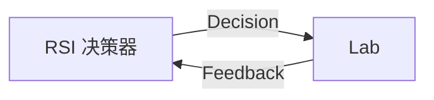

# RSISys

[English](README.md)

面向已有 RSI 算法的可复用框架，提供注册实现与可直接配置运行的 LLM benchmark 配方。
当前接入 ReST^EM、RRSI、SEAL、TTRL、AIDE；FT-Agent 明确标为部分适配。

**RSI 决策器 → Lab 执行 → 反馈 → RSI 决策器**。
`rsisys.algorithms` 收纳决策器、专属 Lab 和配置；共享训练引擎与执行服务留在框架组件层。
Harness、memory、验证器、训推引擎仍是两大模块内部可替换的组件。

当前是早期研究版本。CPU 入门不需要 GPU、API key 或模型服务。
真实模型实验需要自行准备模型、数据和可选环境。流程跑通、真实训练完成、
效果提升和论文收益复现是不同结论。

## 快速开始

支持 Linux/macOS、Python **3.12 或 3.13**，从源码安装：

```sh
git clone https://github.com/satsuki2486441738/RSISys.git
cd RSISys
python3.12 -m venv .venv
. .venv/bin/activate
python -m pip install -e .
rsisys catalog
rsisys run --config src/rsisys/algorithms/rest_em/configs/cpu/rest_em.json
```

这里运行 ReST^EM 决策器与**模拟算术 Lab**，不训练 LLM。
结果在 `runs/rest-em-quickstart/result.json` 及操作回执中。
再次运行需用新目录，例如追加 `--data-dir runs/another-run`。
当前安装方式为源码或本地构建的 wheel，不假定 PyPI 已发布。

## 框架职责



决策器负责算法策略、候选选择与停止；Lab 负责领域执行，返回指标、产物和日志引用。
公共运行时负责注册装配、配置、操作授权、路由、回执、证据引用、生命周期和自有资源清理。
宿主不会根据分数替算法选择赢家。

新增算法通常只需库外注册；修改共享调度、反馈交付、取消或恢复语义时，应扩展底层库。
内置方法位于 `src/rsisys/algorithms/<方法>/`：`controller.py` 实现决策，
`lab.py` 实现专属执行，`configs/` 选择已注册组合。各方法自己的控制器、注册、
专属 worker、评分器与上游桥接都留在方法目录，
可复用数学 Lab 与共享引擎仍在 `rsisys.labs`。
服务启动、历史报告、benchmark 脚本和领域演示私有维护，公开入口为
[rsisys.api](src/rsisys/api.py)。

## 注册自己的算法

一个方法在一个目录内闭环管理：

```text
my_method/
  __init__.py       # register(registry)：一次注册决策器与所有 Lab
  controller.py    # 决策与方法状态
  lab.py           # 执行与反馈
  config.json      # 完整组合配置
```

框架只约定 `register(registry)` 入口，不强制内部文件结构；简单方法可以全部写在 `__init__.py`。
也可通过 `.controller`、`.lab` 相对导入，并在同一个 `register(registry)`
中注册所需对象。专属 memory、harness、后端适配可继续放在该目录，通用能力直接引用框架。
运行 `rsisys run --plugin ./my_method --config ./my_method/config.json`，无需修改核心注册表。
库内 `rsisys.algorithms` 下的方法包也提供同一个注册入口，由框架自动发现。
目录插件记录本地包文件的哈希；插件是显式受信任的宿主代码。


已有方法无需插件即可运行。新增算法时，可把以下公开接口实现保存为 `plugin.py`：

```python
from rsisys.api import Decision, LabRequest, LabFeedback, OperationSpec

class Controller:
    def __init__(self, context, config):
        pass

    def decide(self, window):
        if window.feedback is not None:
            return Decision("finish", reason="已收到 Lab 结果")
        return Decision("invoke", operation=LabRequest("demo.step", {}))

class Lab:
    def __init__(self, context, config):
        pass

    def describe(self):
        return (OperationSpec("step", "运行一次实验", {
            "type": "object", "properties": {}, "additionalProperties": False
        }),)

    def execute(self, call):
        return LabFeedback("示例完成", (), False, data={"score": 1})

def register(registry):
    registry.register_controller("custom", Controller, version="1")
    registry.register_lab("custom", Lab, version="1")
```

独立配置 `experiment.json`：

```json
{
  "objective": "运行自己的 RSI 方法",
  "data_dir": "runs/custom",
  "max_decision_steps": 8,
  "framework": {
    "controller": {"name": "custom", "config": {}},
    "labs": {"demo": {"name": "custom", "config": {}}}
  }
}
```

执行 `rsisys run --config experiment.json --plugin plugin.py`。
工厂接收装配上下文与 `config`；可在注册时传 `validate_config`，于构造前校验参数。
多个 Lab 通过 `别名.操作名` 路由，Lab 收到自己的原生操作名。
决策输入包含目标、最新回执、上次操作、能力目录、上下文和证据引用；
输出为 `invoke`、`wait` 或 `finish`。领域参数需在产生副作用前校验。

有后台资源的 Lab 应提供幂等 `close()` 与 `shutdown(mode) -> bool`，确认资源停止后才返回 true。
异步任务建议暴露 start/poll/result/cancel 操作，并交付终态回执；注册不会自动轮询任意外部作业。
决策器可选提供 `required_operations()` 检查操作是否存在，或 `report()` 输出 JSON 方法状态，
保存到 `result.json.controller_report`。

## 组件组合

- `single_loop` 是固定迭代模板；`meta_agent` 使用配置的模型，支持 `harness=default|dsh`。
  在自己的 JSON 配置中填入实际后端、角色与模型身份。
  DSH 需安装 `python -m pip install -e '.[dsh]'`，并设置原生 home/workspace/session 配置。
- Memory、engine、scorer 在模块工厂内注入。
  默认 memory 为显式 literal 后端。ReMe BM25 检索可通过
  `python -m pip install -r requirements/reme.txt` 与 `rsisys.research.ResearchAssembly.reme()` 使用，
  不引入 embedding 服务或自主 memory agent；LangMem 是独立可选 extra。
- 需要整套状态适配时，可用 `registry.register_method` 注册 `MethodDefinition`，
  配置 `framework.method`，不同时指定 `framework.controller/labs`。

## 方法与验证范围

| 决策器 / Lab | 接入范围 | 配置 / 证据 |
| --- | --- | --- |
| `rest_em` / `math` | 生成、筛选、每轮从初始模型重新训练；轻量 LoRA 实现 | [GSM8K](src/rsisys/algorithms/rest_em/configs/gsm8k-8gpu.json)、[MATH](src/rsisys/algorithms/rest_em/configs/math-8gpu.json) |
| `rrsi` / `harness_math` | 固定权重的 harness 进化；保留正则化与 critic，移植到 MATH | [配置](src/rsisys/algorithms/rrsi/configs/math.json) |
| `seal` / `seal` | self-edit、内层适配、选择、外层 SFT；reference/paper 两种 profile | [参考配置](src/rsisys/algorithms/seal/configs/8gpu.json)、[论文配置](src/rsisys/algorithms/seal/configs/paper.json) |
| `ttrl` / `ttrl` | 多数奖励与独立 LoRA GRPO 参考后端 | [配置](src/rsisys/algorithms/ttrl/configs/8gpu.json) |
| `ttrl_verl` / `ttrl_verl` | 固定官方全参数后端，连续保持优化器与 reference 状态 | [配置](src/rsisys/algorithms/ttrl/configs/paper.json) |
| `ft_agent` / `llm_finetune` | 部分原生 RD-Agent 策略，本地 GSM8K/LLaMA-Factory 执行适配 | [配置](src/rsisys/algorithms/ft_agent/configs/gsm8k.json) |
| `aide` / `aide_program` | 原生 Agent/search/review/Journal，任务改为固定模型推理程序搜索 | [配置](src/rsisys/algorithms/aide/configs/gsm8k.json) |

SEAL 与 reference TTRL 完成 Qwen2.5-7B Base 两轮八卡真实训练，**均未复现论文收益**。
SEAL paper profile 只完成使用词面 smoke scorer 的小规模原生训练验证，未验收 GPT-4.1
语义服务或完整论文实验。原生 TTRL 完成 32 道目标题、1 epoch 的 GPU 验证，
未完成 500 题 × 10 epochs；其目标题指标属于 transductive 评估。

FT-Agent 完成三次原生 SFT，留出准确率从 48/64 降到 45/64，未接完整 CoSTEER 知识/调试链。
AIDE 完成三个搜索节点，留出准确率从 28/64 升到 34/64，但调用次数从 29 增到 67，
token 也增加，不是等算力比较或原始 benchmark 复现。两者均未训练 meta-agent 自身权重。
这些结果验证接入边界，不能据此把论文收益未复现归咎于论文；详细实跑与失败证据单独私有维护。

## 运行已适配方法

从方法表选择配置，自行获取模型和数据，设置路径、解释器、端点及互不重叠的 GPU 分配。
数据 JSON 格式与参数校验以各 Lab 实现为准。命令从仓库根目录执行，例如：

```sh
rsisys run --config src/rsisys/algorithms/rest_em/configs/math-8gpu.json
```

训练需另装 PyTorch/Transformers/PEFT，配置选用 vLLM 时还需对应推理环境。
SEAL/TTRL 论文后端使用独立环境与
[requirements/seal-ttrl.txt](requirements/seal-ttrl.txt)；SEAL 语义判分另需配置的 GPT-4.1 服务。
FT-Agent/AIDE 需要 Linux bubblewrap、模型服务、固定 revision 的干净上游 checkout，及
[FT-Agent](requirements/ft_agent.txt) / [AIDE](requirements/aide.txt) 依赖。
源码校验上游版本与允许的执行参数；注册不会安装或启动这些外部依赖与服务。
配好即可通过统一入口运行，不代表模型、数据或 GPU 环境已随库分发。

## 监控

监控是独立可选包，不依赖核心包或 GPU：

```sh
python -m pip install ./src/rsimonitor
rsimonitor --runs-dir runs
```

默认只监听本机，只读，无鉴权或多租户隔离；对外提供服务需自行配置访问控制。

## 限制与安全

0.x 接口仍可能调整，长实验需固定 commit、模型/数据 revision 与依赖。
快照恢复需显式状态适配；普通注册不会自动恢复决策器内存与外部任务。
FT-Agent/AIDE 原生搜索与同步训练配方重跑需新目录；快照元数据不冻结实际依赖环境。
目前没有跨 Lab/run 的全局 GPU lease，长作业计费与预算接管尚不完整，设备需由操作者分配。

插件是受信任宿主 Python 代码；普通 local-process Lab 不是 OS 沙箱。
不可信生成程序需显式隔离执行器。自定义 Lab 负责网络访问、外部计费与资源退出。
凭据放环境变量，分享前检查日志、提示与产物中的私有内容。
`finished` 仅描述宿主生命周期，训练和收益需结合方法报告、回执、优化器/权重证据与固定留出评测判断。
漏洞优先通过 GitHub 私密报告；未启用时只公开请求私密联系渠道，不发布漏洞细节或凭据。

## 开发与验证

```sh
python -m pip install -e '.[dev]'
ruff check --select E9,F63,F7,F82 src
python -m build --outdir dist/core .
python -m build --outdir dist/monitor src/rsimonitor
python -m twine check --strict dist/core/* dist/monitor/*
```

回归测试与验证脚本单独私有维护，仓库不包含 GitHub Actions 工作流。
PR 说明行为变化、验证与算法偏差；使用合成 fixture，不提交权重、下载数据、凭据或原始运行日志。
贡献按 Apache-2.0 接收，讨论保持尊重与具体。

## 许可

Copyright 2026 RSISys contributors，采用 [Apache-2.0](LICENSE)。
第三方来源在对应适配代码中标注，
改编 SEAL 代码的 MIT 文本保留在 [seal/lab.py](src/rsisys/algorithms/seal/lab.py)。
外部依赖、模型权重和数据集另行获取，遵循各自条款。
