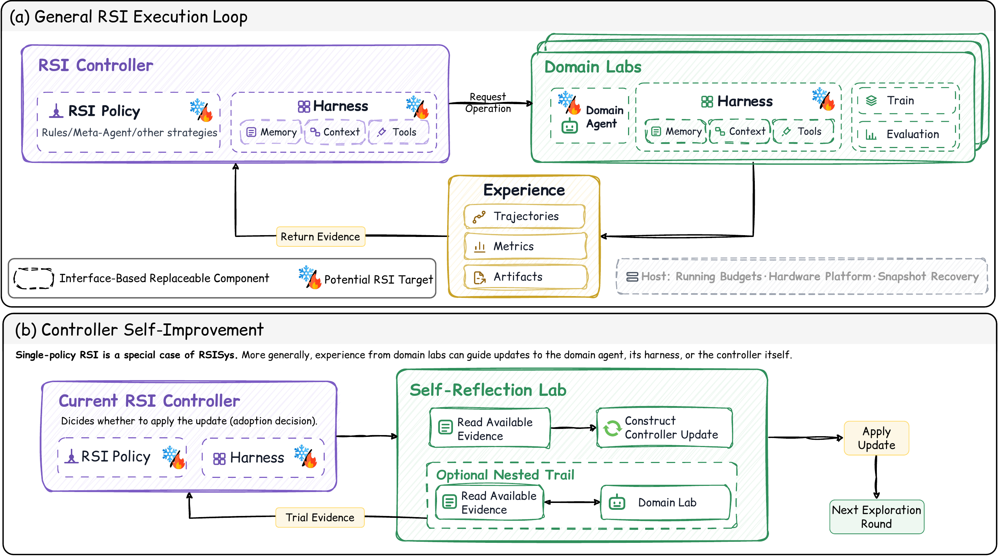

<h1 align="center">RSISys</h1>

<p align="center">
  <a href="LICENSE"></a>
  <a href="https://github.com/satsuki2486441738/RSISys/stargazers"></a>
  
</p>

<p align="center"><strong>通用的递归自改进框架：自由选择改进对象，用可替换组件构建你的 RSI 系统</strong></p>

<p align="center"><a href="README.md">English</a> · 简体中文</p>

<p align="center"><a href="#框架概览">框架概览</a> · <a href="#最新动态">最新动态</a> · <a href="#亮点">亮点</a> · <a href="#快速开始">快速开始</a> · <a href="docs/README.md">文档</a> · <a href="#已适配的方法">支持的方法</a> · <a href="#引用">引用</a></p>

RSISys 把递归自改进（RSI）实验组织成一个闭环：Controller 决定下一步做什么，Lab 运行实验并返回回执，Controller 根据证据决定下一步或采纳哪个候选。提示词搜索、harness 搜索、监督微调和强化学习都使用这个闭环，因此可以替换 Controller、复用 Lab，或在不改核心代码的前提下新增方法。

## 框架概览



**Controller** 决定下一步试什么、采纳什么。Policy 负责决策，Harness 准备输入和工具，可选的 Memory 提供上下文。**Lab** 使用配置好的输入执行评测、采样或训练等操作。宿主负责转发调用、执行预算和数据划分规则，并保存回执以支持恢复。

## 最新动态

- **[2026 年 11 月]** RSISys 开源，内置 16 个已注册的方法，支持可恢复运行。

## 亮点

**以研究闭环为核心的通用 RSI 框架。** 研究者围绕目标任务设计实验来改进 AI，从每轮反馈中积累研究经验，并据此决定下一步。RSISys 将这个人和 AI 协作的研究闭环自动化：Controller 决定试什么，Lab 运行实验并返回证据，Controller 根据历次实验的证据决定下一步试什么或采纳哪个候选。研究决策和任务执行可以由同一个 agent 承担，也可以交给不同的 agent。这个闭环为[不同 RSI 方法](#已适配的方法)提供统一的运行结构，各方法仍可使用自己的优化算法。

**改进对象由方法决定。** 方法可以改 agent 的提示词、程序、harness 或模型权重，也可以改决定「如何改进」的 RSI 策略。Self-Reflection Lab 可以在嵌套实验中验证候选 Controller，再由当前 Controller 根据证据决定是否采纳。

**组件可替换、可复用。** Controller 和 Lab 通过公开接口装配，Policy、Harness、Memory 和后端都可以独立替换。同一个 Coding Lab 可以配合不同的兼容 Controller 使用，也可以通过 Lab 接入新的数据集或 benchmark，无需改动核心。[查看装配方式](docs/compose.md)。

## 快速开始

在 Linux 或 macOS 上用 Python 3.12 或 3.13 安装。核心没有第三方依赖；各方法需要的[可选依赖](docs/components.md#methods)列在组件页里。

```sh
git clone https://github.com/satsuki2486441738/RSISys.git
cd RSISys
python -m pip install -e .
```

**不用 GPU 先跑一次。** 下面的命令在示例数据上用模拟模型跑两轮 ReST^EM，用来检查安装是否成功，并了解一次运行会产出什么。

```sh
rsisys run --config src/rsisys/algorithms/rest_em/configs/cpu/rest_em.json --data-dir runs/quickstart
```

**用 GPU 模型运行。** 先[启动一个 Chat Completions 服务](src/rsisys/labs/_template/README.md#connect-a-gpu-model)，再运行方法模板，它会搜索提示词和 few-shot 设置：

```sh
rsisys run --plugin src/rsisys/labs/_template --plugin src/rsisys/algorithms/_template \
  --config src/rsisys/algorithms/_template/configs/run.json --data-dir runs/gpu-quickstart
```

[Quickstart](docs/quickstart.md) 介绍了如何读取结果、用 RSIMonitor 查看运行，以及如何恢复中断的运行。

## 文档

| 我想… | 阅读 |
| --- | --- |
| 了解基本概念：Controller、Lab、operation、receipt、split | [Concepts](docs/concepts.md) |
| 查看内置的方法、Controller、Lab 和组件 | [Components](docs/components.md) |
| 把 Controller 换到别的 Lab 上，或加载自己写的 Controller | [Compose a system](docs/compose.md) |
| 编写新方法 | [方法模板](src/rsisys/algorithms/_template/README.md) |
| 编写 Lab 或接入自己的评测集 | [Lab 模板](src/rsisys/labs/_template/README.md) |
| 查询配置字段或命令行选项 | [Run configuration](docs/config.md) |
| 查看和对比运行 | [RSIMonitor](src/rsimonitor/README.md) |

文档目前只有英文版。

## 已适配的方法

| 类别 | 方法 | Controller（研究） | Lab（探索） | 改进对象 |
| :-- | :-- | :-- | :-- | :-- |
| 自训练 | [ReST^EM](https://arxiv.org/abs/2312.06585) · [STaR](https://arxiv.org/abs/2203.14465) · [TTRL](https://arxiv.org/abs/2504.16084) · TTRL-verl | 调度生成、筛选、训练各轮 | 模型采样作答，经评分后微调 | 模型权重 |
| 自我编辑 | [SEAL](https://arxiv.org/abs/2506.10943) | 调度自我编辑各轮 | 模型为自己生成训练数据并据此更新 | 模型权重（统一） |
| 提示词搜索 | [OPRO](https://arxiv.org/abs/2309.03409) · [GEPA](https://arxiv.org/abs/2507.19457) · GEPA-Merge · [PromptPG](https://arxiv.org/abs/2209.14610) | 在候选提示词中搜索 | 用每个提示词评测任务模型 | 提示词 |
| 程序搜索 | [FunSearch](https://github.com/google-deepmind/funsearch) | 演化程序种群 | 执行程序并打分 | 程序 |
| Harness 搜索 | [RRSI](https://arxiv.org/abs/2609.24972) · Meta-Agent · [Coding Meta-Agent](src/rsisys/algorithms/coding_meta_agent/README.md) | 模型提出 harness 修改 | agent 用候选 harness 解题 | Agent harness |
| 反思 | [Reflexion](https://arxiv.org/abs/2303.11366) | 决定何时重试 | 同一个 agent 写代码、跑测试并反思失败 | 自身的反思（统一） |
| 研究型 agent | [AIDE](https://github.com/WecoAI/aideml) · [FT-Agent](https://github.com/microsoft/RD-Agent) | 上游 agent 起草、调试并选择方案 | 运行候选程序和微调任务 | 解决方案与微调模型 |
| 自我反思 | [Self-Reflection Lab](src/rsisys/labs/scenes/self_reflection/lab.py)（是一个 Lab，需搭配 Controller 使用） | 当前 Controller | 候选 Controller 在嵌套实验中运行 | Controller 自身 |

运行 `rsisys catalog` 查看已注册的方法。各方法的预设配置、硬件和依赖见 [Components](docs/components.md#methods)。目前只有 ReST^EM、GEPA 和 Coding Meta-Agent 有使用指南，其他方法只有预设配置。预设配置只是起点，不代表已经复现论文结果。

## 参与贡献

请从[方法模板](src/rsisys/algorithms/_template/)或 [Lab 模板](src/rsisys/labs/_template/)开始，插件的写法见 [Compose a system](docs/compose.md)。新增方法或 Lab 时，请提供可运行的配置，说明它对照哪些结果验证过，并标注改编来源。框架接口统一从 `rsisys.api` 导入。

## 引用

如果 RSISys 对你的研究有帮助，请引用：

```bibtex
@misc{rsisys2026,
  title        = {RSISys: A Modular Runtime for Recursive Self-Improvement Research},
  author       = {{RSISys contributors}},
  year         = {2026},
  howpublished = {\url{https://github.com/satsuki2486441738/RSISys}}
}
```

## 许可证

RSISys 以 [Apache 2.0](LICENSE) 许可证发布。改编的上游代码在实现旁保留署名。
