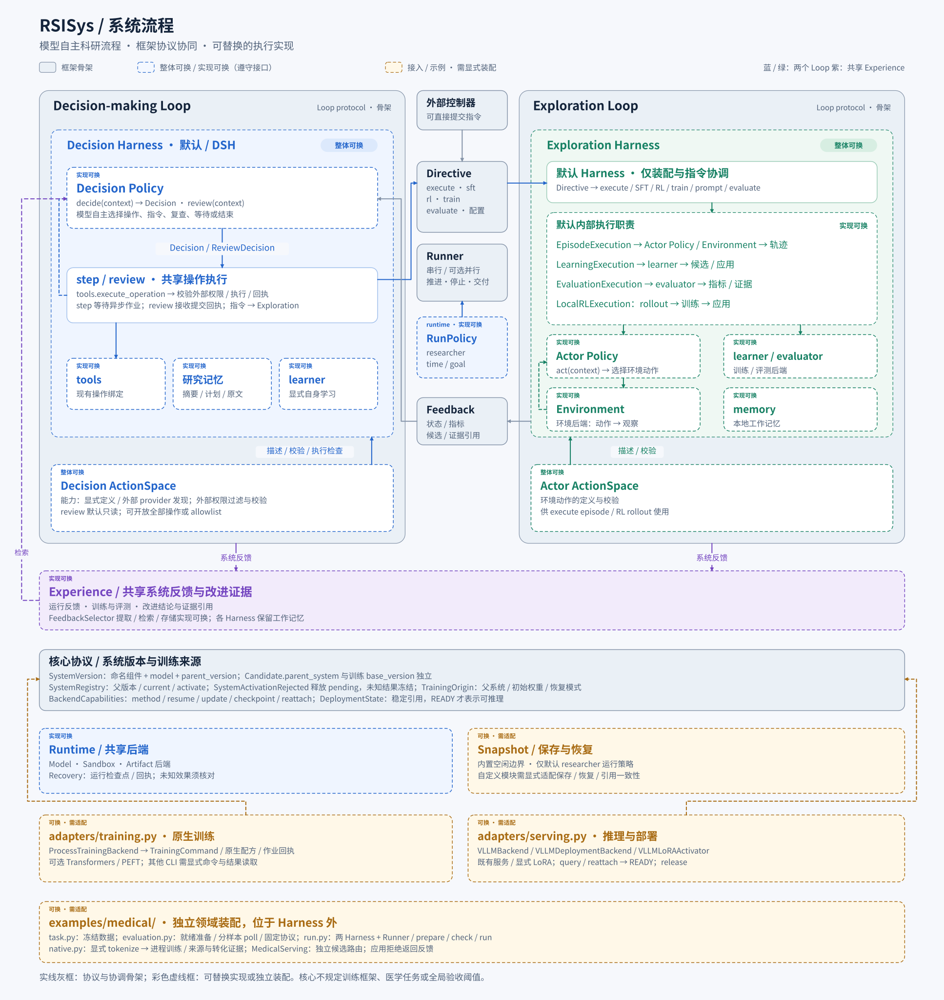
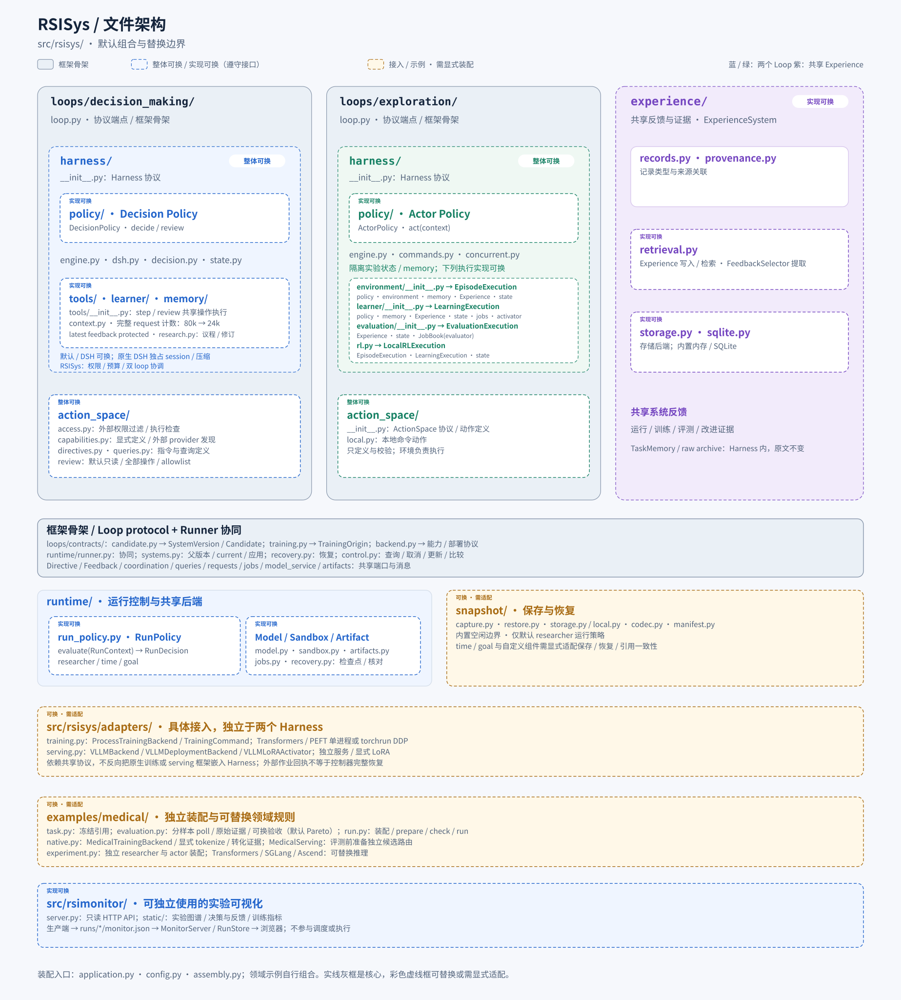

# 系统架构

框架负责两个 loop 的生命周期与协同，具体能力由组件实现。本文维护跨组件关系；组件细节从[根 README](../README.md)进入，启动方法见[使用指南](GUIDE.md)。

## 模块关系

```text
src/rsisys/
├── loops/
│   ├── decision_making/   # loop + policy / decision_space / learner
│   ├── exploration/      # loop + policy / action_space / environment / learner / evaluation
│   └── contracts/        # 两个 loop 共用的消息、引用和公开端口
├── experience/           # 共享经验与 memory
├── snapshot/             # 独立保存与恢复
├── runtime/              # 公共后端与协同推进
├── application.py        # 本地持久化装配
├── config.py             # 内存演示装配
├── cli.py                # 命令逻辑
├── __main__.py           # python -m rsisys 的薄入口
└── __init__.py           # 包初始化
```

policy、space、learner 等实现归所属 loop，通过构造函数注入；两个 loop 共享 Experience。Runtime 提供公共能力并通过公开端口协调，不选择改进策略。Snapshot 独立于改进过程，具体组件的状态需求可以不同。

模型可共享或独立绑定，部署在框架外；角色引用相同模型不表示训练结果自动同步。agent 执行流程归所属 loop，不强制增加 Harness 或顶层 services。

## 双 loop 协同

1. Decision-making 完成本地准备，policy 发出 Directive。
2. Exploration 接收请求并按指令推进环境执行、学习或评测。
3. Runner 遇到等待返回调用方，下次推进继续原任务。
4. Exploration 形成终态 Feedback；Decision-making 写入经验，供下一次决策使用。
5. 反馈交付成功后确认指令，释放探索流程占用。

消息与公开端口定义见[共享协议](../src/rsisys/loops/contracts/README.md)；两边内部流程见 [Decision-making](../src/rsisys/loops/decision_making/README.md) 和 [Exploration](../src/rsisys/loops/exploration/README.md)。

当前一次只有一个未完成交付的指令；一条 RL 指令内部可以多次采样和更新 Actor。自动监控频率、时间/token 优化触发、多 Actor 并发及共享模型更新事务尚未实现。

## 交付与失败边界

- Runner.step 最多调用一次决策并推进一个探索阶段；run 遇到 waiting 返回，不在内部连续轮询。等待状态可以没有 JobRef，rounds 统计已交付反馈的指令数。
- 新决策使用新 ID；同 ID 同内容重复接收返回原进度，内容不同则拒绝。指令交付确认前独占探索流程。
- 取消只提出请求，后续推进确认终态；取消与训练成功竞速时不自动应用候选。同步环境调用不能由下一 tick 中途抢占。
- 提交响应丢失后保留请求与幂等键，不重新生成任务。后端需兑现幂等提交；非终态查询或记录异常允许后续推进重试。
- Runner 保留待交付反馈，Decision-making 使用稳定记录 ID。receive 接受最近一次相同交付的重试；写入失败只重试交付，不重跑 Actor。
- 执行异常先交回已有证据，再抛出原异常；清理异常附加到原异常。回执与待交付区仅在进程内，不保证崩溃后的恢复。

`completed` 表示终态反馈已交付，任务结果看 Feedback；是否有质量提升由评测确定。模型绑定、服务部署与候选验收由各自组件或策略负责。

## 图示

图示展示结构与职责，具体实现范围见组件 README。





修改生成器后运行 `python docs/diagrams/build_diagrams.py`。只维护 SVG，不保留重复 PNG 预览或独立图集文档。
