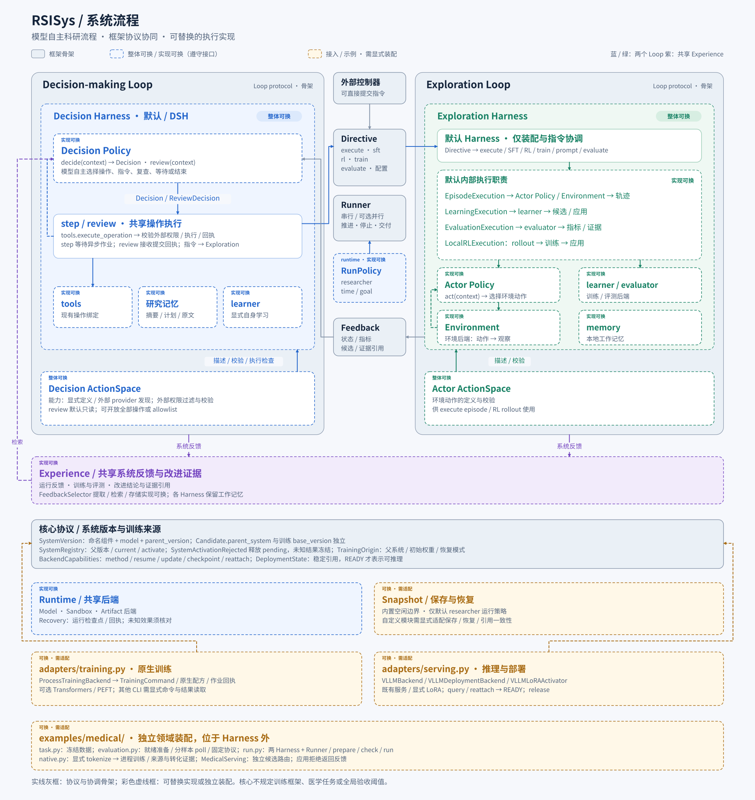
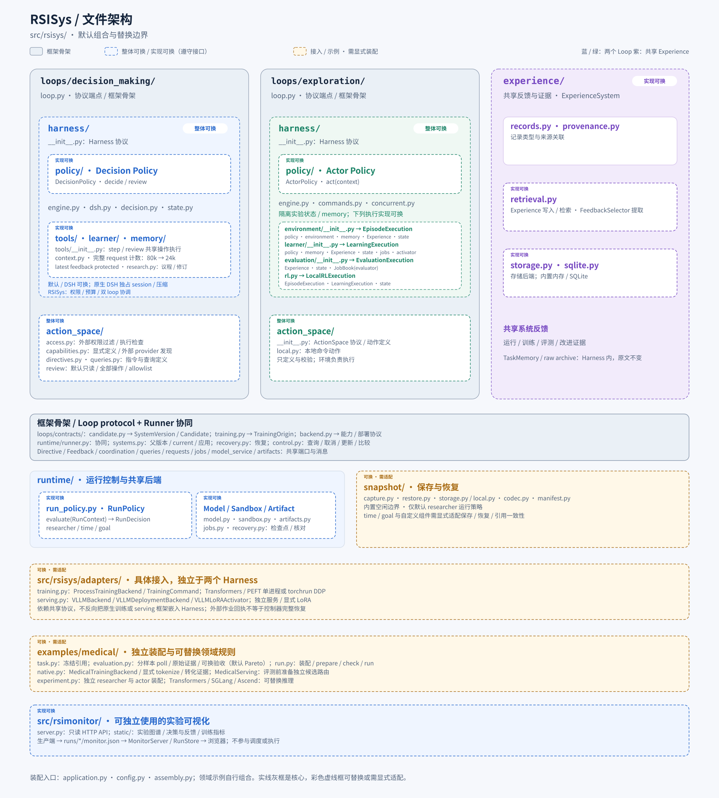

# RSISys：统一术语与架构

更新：2026-11-06。顶层职责是 **host、一个 meta-agent/harness 与 Lab**。
Memory 是 harness 的可替换子模块；正式评测是 Lab 能力，其协议由 host 固定。
历史审查材料和冻结实验保留当时的两侧称谓；新运行以本文和实际装配配置为准。

## 一条主链路

**meta-agent → Lab → 原始 feedback → 同一个 meta-agent。**
meta-agent 直接负责行动选择、结果解释、调试、上下文管理以及记忆的写入、更新和删除。
旧“整理侧”的语义判断职责合入这个工作流；默认不再创建独立上下文中的整理模型。



| 名称 | 定义与职责 |
| --- | --- |
| **meta-agent** | 根据目标、真实状态、当前任务原始反馈和相关记忆选择行动，读写代码、调试和解释结果，并显式管理自己的记忆。`decision侧` 可作为兼容说明，不再另设整理侧。 |
| **Lab** | 任务与实验的执行环境，包含数据、模型或 agent、工具、harness 和授权资源；内部可以直接运行程序，也可以含 agent。 |
| **memory 模块** | harness 内的存储、索引、检索和修订服务；默认 `AgentMemory` 使用本地原子 JSON 和确定性文本检索，不发出模型或 embedding 请求。 |
| **decision** | 一次带身份、参数和来源的行动或任务，不是另一种 agent。 |
| **Meta-agent harness** | 装配输入、执行工具边界、计量和容量管理；与 Lab harness 分开。 |

## 共同演化与 reflect

**Coevolution（共同演化）** 是 meta-agent 与 Lab 中研究对象相互提供反馈、按需改进的
整体过程。Lab 中的研究对象可以是 agent，也可以是模型或程序；Lab 本身仍是执行环境。
**Reflect** 是其中面向 meta-agent 自身的反思与改进过程，包含对自身策略、harness、
工具、上下文与 memory 机制的改进，以及自身训练数据构建、训练、验证和版本选择。
Reflect 可以只分析问题、修订经验或决定暂不改动，不保证产出候选、启动训练或提升能力。
Reflect 策略归入 **RSI 优化器**：它决定自身改进的触发、构建、验证与选择；Lab 侧改进
由同一优化器统一编排。方法可以整体实现两侧策略，也可以把 reflect 策略作为内部组件。

| 过程 | 改进对象 | 典型工作 |
| --- | --- | --- |
| Lab 侧改进 | Lab 内的 agent、模型或程序 | 改训练数据与算法、权重、推理策略、工具和 Lab agent harness |
| Meta-agent reflect | meta-agent 自身 | 分析研究失败、改自身 harness/工具/memory 策略，或构建数据并训练自身模型 |
| Coevolution 编排 | 两侧的反馈、改进与版本组合 | 决定何时触发、改哪一侧、验证哪些组合以及是否启用候选 |

改进对象与执行位置分开记录：在 Lab 中执行的 meta-agent 训练仍属于 reflect；
meta-agent 修改 Lab agent 的 harness 属于 Lab 侧改进。Reflect 是同一个 meta-agent
可承担的职责，不新增一个必须存在的反思 agent、独立模型或后台整理阶段。
候选由 meta-agent 通过普通 decision 自主编写、调试、训练和构建，使用其选择的策略与
已安装执行能力。Host 提供执行设施、必要的接口校验与版本记录，不替它设计候选或配方。

一次运行可以持续进行普通研究；算法按事件、周期、性能或资源状态触发一侧或两侧的
改进，也可延后或跳过。触发、候选构建、验证与选择可以整体封装在一个方法中，或按需
拆为可组合策略；不要求逐轮执行、两侧同步更新或每次触发都生成候选。两侧可共享已有
能力和协议，不强制使用同一模型、训练配方或评分标准。

典型关系是：**meta-agent 研究 Lab 对象 → Lab 原始反馈 → 算法选择后续研究或 reflect
→ 经验证后选择版本 → 继续研究**。这是可分支、等待与并行的关系，不是固定顺序流水线。
普通反馈解释和 memory 读写可以照常发生；这些状态变化不自动证明 harness 已升级。

Host 固定各目标适用的验收规则、权限、资源和账本。Lab 侧的任务分数与 meta-agent 的
研究质量、工具可靠性或成本分别归因；验证须记录实际使用的 meta-agent 与 Lab 对象
版本组合。两侧同时变化时保留联合变化事实，不据此宣称任意单侧有独立提升。
候选构建、验证、启用和结果接受分别留证；反思文本、提案或训练完成不等于候选已启用。

权限采用尽量开放研究空间的原则：在 host 装配的能力和分配的资源范围内，通常允许
自主研究与修改；host 显式限制敏感操作，例如修改自身权限、正式计分规则或访问封闭
数据。候选启用也可按 host 预设规则自动执行，不引入逐次人工确认。具体敏感范围由
host 配置并由执行边界兑现，不把所有未逐项列出的研究动作一律视为禁止。

`runtime.evolution` 提供显式激活端口、联合候选、启用/回滚确认和持久状态集成。
医疗入口通过 `MethodCatalog` 选择 RSI 优化器；默认 `open_lab` 由同一个 meta-agent
按需调用 `system_register` / `system_activate`，可改变实际 prompt 与 harness 参数。
候选 JSON 由 meta-agent 自行构建。激活保持现有 harness 对象、任务、memory 与账本；
不确定的启用结果留在 journal 中，不能自动重放。任意训练后模型的部署、全新工具或
harness 实现仍须安装相应 host 激活端口和状态适配器，不能用引用回执冒充真实启用。
当前组件图在一次运行内固定；动态变化发生在已注册端口内部，保留顶层装配身份检查。
旧 `subject=meta_agent|lab` 继续区分作用对象，reflect 不作为新的强制消息类型。

`SystemVersion.models` 按目标记录模型，使用 `model_for(target)` 取值；两侧不同模型的
候选可以联合组合，同一目标的冲突仍拒绝。旧单 `model` 清单继续兼容；一旦使用具名
清单，未声明的目标不会偷偷绑定到旧的单模型别名。

医疗研究程序使用 `IsolatedProcessBackend`。Host 显式挂载只读运行时、分配的设备节点和
可写工作区，关闭直接外网与 host 服务访问；修改可见设备环境变量不会增加设备权限。
Linux 要求可用的 bubblewrap/namespace 和明确的 `--execution-policy`，不可用即拒绝。
启用 AppArmor 用户命名空间限制的主机，需要为系统 `/usr/bin/bwrap` 安装允许 `userns`
的程序级 profile。若预检报告 `loopback: Failed RTM_NEWADDR`，应检查内核 AppArmor
拒绝记录并修复该程序的配置；不要关闭全局限制、取消网络隔离或以 root 运行研究程序。
本机 Seatbelt 支持 CPU 文件/网络边界回归；GPU/NPU 驱动组合需要各节点独立验收。
可信本地执行器仍保留给明确选择的旧集成，不承担上述隔离保证。

可替换方法共用 `HostModelSession` 与 `AccountedModelBackend`，不可信程序经 Unix broker
查询模型。每次 provider 尝试先持久预留，失败和重启不清账；离线程序另记分配资源的占用
时间，不换算成 API calls、optimizer steps 或训练提升。可信的宿主 Python 插件仍属于
host 的信任边界，不能据此声称任意第三方 SDK 已被进程内自动截获。

## 决策时看到什么

1. 宿主给定的任务、约束、权限、资源和截止时间。
2. 当前任务、作业和候选的真实状态；历史记忆不能覆盖它们。
3. 最新原始 Lab 回执，以及仍开放的实验/调试任务所固定的原始证据。
4. 有界检索的既有记忆与归档读取入口；记忆正文可通过 `memory_read` 阅读。

完整原始历史保留在执行归档中，按需读取。单条原文在容量内直接交付；超长内容使用明确的
UTF-8 原文页、完整性标记、SHA 和精确读取地址，不能把摘要或预览当作已读完整原文。

## 当前任务与长期记忆

| 信息 | 谁管理 | 生命周期 |
| --- | --- | --- |
| **原始即时反馈** | 执行设施交付，同一个 meta-agent 使用 | `previous_feedback` 展示最新原生操作；任务固定的证据见 `active_feedback`，中间读代码/日志和编辑不会挤掉它。 |
| **实验/调试任务** | meta-agent 调用 `research_task` 的 open/pin/close | open 可固定已有错误，pin 增补原始回执；任务关闭才释放该驻留窗口。任务完成不是单个工具调用结束。 |
| **可检索 memory** | meta-agent 调用 `memory_write`、`memory_delete` | 跨决策保留，显式修订；更新和删除均记录修订证据，不自动把每条 feedback 写成记忆。 |
| **原始归档** | 宿主持久化 | 独立于任务窗口和记忆；关闭任务或删除记忆不删除实验原文。可选轨迹产品不等于执行账本。 |

默认最多同时开放两个任务，每个可固定四条回执，并保留该任务最近两条 producer 回执。
原始正文使用共享有界窗口，超量时给出原文分页地址。没有授权归档能力时不悄悄丢弃原文。
这些限额是公开工具能力，超限返回可修正反馈，不驱逐别的活跃任务。

`memory_search` 提供文字匹配和近期检索；`memory_read` 可读当前或历史修订，大记录分页。
写入需要明确来源，或以无来源的 unverified 假设保存；supported/refuted 是 meta-agent 的判断，
宿主只校验来源与修订身份，**不把记忆散文升级为已验证评测或事实**。

## 默认接线与兼容范围

`ResearchAssembly()` 和 `ResearchAssembly.single_meta()` 默认安装同一个 meta-agent 的记忆工具与任务窗口。
医疗 Open Lab 默认 `--feedback-routing agent_memory`，没有后台 LangMem 语义抽取或独立提案模型。
默认 `ModelDecisionPolicy` 在该模式下的容量压缩只生成机械归档导航，不额外调用总结模型；
需要语义摘要时，由 meta-agent 在普通 decision 中写研究笔记或 memory。
所有这些普通 decision 仍按宿主统一调用和 token 账本计费。

旧 `ResearchAssembly.langmem()`、journal provider、`context_or_memory` 路由和 proposer 保留为
**显式选择的兼容工作流**，不混入单 meta-agent 默认路径。旧冻结运行不能换装本版恢复；
装配配置升为版本 5，仍拒绝无证据迁移。自定义 harness/provider 自行兑现其已声明能力。

新增 `AgentMemoryState` 保存任务、记忆和修订。医疗原目录恢复已注册该组件，原始历史、
调用账本和绝对截止时间继续沿用；磁盘状态与 checkpoint 不一致时阻塞核对，不清空日志、
回滚记忆或自动重放不明 mutation。可迁移快照仍需所有组件显式提供完整状态接口。

## harness、能力与宿主

始终写清归属：**meta-agent harness** 组织 meta-agent 的模型输入、工具调用和研究状态；
**Lab harness** 组织 Lab 内部的任务执行、推理、训练或评测。修改其中一边不表示另一边也改变。
同一个 meta-agent 负责行动与语义整理；memory provider 负责存储和检索。第三方 harness 可替换内部实现，但须显式接入记忆工具、上下文与恢复状态。

开放执行按已安装工具及权限提供编程能力，SFT / RL / evaluate 是可实现的任务，
不是框架强制给模型的固定算法菜单。模型可以修改 Lab 代码；真正可执行的范围仍由
已安装能力、实际权限、资源和执行后端决定。

| 基础设施 | 职责 |
| --- | --- |
| **Host / 宿主** | 装配模块、固定目标和验收规则、授权、资源准入、统一调用计费、截止时间、生命周期与 owned 资源清理。 |
| **Runner / 调度** | 按公开端口推进任务、等待、交付和停止。调度模块可替换；不自行产生研究结论。 |
| **Sandbox / 执行后端** | 运行代码并兑现其实际隔离边界。Lab 是环境，Sandbox 是可使用的设施，两者不是同义词。 |
| **看板 / Monitor** | 面向人的只读可观测界面，消费公开运行投影；不处于模型输入链路，不作为 agent 的反馈工具。模型读运行状态用 Lab 或显式状态查询端口。 |

整套 RSI 方法通过 `MethodCatalog` 选择协议、ID、版本和原生参数，返回统一 `ModuleAssembly`。
可以整体实现 harness/Lab，也可内部组合；实验设计、反馈解释和下一步选择可以由同一个
meta-agent 完成，不要求独立的研究阶段插件。方法版本与配置随运行和快照保存，恢复拒绝
身份变化。可选 `ComponentGraph` 将 host 注册的训练/推理策略、
训推引擎、数据、harness 和 RSI 决策策略按显式依赖组合；构造前检查缺失项、契约冲突与
循环，运行身份记录每个组件的版本、参数及根端口绑定。训练引擎和推理引擎可以独立选择，
`ResearchAssembly` 继续负责 memory/feedback 接线，不代表整个 RSI 算法。
模型可修改的脚本和参数仍由 host 的工具、权限与执行隔离决定；组件目录不授予权限。
分类、代码入口、恢复与验证范围见[组件组合说明](component-composition.md)。

## 评测、训练和改进声明

| 名称 | 可以声明什么 |
| --- | --- |
| **执行回执 / receipt** | 某任务的提交、状态、完成、错误和产物引用；成功退出不等于质量提升。`Feedback` 是兼容执行端口中的一种终态消息类型。 |
| **探索性评测** | 模型自行编写或修改的测量结果；须保留代码、数据与协议身份，不能冒充固定正式评测。 |
| **正式评测** | 领域装配或宿主固定的验收协议。可比较结果须绑定精确候选、数据、解析、指标与来源。医疗 Open Lab 的正式评分由 `FixedMedicalLab` 提供。 |
| **训练完成** | 有真实 optimizer steps、数据曝光、loss 或权重产物等适用证据；写过训练代码、提交过程序、测速或 fixture 不能代替训练。 |
| **候选 / candidate** | 待验证的模型或组件变更；可以尚未评测、部署或采纳。 |
| **提案 / proposal** | 未执行的建议，不能写成已构建、已训练或已应用。 |
| **部署 / 应用 / 采纳** | 分别记录服务就绪、实际版本绑定变化与结果接受；三个状态不由摘要、分数或成功回执互相推定。 |

训练数据构建、SFT / RL、harness 构建与验证都可以作为 **Lab 内任务**；不强制每类任务
新建一种 Lab。只有需要独立资源、权限或生命周期时，才单独装配改进 Lab。
原始归档到数据构建、训练和应用之间都需要正式任务及相应证据，不能按轨迹数量自动推定训练质量。
固定正式协议适用于对应领域装配；核心框架不内置通用于所有领域的评分阈值。

## 项目、运行和恢复

- **项目 / project**：共同目标和领域配置下的一组运行。
- **运行 / run**：一次完整系统运行，不是单个训练 job；暂停后在原目录恢复仍是同一 run。
- **任务 / task、作业 / job**：某次实际执行及其生命周期；提交确认不等于终态完成。
- **研究尝试 / Attempt**：围绕一个想法的可选决策关联；执行时的明确归属与历史兼容工作流的事后分组分别记录，不增加调度层级。
- **版本**：区分代码版本、模型权重版本、系统组件版本、评测协议版本和记忆修订，不能用一个 revision 替代所有身份。
- **运行恢复 / durable resume**：在原目录按显式组件状态适配器接续研究状态、调用账本与相同截止时间；未知副作用阻塞核对，不自动重放。
- **可迁移快照 / snapshot**：在支持的空闲边界导出、到新目录恢复；不是任意组件的通用进程快照。Lab 的 optimizer checkpoint 另由具体训练程序实现。

新版医疗 Open Lab 已接通正常暂停与原目录恢复；旧的非 durable 运行不能追溯恢复。
完整边界与命令见[恢复说明](review/open-lab-recovery-20261105.md)。

## 接口与实现映射



新文档、图示和 prompt 使用上面的统一称谓；旧 Python 符号、配置键、日志字段与来源引用
暂保持兼容。以下是映射，不应把兼容名字重新宣称为额外的系统角色。

| 现有标识 | 统一解释 |
| --- | --- |
| `decision_maker` | 历史 meta-agent 模型角色键；默认唯一的 meta-agent 负责行动、调试与记忆管理。 |
| `DecisionMakingLoop` / `DefaultDecisionHarness` / `ModelDecisionPolicy` | 唯一 meta-agent 的默认端点、harness 和策略实现。 |
| `FeedbackLearningService` / `feedback_learning` | 原始回执、归档、交付与兼容处理器管理；默认不调用整理模型，learning 不表示权重训练。 |
| `AgentMemory` | 默认确定性记忆存储、检索、显式写入和任务反馈驻留；不持有模型。 |
| `LangMemContextMemory` | 显式选用的旧版独立抽取工作流；不属于默认单 meta-agent 路径。 |
| `LabExecution` / `LocalProcessLab` / `FixedMedicalLab` | Lab 的公开执行窗口及两种具体实现。 |
| `ExplorationLoop` / `ExplorationLab` | 兼容执行端口及其 Lab 适配；不是所有 Lab 都必须有的内部结构。 |
| `actor` / `ActorPolicy` / `Environment` | 兼容 Lab 的内部执行组件，不能与整个 Lab 或 meta-agent 画等号。 |
| `issuing_decision_model` / `learning_decision_model` | 分别是发出动作时、捕获整理任务时的模型身份，保留各自历史。 |
| `subject=meta_agent|lab|unspecified` | 提案或产物作用对象；它与当次模型的工作职责是两个维度。 |

可替换模块只兑现公开窗口：Lab `describe/execute`、memory `context(query) -> str`、
可选归档 `write/read`、可选提案 `propose`、可选调度 `select`，以及需要恢复时的显式状态端口。
各模块可以自由选择算法和内部结构；宿主保留身份、授权、状态、引用与恢复一致性的必要校验。
窗口的具体协议见[模块窗口规范](review/feedback-module-windows-20261104.md)。

文档和两张 SVG 由同一组术语维护；重新生成图示运行：

```sh
python docs/diagrams/build_diagrams.py
```
