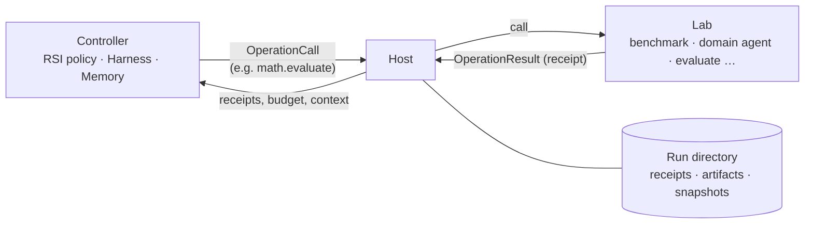

# Concepts

RSIComposer runs recursive self-improvement as a loop between a **Controller** and
one or more **Labs**. The **host** sits between them: it routes every call,
enforces budgets and data-access rules, and stores the results.

At each step the Controller receives a decision window and returns a
`Decision`: invoke one or more Lab operations, wait for a running job, or
finish. The host executes the calls, stores each receipt, and passes the
receipts to the Controller at the next step. A run ends when the Controller
finishes or a budget or step limit is reached.

## Terms

| Term | Meaning | In code |
| --- | --- | --- |
| **Run** | One execution of a run config. All its outputs go to one data directory. | `rsisys run --config … --data-dir …` |
| **Controller** | Decides what to try next and which domain agent to adopt. It has an RSI policy and may also have a Harness and Memory. | `ControllerDefinition` |
| **RSI policy** | The researcher: the decision logic that proposes and revises domain agents. It can be plain Python or a model that chooses actions. Called Policy in code. | `DecisionPolicy.decide(DecisionInput) -> Decision` |
| **Harness** | The Controller's own: builds the RSI policy's input window and provides Controller-local tools. Without one, the default Harness is used. Not the harness of a domain agent. | `ControllerHarness` |
| **Memory** | Builds text context from past evidence for model-driven Policies. | `ControllerMemory.context(query) -> str` |
| **Lab** | An environment that runs operations against its own data, models, and scorer, and returns receipts. | `describe()`, `execute(call)` |
| **Domain agent** | What a Lab measures: the thing that does the domain task and is under study, such as an instruction, a configuration, a `step` program, a Harbor agent source tree or a checkpoint. The RSI policy submits and revises it; the Lab pins it by content hash, runs it and never edits or selects it. Any harness it has belongs to it, not to the Controller. | `DomainAgent`, `DomainAgentSpec` |
| **Runtime** | How a Lab runs one domain agent on a benchmark's tasks. It is named in the benchmark entry and recorded in the benchmark's `protocol_id`, with a trust level: `data`, `sandboxed-code` or `host-code`. | `DomainAgentRuntime` |
| **Benchmark** | A frozen task set with its verifier, budgets and runtime. A Lab mounts benchmarks and does not override their protocol. | `Benchmark`, `protocol_id` |
| **Operation** | A named action that a Lab publishes, with a JSON input schema. The Controller calls it as `<lab alias>.<operation>`, for example `math.evaluate`. | `OperationSpec`, `OperationCall` |
| **Receipt** | The result of one operation: status, summary, data, and artifacts. The host stores every receipt; the Controller reads them in `DecisionInput.feedbacks`. | `OperationResult` |
| **Primary metric** | The score a Lab declares and reports in `data['quality_metrics']`. The RSI policy uses it to compare domain agents. | `MetricSpec(name, direction, scorer)` |
| **Split role** | How much of a data split the Controller can see. | `TRAIN`, `TRAIN_UNLABELED`, `DEV`, `SEALED` |
| **Method** | A Controller bound to its own Labs and registered under one name. Most built-in algorithms are methods. | `MethodDefinition`, `registry.register_method` |
| **Registry** | The catalog of methods, Controllers, Labs, and components that a run config can select by name. | `rsisys catalog` |
| **Plugin** | Your own Python file or package with a `register(registry)` function, loaded with `--plugin`. | `Registry.load_plugin` |
| **Component** | A reusable part, such as a model backend, Memory, or Harness, that a method resolves by name. | `registry.register_component` |

## Split roles

A Lab declares a role for each data split. The host uses the roles to decide
what the Controller may see.

| Role | Inputs visible | Labels visible | Per-item results | When |
| --- | --- | --- | --- | --- |
| `train` | yes | yes | yes | any time |
| `train_unlabeled` | yes | no | yes | any time |
| `dev` | yes | yes | yes | any time; use for candidate selection |
| `sealed` | no | no | no | only after the Controller finishes |

Select candidates on `dev`. To report a final score, declare a `sealed` split.
The host evaluates it after the Controller finishes, so the result cannot
affect selection.

## Research and exploration roles

The Controller plays the research role: it plans and selects. Each Lab plays
the exploration role: it runs experiments and returns evidence. The two roles
can use different models, for example a strong model directing the training of
a small one. They can also use the same model, which gives the usual
single-agent self-improvement loop. Both cases use the same interfaces.

The split follows the model roles. Work done by the `decision_maker` model,
such as writing a new prompt, reflecting on a failed minibatch, or sampling new
programs, is research and belongs to the Controller: GEPA, OPRO and FunSearch
generate their candidates there. Work done by the `actor`, or by whatever is
being improved, is exploration and belongs to the Lab, together with the data
and the scoring. A Lab never proposes candidates, so any Controller that speaks
its profile can drive it.

The Controller is also replaceable at run time. The
[Self-Reflection Lab](../src/rsisys/labs/self_reflection/lab.py) builds
candidate Controllers and tests them in nested runs. The current Controller then
decides whether to adopt one.

## What a run writes

Each run writes to its data directory. The most useful files are:

| Path | Contents |
| --- | --- |
| `result.json` | Final status, stop reason, every step's receipt in `events`, and `controller_report` if the Controller provides one |
| `lab_receipts/` | One stored receipt per operation call |
| `artifacts/` and Lab output directories (for example `math-lab/`) | Files that Labs produced, such as generated data, evaluations, and models |
| `snapshots/` | Snapshots for `rsisys resume --snapshot`, for methods that support them |

The [Quickstart](quickstart.md#read-the-results) shows how to print the metrics
from `result.json`.
