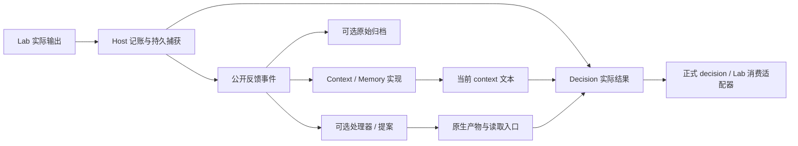

# Feedback 模块接口与实现边界

日期：2026-11-04。本文是当前接口规范与接线说明，不规定整理算法、prompt、SDK、目录或检索方式。
公开定义：[context 窗口](../../src/rsisys/loops/contracts/feedback_context.py)、
[可选模块窗口](../../src/rsisys/loops/contracts/feedback_modules.py)。

## 基本协议

| 能力 | 输入 | 输出 | 是否必需 |
| --- | --- | --- | --- |
| 当前 context/memory | context(ContextQuery) | str，可以为空 | 必须激活，可替换 |
| 原始事件归档 | write(ArchiveEvent) / read(reference) | 存储引用 / 原始事件 | 默认开启，可关闭、可替换 |
| 反馈处理 | process(FeedbackContextEvent, FeedbackModel) | 原生产物 | 可选 |
| 改进建议 | propose(FeedbackContextEvent, FeedbackModel) | 原生建议 | 可选 |
| 调度扩展 | select(tuple[PendingFeedback], tuple[running_event_id]) | 待处理 event_id 或 None | 可选；未装配时默认 FIFO |

处理器也接受相同二参数的函数；提案入口支持 propose、通用处理器或函数。
不要求继承类，configuration() 和 recover(event) 均非基础必需方法。
Context 的更新通知 observe(event) 也可省略。

FeedbackContextEvent 只有公开的任务/事件身份、原始输出、请求、引用、来源及宿主关联。
ArchiveEvent 只有 event_id、kind、payload、identity。Lab 不需要构造这些类型，由执行设施适配。
归档组件不需要读取 jobs 或理解 snapshot 字段，只需保存、读回同一事件。
输入与返回值均在接点处复制，插件修改输入不会改写原始回执或执行账本。

持久化产物与存储引用必须是有限 JSON 数据；文本、数字、数组、对象、null 都合法。
二进制由其原生文件/对象引用表示。这个要求不规定业务键、建议类别、memory 格式或训练样本格式。
原生产物里的 status、job_id、charged_calls 等键只保留为内容，不能覆盖宿主元数据。

## 运行路径



1. observe / observe_output 持久捕获并排队，不调用插件、模型或外部归档存储。
2. 后续 refresh 通知可选 memory hook、交付外部归档，并推进后台处理。
3. 调度器只选择公开待处理事件；host 决定准入、并发容量、资源预留与关闭。
4. 处理器返回业务产物，host 单独保存状态、错误、实际调用及交换。
5. service.context 返回当前文本，默认 harness 替换 memory_context。
6. service.outputs 列出原生产物，实际 decision 导航提供精确读取路径。

refresh 不等待未完成的 worker，但通知、归档写入和调度选择是同步接点。
实现应及时返回；自带后台管理的 SDK 可通过适配器接入，接口不承诺任意函数都不会阻塞。
外部 harness 可以独立调用 refresh；默认 harness 的下一次 context 组装会调用它。

## 最小组件与装配

```python
from rsisys.research import ResearchAssembly, assemble_research

class MyMemory:
    def context(self, query):
        return my_store.retrieve_text(query.objective)

class MyArchive:
    def write(self, event):
        return object_store.save(event.event_id, event)

    def read(self, reference):
        return object_store.load_event(reference)

class MyProposer:
    def propose(self, event, model):
        return {'ideas': local_rules(event.output)}

assembly = ResearchAssembly(
    context_memory=MyMemory(),
    trajectory_archive=MyArchive(),
    improvement_proposals=MyProposer(),
)
service = assemble_research(loop, assembly=assembly, backend=host_backend, path=feedback_path)
```

示例的存储与规则由集成方提供。不存在统一 memory 数据库、提案字段或归档目录要求。
原生建议保存到 /outputs/improvement_proposals，不自动变成 harness_change 或训练任务。
内置 ModelImprovementProposer 使用自己的结构化提案协议；正式 consumer 要执行某项建议时，
由对应适配器校验所需来源、目标和参数。任意原生产物不能冒充已验证的正式提案 ID。

memory_processor 是可选后台更新机会，不是 context 的必要实现方式。
它可以更新自己的存储，让 context provider 随后检索，也可以返回供 decision 读取的原生产物。
返回名为 context 的业务键不会自动覆写当前 context，provider 由装配明确决定。

## 模型访问与零调用实现

纯函数、规则和外部检索组件默认预留零次模型调用，不需要自报 charged_calls。
需要推理时，通过部署适配器设置调用 allowance：

```python
from rsisys.loops.decision_making.feedback import CallbackFeedbackProcessor
from rsisys.loops.contracts.model_service import GenerationRequest

def process(event, model):
    request = GenerationRequest('decision_maker', model.model,
        prompt_for(event.output), system=my_prompt, max_output_tokens=2048)
    return {'suggestion': model.generate(request).text}

processor = CallbackFeedbackProcessor(process, max_model_calls=2)
```

max_model_calls 是部署给适配器的上限，不进入研究模型的业务反馈内容。
host 提供的模型能力校验捕获的 active ModelRef、完整请求 token、输出上限，
记录每次请求/响应并计费，包括准入拒绝或未知结果；组件不能通过返回值修改计费。
共享服务的总限制继续由原 backend 执行。零模型调用的工作不因模型额度耗尽而跳过。

有运行目录时，现代组件的逐次交换保存在 feedback-stem-exchanges/event-id/product.json；
恢复不会覆盖旧交换或自动重发不确定请求。内置 LangMem/提案继续使用其已实现的 gateway。
这不是 Python 沙箱；部署应提供受控依赖，接口不能约束任意插件在能力之外访问外部服务。

## 产品独立与故障策略

Memory 后台处理和建议默认独立。Memory 失败不会跳过独立建议，也不会占用建议条目上限。
确有成功依赖时显式设置 proposal_requires_memory=True。默认执行顺序仍为串行，依赖与顺序分开。
每个产品保留各自 status/error/calls；总任务可含成功与失败产品，不能只看总 status 宣称全部成功。

FeedbackFailurePolicy 是 host 配置：

| 配置 | 默认 | 行为 |
| --- | --- | --- |
| context | raise | renderer 失败记录后抛出，不静默换 provider |
| context=last_valid | 需显式选择 | 只复用同 objective 的上一份有效文本；执行事实仍使用当前账本 |
| publication | isolate | 旧 Memory 发布异常单独记录，不阻断主 context 组装 |
| publication=raise | 需显式选择 | 保留错误并向调用方抛出 |

外部 context 通知、归档写入、兼容发布均先持久记录 running，再调用实现。
成功记 delivered，异常记 failed；恢复遇到 running 记 interrupted，不自动重放未知副作用。
旧 Memory 投递可用 service.retry_publication(event_id) 显式重试，目标须具备同 ID 幂等保证；
不会重复 Lab 行为或模型请求。持久化执行意图失败会明确中止，不伪装为可选产品错误。
归档读回必须匹配原事件指纹，身份或内容变化明确拒绝。

可选 recover(event) 只读已经提交的产品，None 表示未知，不重新执行业务动作。
恢复产品本身不能证明实际用量，现代组件恢复保守保留调用预约；未知阶段不释放整个任务预约。
失败、投递、调度错误与 context 复用在 host 状态和默认 decision 导航可见。

## 默认实现与兼容适配

- ContextMemoryBinding 隔离原 record/working_memory/memory 协议。
- ArchiveBinding 隔离原 records(jobs)/extract(job)/snapshot(job) 协议。
- FeedbackStageBinding 隔离原 process(job, backend, limits)、调用预留与 recover(job) 协议。
- FIFO 在 scheduling.py；executor 与 max_concurrent_jobs 属于 host，不由 selector 放宽。
- 旧解释 prompt 在 LegacyFeedbackInterpreter 与 prompts/legacy_feedback.txt；新组件可以换 prompt 或不用 prompt。

内置 Journal/LangMem 可复用原实现。兼容协议不构成新插件的必需方法或业务格式。
正式入口是 ResearchAssembly / assemble_research，配置 schema_version=4；
记录四个协议版本、组件身份、依赖和故障策略。与旧冻结配置不同则拒绝恢复，不静默迁移。
自定义闭包、外部数据库和 SDK 的持久状态仍由集成方提供，配置指纹不是任意对象序列化。

## 验收范围

专门测试：[test_feedback_module_windows.py](../../tests/feedback/test_feedback_module_windows.py)。
覆盖最小组件、原生产物、实际 decision 读取导航、模型计费/身份/完整请求容量、归档读回/恢复、
独立与显式依赖、调度选择/host 并发及发布故障隔离。
整仓回归 1,527 项：1,515 通过、12 跳过、0 失败/错误；303 个 source/example/test 文件验证期间无变化。
记录：[feedback-module-windows-validation.json](repros/feedback-module-windows-validation.json)。

当前归档只覆盖已捕获的公开 decision/执行片段，没有原始 meta-agent 的完整 prompt/response。
替换存储不等于补齐历史覆盖，coverage 与 complete_conversation=false 继续保留。
回归使用离线 fixture；12 项跳过为 6 项外部 DSH SDK 与 6 项真实推理检查。
未做真实模型推理或训练，回归不证明 memory 总结质量，也不替代长期运行验收。
