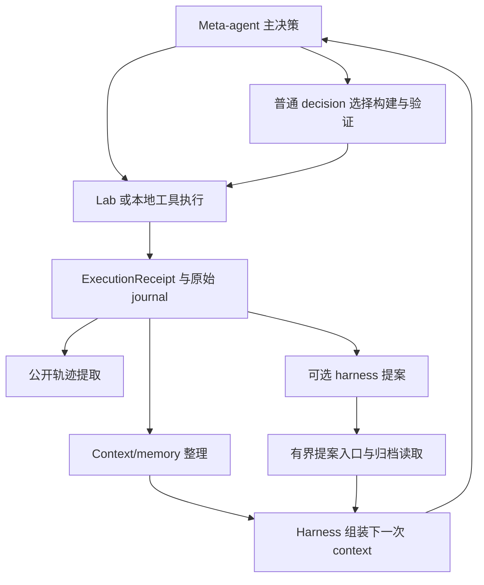

# Feedback 链路与装配

更新：2026-11-04。研究装配入口已统一；memory 的整理质量单独验收。

## 职责

| 模块 | 输入 | 输出与执行边界 |
| --- | --- | --- |
| Meta-agent 主决策 | 当前状态、可用能力、memory、提案入口 | 普通 decision；负责选择构建、修复、执行、验证和应用任务 |
| Lab / 本地工具 | 被授权的 decision / task | 执行回执、指标、错误、产物引用 |
| Feedback 宿主 | 执行回执及相关证据 | 原始 journal、派生产品、稳定身份、调用与恢复记录 |
| Context/memory provider | 同一证据快照、已有记忆 | 主动整理与有界工作视图；必须激活，实现可替换 |
| Trajectory archive / extractor | 已记录的公开决策、执行及反馈 | 默认开启，提取原始片段；不生成训练目标 |
| Harness proposer | 证据快照 | 可选的 harness_change 提案；主决策选择是否构建 |

反馈模型使用捕获时的 active meta-agent ModelRef，独立上下文。它不是另一套固定权重。
Memory 与 harness 提案分别处理同一执行证据，提案生成不把 memory 解释提升为执行事实。



## 装配入口

研究启动统一使用 `ResearchAssembly / assemble_research`。默认 JournalContextMemory 保留事实记录与工作视图，
无需额外 memory 推理；默认 JournalTrajectoryArchive 提供索引和提取。省略 proposer 即关闭
提案生成。显式传入 `context_memory=None` 仍会被拒绝。

```python
from rsisys.research import ResearchAssembly, assemble_research
from rsisys.loops.decision_making.feedback import ModelHarnessProposer

assemble_research(
    loop,
    assembly=ResearchAssembly(
        harness_proposals=ModelHarnessProposer(run_dir / 'harness_proposals')),
    path=run_dir / 'feedback.json',
    backend=host_accounted_backend,
)
```

开源 memory 通过现有 LangMem 入口组合，同样可以不装 proposer：

```python
from rsisys.application import Application
from rsisys.research import ResearchAssembly

research = ResearchAssembly.langmem(
    memory_path=config.data_dir / 'feedback_memory.sqlite',
    namespace=('research', config.run_id),
)
with Application(config, research=research) as app:
    app.run()
```

自定义组件通过 `ResearchAssembly(context_memory=..., memory_processor=..., trajectory_archive=...,
harness_proposals=...)` 声明。底层 enable_* 接口保留给兼容和独立组件集成；新研究启动只走统一入口。
第三方 harness 仍通过 FeedbackAdapter 接入；默认 adapter 提供 context 接入及提案引用校验。

`Application(config, research=...)` 和 `build_demo(config, research=...)` 负责服务关闭；
手工调用 assemble_research 可传 AssemblyContext 作为 owner，或由调用方显式关闭服务。
启动即持久化 `research_assembly.json` 及 journal 内的 assembly；配置变更、重复安装、
缺失必需整理器和无效组件在执行前拒绝。LangMem 还要求 native tool calling，依赖缺失不回退。
配置对象不创建 SQLite；存储访问发生在宿主建立工作区后。
外部组件若提供 configuration()，其公开配置也参与身份校验；未提供时只记录组件类型，
外部状态与完整恢复仍由集成方的显式契约负责，不从 Python 对象内部猜测配置。

医疗入口默认使用 journal，始终启用 context/memory，默认提取轨迹；用 `--memory-provider langmem`、
`--harness-proposals`、`--no-trajectory-archive` 分别选择。旧 --feedback-learning 选择 LangMem，
显式 memory provider 优先。旧冻结 run 仍使用原代码，不迁移旧 journal，也不重新启动。
完整 Runner durable 仍需显式 recovery_contract；内置 snapshot 不支持此组合。

旧 `enable_feedback_learning` / `feedback_learning_decision_factory` 的组合解释 prompt 保留兼容，
没有悄悄改写历史 campaign 或恢复日志。该旧路径仍能生成历史四类建议；上述新 pipeline 的
数据职责固定为轨迹提取，新增模型提案只接受 harness_change。

## 提案进入正式 decision

`service.proposals()` 返回稳定 ID、明确的 meta_agent/lab 对象及关联的正式决策。
默认 harness 在 `research_agenda.feedback_learning.harness_proposals` 放入有界的提案入口。
完整内容通过 `feedback_learning_read(view='proposals', target='harness')` 分页读取。

主 meta-agent 可以在正常动作中引用提案：

```json
{
  "kind": "invoke",
  "operation": "installed_build_or_test_operation",
  "arguments": {},
  "feedback_proposal_ids": ["learning-<recorded-id>:0"],
  "reason": "Construct a candidate and check the observed failure."
}
```

operation 必须实际安装并授权；示例不新增构建能力。explore 任务同样支持该顶层引用。
执行前宿主校验提案 ID、来源及作用对象，保存 proposal digest 与决策关联。
未知提案在工具调用前拒绝。执行结果通过原回执观察入口进入 feedback，关联 ID 随轨迹保留。
选中、构建成功和真正应用是不同事件；当前通用成功回执不宣称 harness 已激活。
版本部署与回滚取决于宿主已安装能力，本阶段未实现通用 harness 激活器。

## 数据只提取轨迹

```python
index = service.trajectories()
segment = service.extract_trajectory(job_id)
```

默认 extractor 返回 JSON 对象，保留捕获的 history、research_context、execution_receipt、
evaluations、feedback model/request/response 与各产品状态，不调用模型加工监督标签。
工具读取入口为 `/trajectory_segment`，索引入口仍为 `view=trajectories` / `/trajectory`。
只实现自定义索引而没有 extract 方法的外部 archive，会明确报告不支持片段提取。

这些是捕获到的公开片段。当前 observer 未捕获完整原始 meta-agent 模型交换，因此
`complete_conversation=false`、`training_ready=false`，不能称作完整 SFT/RL 数据集。
同一次反馈从 pending 到终态会补齐交换信息，分页读取继续使用 digest 检测变化。

## 调度、故障与恢复

宿主单 worker 顺序执行 memory，再执行可选 proposer，不另加模型 routing 调用。
Memory 的选择与整理算法保持 provider 原实现。每个组件都经过共享宿主 backend；完整 prompt、
schema/tools 参与准入，内部调用使用预留额度并按实际调用结算。模型不管理额度。

`products.context_memory` 与 `products.harness_proposals` 分别记录状态、错误、调用数。
必需 memory 处理失败时不继续可选生成。可选提案失败不会抹去已提交的 memory；其原响应
和错误保留在 feedback_response。新 proposer 单次生成，支持 native tool calling、schema
或 JSON 输出，不执行提案中的代码。

恢复只读取已提交结果。已提交 memory 后可选调用结果不明时，保留 memory、将可选产品记为
interrupted 并保留预约，不自动重放。原回执重送不会重复生成或执行。
Journal 的恢复仍不替代完整 Runner/snapshot 的外部资源恢复协议。

## 审查与运行入口

- [pipeline.py](../../src/rsisys/loops/decision_making/feedback/pipeline.py)：产品组合与恢复。
- [research.py](../../src/rsisys/research.py)：统一装配、组件检查和配置身份。
- [proposals.py](../../src/rsisys/loops/decision_making/feedback/proposals.py)：可选提案生成。
- [harness_proposals.txt](../../src/rsisys/loops/decision_making/feedback/prompts/harness_proposals.txt)：提案 prompt。
- [knowledge.py](../../src/rsisys/loops/decision_making/feedback/knowledge.py)：默认轨迹索引与提取。
- [CPU fixture](../../examples/feedback_pipeline.py)：`PYTHONPATH=src python examples/feedback_pipeline.py`。
- [验证记录](repros/feedback-pipeline-validation.json)：全量日志、源文件指纹及验证范围。

CPU fixture 只验证两份模拟执行回执、一条提案进入正式 decision 及轨迹提取。
另有真实上游 LangMem/Trustcall/SQLite 配合 fixture 推理的组合回归。
这些不是真实自主研究、真实训练或 harness 优化效果验证。LangMem 原有记忆删除、语义归因和
长程 context 缺口仍见[原验收记录](feedback-oss-adoption.md#尚未通过的语义验收)。
