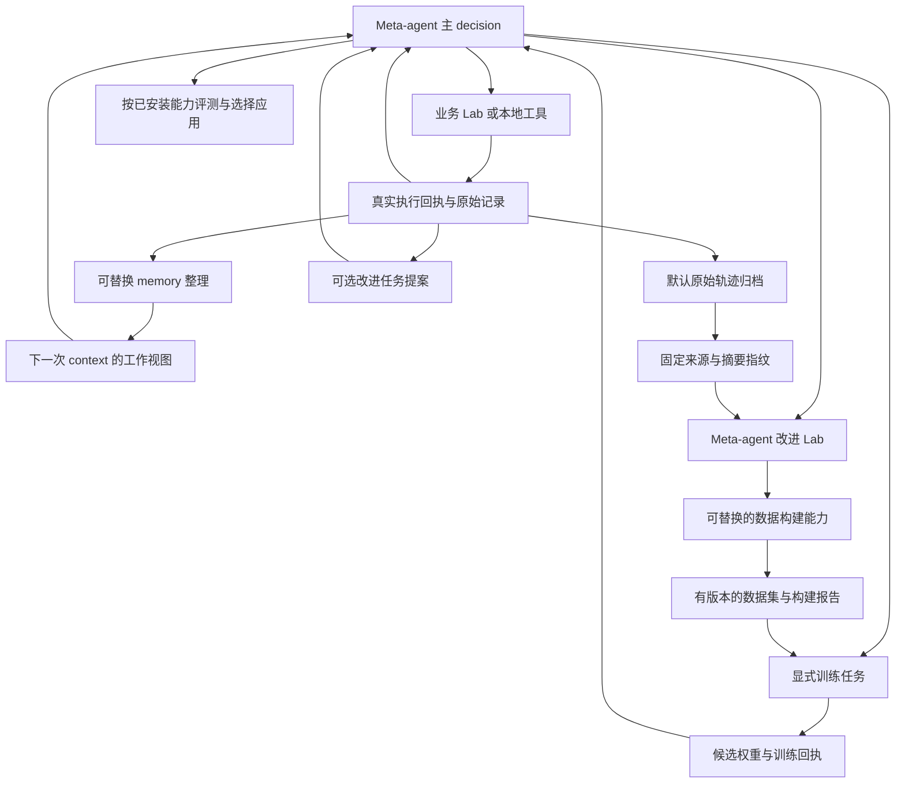

# Feedback 四条链路与改进 Lab

更新：2026-11-04。本文是当前职责与接线说明；此前验证记录保留为历史版本。
本次已落实 [Context / Memory 接入窗口](feedback-context-window-20261104.md)：
公开 context(query) -> str，默认 journal/LangMem 通过内部适配接入，当前文本替换 memory_context 区块。
归档、处理、建议、调度的当前协议及失败行为见 [模块窗口](feedback-module-windows-20261104.md)。
新插件只接公开事件和自己的产物，不必模拟内部 job、状态或计费结构。

## 四条分支

Lab 原样提供文本、JSON、日志或原生文件引用，内容不要求符合 RSISys 的业务 schema。
执行设施补充任务关联与生命周期状态；旧结构化 Feedback / OperationResult 接入继续有效。
执行端先将真实回执写入决策账本，
反馈侧保存原始捕获后返回；这个交付过程不调用 memory 或 proposer 模型，也不等待它们发布。

| 分支 | 输入 | 产物与职责 |
| --- | --- | --- |
| 快速结果返回 | Lab / 工具的真实结果 | 直接成为 decision 的 last_feedback / operation_results 与账本记录，不经过模型改写 |
| Memory | 公开反馈事件与 ContextQuery | 必须启用、实现可替换；输出 context 文本，Harness 注入当前 memory_context |
| 原始轨迹归档 | 已捕获的公开 decision、执行及证据 | 默认开启、实现可替换；保存原始片段，不筛选标签、不构建训练数据 |
| 改进提案 | 公开反馈事件 | 原生建议；内置适配器支持 harness_change / policy_training，主 decision 选择正式动作 |

同一份结果可以进入多条分支。短查询也保存原始轨迹，但不产生 memory 模型任务，
不因读取 feedback 再调用 feedback 模型。归档查询不自动挤入研究 working memory。
反馈分身使用捕获时 active meta-agent 的同一 ModelRef 和独立上下文。



## 统一装配与推进

研究启动仍统一使用 `ResearchAssembly / assemble_research`。默认是 JournalContextMemory、
JournalTrajectoryArchive，没有额外 memory/proposal 模型推理。

新 Lab 的反馈接入只需提交原始输出，任务关联与 status 来自其执行器：

```python
job_id = service.observe_output(
    native_output,
    task_id=host_task_id,
    status=host_terminal_status,
    lab_id=host_lab_id,
    references=native_artifact_references,
)
```

output 可以是文本或任意可持久化 JSON；也可仅提供原生格式 references。
Lab 不必实现 Directive / Feedback、统一 summary/error、三组 metrics、candidate 或 protocol。
现有 FeedbackEvidence 是可选的补充证据，不是 Lab 的必填输出；这个入口默认不读取默认 harness 的领域目录。
执行设施可调用 ExecutionReceipt.from_output 封装同样的输入。业务键即使叫 status、quality_metrics
或 adopted_candidate_ids，也只保留在原始 output 中，不自动变成宿主状态、已验证指标或采纳声明。

大输出和未知字段以有界 JSON 预览进入模型，包含精确原文读取路径和省略标记；
原始 JSON/文本保存在 journal，不受模型预览大小影响。文件内容仍由对应 Lab 的读取工具提供，
核心不自动下载引用，也不要求原生文件引用采用我们的 ArtifactRef 格式。
observe_output 是反馈观察入口；执行器仍负责原结果交付与任务推进，未新增跨 Lab 调度。
本轮接口减负自查与待 checkpoint 项见 [适配自查](feedback-adaptation-review-20261104.md)。

```python
from rsisys.research import ResearchAssembly, assemble_research
from rsisys.loops.decision_making.feedback import ModelImprovementProposer

service = assemble_research(
    loop,
    assembly=ResearchAssembly(
        improvement_proposals=ModelImprovementProposer(run_dir / 'improvement_proposals')),
    path=run_dir / 'feedback.json',
    backend=host_accounted_backend,
)
```

`service.observe(receipt)` 只持久捕获并排队，不推进模型。`service.archive(receipt)` 只归档，
不排队。`service.refresh()` 通知可选 observe hook、写入外部归档、采集后台结果、按 selector 和 host 容量启动任务并发布兼容 memory；
不等待未完成 worker。默认 Harness 在组装下一次 context 时 refresh，外部 Harness 自行提供 tick。
宿主原始捕获落盘失败仍阻止确认交付。外部可选归档写入失败单独记录，不重做实际任务或自动重放未知写入。
独立提案不依赖 memory 处理成功；显式设置 proposal_requires_memory 时才建立成功依赖。
关闭时未提交的整理任务会取消，原始捕获仍保留；不保证最后一份结果已完成模型整理。

模型 memory 可通过 `ResearchAssembly.langmem(memory_path=..., namespace=...)` 选择。
缺少 optional 依赖或 native tool calling 时明确失败，不静默回退。外部 organizer/processor
可以替换整个实现，不要求使用内置记忆格式。宿主仍管理准入和预算。

`harness_proposals=ModelHarnessProposer(...)` 保留为仅产生 harness_change 的兼容选项，
与 improvement_proposals 互斥。底层旧 enable_feedback_learning 的组合 prompt 保留兼容，
可读取旧 training_data 草稿；新 ResearchAssembly pipeline 不生成训练样本。
医疗默认配置继续使用统一入口，旧 --harness-proposals 仍仅启用 harness 提案。
本次没有修改、迁移或恢复任何旧冻结实验。

配置 schema_version=4 记录 text-v1/raw-event-v1/product-v1/selection-v1、独立产品依赖和故障策略，
保留 replace_current_view、archive_only、direct_before_processing、dataset_construction_owner=lab。
与旧 journal 配置不符时拒绝重开，不静默迁移；完整 Application durable 仍要求显式 recovery_contract。

## 原始轨迹到 Lab 的接口

```python
from rsisys.adapters.trajectory import FeedbackTrajectorySource
from rsisys.loops.contracts.improvement import DecisionDatasetBuildRequest

source = FeedbackTrajectorySource(service, archive_id='project/run')
ref = source.reference(job_id)
capture = source.read(ref)
request = DecisionDatasetBuildRequest((ref,), recipe_ref='reviewed-data-recipe:v1')
```

`TrajectoryRef` 包含 archive_id、trajectory_id、SHA256 digest。读回必须匹配同一 archive、
轨迹身份和摘要指纹。`/trajectory_snapshot` 是不可变原始捕获，不包括之后生成的 memory/proposal。
整理任务由 queued 变为 completed，不会改变这个快照及引用。

`/trajectory_segment` 和 extract_trajectory 保留为旧的组合查看接口，会附带后来完成的 feedback
交换信息，不应作为固定训练来源。view=trajectories 仍提供索引。
新外部 archive 只需 write(event)/read(reference)，host 校验读回后导出固定捕获。
旧兼容 archive 可以只提供索引；没有 snapshot 的旧实现会明确拒绝导出固定来源。
外部 Lab 也可实现自己的 TrajectorySource，不必依赖 FeedbackLearningService。

当前 observer 捕获的是公开 decision 记录与执行片段，**未捕获原始 meta-agent 的完整模型交换**。
快照明确标记 coverage、complete_conversation=false、training_ready=false。数据构建 recipe
必须检查覆盖范围与所需原始输入；不能由 action/理由伪造完整训练对，也不能把反馈摘要当正确标签。

## Lab 内的可替换能力

| 能力 | 请求 | 结果 |
| --- | --- | --- |
| build_decision_dataset | DecisionDatasetBuildRequest：固定轨迹引用 + recipe_ref | DecisionDatasetBuildResult：数据集引用、构建报告、原始来源/recipe、样本数与 simulated |
| train_decision_policy | 既有 DecisionTrainingRequest：明确 base、data_refs、recipe_ref、method | 既有 TrainingResult：base、新模型、candidate、真实后端提供的指标与 simulated |

数据构建 backend 实现 submit/poll/cancel，主机用稳定 idempotency key 绑定请求。
构建报告应记录筛选/排除、标签与格式规则及样本来源；协议校验来源和 recipe 身份，
不声称验证了自然语言标签质量。训练只接受明确且有版本/指纹的数据集，不将 archive 直接当数据集。
两个任务独立，构建完成不会自动训练；达到某个轨迹数量也不会自动提交训练。

```python
from rsisys.adapters.improvement import improvement_exploration_factory
from rsisys.config import build_demo

runner, _ = build_demo(
    config,
    exploration_factory=improvement_exploration_factory(
        dataset_builder=external_dataset_builder,
        decision_learner=external_decision_learner),
    research=ResearchAssembly(),
)
```

该 factory 只公布已安装的能力，由普通 explore decision 经现有 Runner/命令生命周期执行。
可以用 ExplorationLab 将该 endpoint 暴露为 LabSpec/LabTask/Lab；本次不新增跨 Lab scheduler。
backend 的具体构建算法、训练框架、资源准入和外部恢复由部署方提供，factory 不安装或自动训练。
持久化完整 JobBook/自定义 handler 状态仍需要显式恢复契约。

训练结果只能作用于 decision_maker，返回候选，不绑定或激活当前 meta-agent。
评测/部署/应用由正式 decision 选择已安装能力执行；本次没有新增通用 policy evaluator、
harness 构建器或版本激活器。Harness 提案仍通过现有代码能力构建和验证。

## 改进提案到主 decision

可选 ModelImprovementProposer 的 prompt 位于 feedback/prompts/improvement_proposals.txt。
它只允许 harness_change 或 policy_training，拒绝 training_example 和不匹配的目标。
这轮没有额外 routing 模型调用；同一执行证据由 memory 与可选 proposer 顺序处理。

主 decision 在 research_agenda.feedback_learning.improvement_proposals 中获得有界入口，
通过 feedback_learning_read(view='proposals') 查看完整内容，使用 feedback_proposal_ids 关联正式任务。
宿主在执行前检查 ID、目标和来源，记录 proposal digest；提案、选中、构建、训练、评测、采纳分别记录。
原 harness_proposals 导航保留兼容。提案永远不直接执行代码、生成训练标签或修改权重。

## 可运行验证与审查入口

- [接口与迁移审查](m01-feedback-lab-20261104.md)。
- [数据构建契约](../../src/rsisys/loops/contracts/improvement.py)。
- [Lab capability / factory](../../src/rsisys/adapters/improvement.py)。
- [归档来源适配器](../../src/rsisys/adapters/trajectory.py)。
- [提案 prompt](../../src/rsisys/loops/decision_making/feedback/prompts/improvement_proposals.txt)。
- `PYTHONPATH=src python examples/feedback_pipeline.py`：提案进入正式 decision。
- `PYTHONPATH=src python examples/decision_policy_lab.py`：原始归档到 Lab 构建数据，再显式训练候选。

两个示例都是 CPU fixture，不验证真实自主研究、训练、数据标签、memory 语义或质量提升。
当前 LangMem 的语义限制仍见[原验收记录](feedback-oss-adoption.md#尚未通过的语义验收)。
