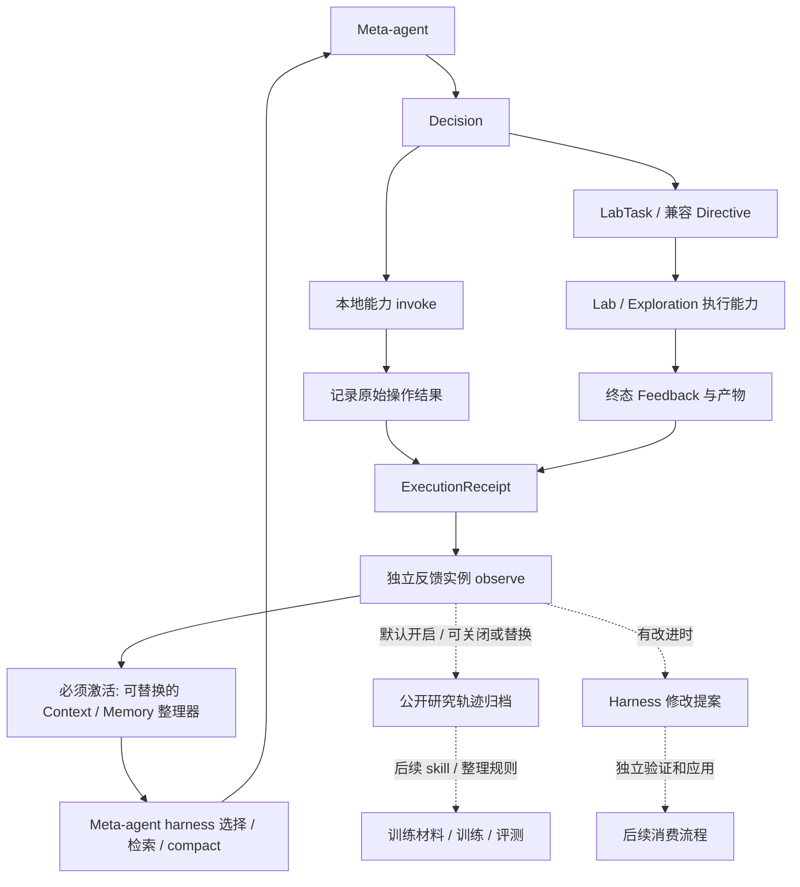

# M01：请逐项核对的逻辑

本文件供用户检查职责与数据流。代码验证通过不代表用户已经认可这些边界；下面的确认框保留为空。

本次已经补修共享指标校验、工具状态校验和可选运行控制发现，并新增基础 Lab 契约、exploration 适配器、本地操作的统一反馈观察入口。现有 Runner 仍使用兼容的 exploration 端口，尚未迁移成跨 Lab 调度器。

2026-11-04：用户认可职责边界并要求先统一装配。现已新增 `ResearchAssembly / assemble_research`，
Application/Demo 的 research 参数与医疗控制器共用此入口；医疗新任务始终激活 context/memory，
默认提取轨迹、按需启用 harness 提案。组件配置持久化并参与恢复身份检查；
LangMem 显式选择且配置不建库，缺依赖/能力时拒绝启动。细节见[当前装配 workflow](feedback-workflow.md)。
这不表示跨 Lab 调度、完整恢复、prompt 语义及模型记忆质量已经验收。
本次改动与最终 1,450 项回归结果见[统一装配验收记录](m01-assembly-20261104.md)。

## 1. 模型、任务与环境各指什么

- [ ] **Meta-agent 是模型/agent 实例，decision 是动作或任务。** 一条决策可以调用本地能力，也可以向 Lab 下发工作。模型版本相同不代表会话相同。
- [x] **反馈是同一个 meta-agent 的另一种职能和上下文。** 按用户明确要求共享当前权重；默认 adapter 每次捕获新反馈时读取 active ModelRef，随 meta-agent 版本更新。已捕获的任务保留当时版本，历史发起决策的版本另行记录。默认安装的 `model=` 只能匹配当前版本，不再把反馈固定在旧模型上。后端负责兑现实际权重身份。
- [ ] **Lab 是固定目标下的研究环境。** `LabSpec` 声明 Lab ID、固定目标、已安装能力及可选 data/model/harness 系统版本。任务可以有具体子目标。
- [ ] **Sandbox 是 Lab 内执行代码的设施。** 隔离强度由后端提供；Lab 的名字不额外赋予文件、网络或设备隔离。
- [ ] **任务身份不合并。** decision ID 关联决策，task ID 关联执行任务，JobRef 关联后端作业，candidate ID 关联变更，system version 关联组件组合；run/agent/Lab 身份按实际已知信息填写，未知不推测。

代码：[lab.py](../../src/rsisys/loops/contracts/lab.py)、[receipts.py](../../src/rsisys/loops/contracts/receipts.py)。

当前 `LabTask` 复用不可变 `Directive`，通过 `mode + payload + input_refs` 表达已安装任务，保留旧后端。代码任务需要安装相应 handler 或本地能力；增加接口本身不会安装通用编程 agent、训练算法或模型服务。

## 2. 实际执行链路



- [ ] **本地任务和 Lab 任务都能交给同一个反馈观察入口。** 来源类型仍保留；本地执行不会被标成新 Lab 评测。
- [ ] **回执记录事实，反馈分身解释事实。** 原始请求、结果、指标、错误、产物引用和来源先记录；解释失败不改写执行结果。
- [ ] **异步提交不算完成。** 收到 JobRef 时继续等待真实终态；本地 resume 或 Lab 终态回执才触发完成后的整理。
- [ ] **重送只补交付。** 同一任务和同一结果是幂等观察；同一身份换内容拒绝。反馈记账响应丢失时补交原回执，不重新执行代码/训练。

两条兼容入口：

```python
# 现有 exploration 交付路径：内部转入 observe。
service.receive_feedback(directive, feedback)

# 本地任务或显式 Lab 接入；无需默认 harness 的 policy/state/memory。
service.observe(execution_receipt, evidence=FeedbackEvidence(...))
```

默认 harness 自动观察已记录的非只读本地操作；只读查询默认只留原始记录，不额外调用反馈模型。这样读取 feedback 不会再生成关于该读取的 feedback。独立接入方可显式观察自己选定的任务；整理范围不是研究动作的准入规则。

代码：[service.py](../../src/rsisys/loops/decision_making/feedback/service.py)、[默认 adapter](../../src/rsisys/loops/decision_making/harness/learning_harness.py)、[engine.py](../../src/rsisys/loops/decision_making/harness/engine.py)。

## 3. 必须激活的能力与可选组件

| 产物 | 反馈分身负责 | 消费方负责 | 现在的状态 |
| --- | --- | --- | --- |
| context / memory（必须激活，实现可替换） | 组织执行事实、解释、来源和未确定问题 | harness 消费整理器提供的视图、检索原文、compact | 装配要求有效 `context_memory`；默认 journal 整理器可被外部实现完全替换 |
| meta-agent 轨迹归档（默认开启，可关闭或替换） | 关联公开决策记录、执行请求/结果、反馈请求/响应及身份 | 后续用 skill 或其他整理规则定义如何转为训练材料，再训练/评测 | 默认 `JournalTrajectoryArchive` 提供索引；`trajectory_archive=None` 关闭该产物；训练转换规则尚未定义 |
| harness 修改（可选） | 有依据时提出改动、目标、理由、证据和验证计划 | 独立实现、测试、评测及版本应用 | 提案可查询，自动应用未实现 |

- [x] **只有 context/memory 整理能力必须激活，具体实现可替换。** 外部实现通过独立快照接入，不必复用内置整理算法、存储组织或记忆正文格式。装配时不能传入 `None`；外部实现需提供记录、工作视图和可选发布接口。零提案不等于关闭整理能力。
- [x] **轨迹归档是默认开启的可选实现，可以关闭或替换。** harness 修改和训练材料处理也按需接入。关闭轨迹产物不关闭 context/memory；执行/交付恢复用的原始事实 journal 仍保留，不把它等同于可选研究轨迹数据集。
- [ ] **轨迹与训练材料分层。** 当前归档的是每份回执捕获的公开记录片段；不是完整 meta-agent 会话，原始决策模型 prompt/response 尚未由此 observer 捕获，缺失明确标记。后续 skill/规则负责聚合、选择、标注和数据格式，不能直接当可训练标签。
- [ ] **区分优化对象。** `subject=meta_agent` 和 `subject=lab` 分开；Lab 模型 SFT 不等于训练 meta-agent，Lab 推理 harness 改进也不等于 meta-agent harness 改进。
- [ ] **解释和提案默认未验证。** 回执成功、结构引用合法、训练完成、评测高分或建议采纳，均不能单独证明某条改进已经有效并应用。

当前装配接口（默认参数省略时使用内置实现）：

```python
assemble_research(
    loop, backend=backend, adapter=adapter,
    assembly=ResearchAssembly(
        context_memory=external_organizer,  # 必须激活，允许外部实现
        trajectory_archive=None,           # 可关闭，也可替换
    ),
)
```

`ContextMemoryOrganizer` 提供 `record / working_memory / memory`，`TrajectoryArchive` 提供
`records`；详见 [components.py](../../src/rsisys/loops/decision_making/feedback/components.py)。
核心传入独立快照并在发布前校验模型输出；组件不能通过修改输入覆盖原始执行事实。
更换实现时由装配方恢复其配置和外部状态，当前 journal 不负责序列化任意插件对象。

## 4. Memory 与 compact 的分工

- [ ] **反馈链路中启用的整理器组织研究知识，harness 组织模型请求。** 整理器可来自外部；默认实现处理 Attempt/解释/来源，harness 选择近期与活跃证据、按引用读回旧记录并 compact。
- [ ] **完整档案与当前上下文分开。** 原始执行记录和解释修订保留；当前请求使用有界视图，不要求把所有旧证据常驻。
- [ ] **反馈上下文接入可替换。** 通用 observer 只接收执行回执和证据；第三方 harness 提供当前 meta-agent 模型引用、发布与上下文接入，不必模拟默认 state。
- [ ] **不把结构完整当成语义正确。** 摘录、未读内容和证据不足明确标记；自然语言结论仍需单独核验。

这里没有新增 compact 算法。具体保护集合、上下文增长、读回与恢复一致性仍在 M06 审查。

## 5. 预算、终止与异常

- [ ] **Host 负责时间、调用和训练准入。** 模型负责选研究动作；缺少可选运行提示接口时，Host 仍能独立截止。
- [ ] **运行提示与研究重启是两个独立可选能力。** 替换 harness 只实现必需接口即可开始研究；需要重启时再检查 restart 能力。
- [ ] **指标必须是有限数值。** NaN/Infinity、bool、字符串或不合法指标名不能进入成功回执。后端可用 `Feedback.from_backend` 将异常测量转为可持久交付的失败，保留有效指标和来源；原始输出由执行提供方归档。
- [ ] **严格校验不会证明第三方实现遵守协议。** 自定义执行器要使用规范回执或适配入口；身份冲突、未知部署状态等仍严格报错。

## 6. 本次实现与后续模块的分界

| 已实现并有 CPU 测试的内容 | 仍需单独实现/验收的内容 |
| --- | --- |
| LabSpec / LabTask / Lab 协议 | 通用代码研究环境和跨 Lab 调度 |
| ExplorationLab：提交、推进、查询、取消、终态结果、确认及进程内幂等 | Lab 适配器任务索引的持久恢复和跨进程幂等 |
| ExecutionReceipt 与独立 observe 入口 | 任意第三方后端的真实部署、隔离、资源和取消保证 |
| 本地同步/异步完成自动整理，查询避免递归整理 | 反馈自由文字的语义正确性、完整轨迹数据集质量 |
| 必须配置但可替换的 context 整理器、默认可选轨迹索引、实际反馈请求/响应归档 | 任意外部整理服务的真实接入、原始 meta-agent 模型交换的通用捕获与完整会话聚合、训练材料 skill/规则 |
| 异常指标、状态类型和可选能力修复 | harness 提案的验证/应用状态机、researcher 权重训练链 |

因此本次补齐的是 **M01 的公共契约和接线**，没有把后续执行、上下文和训练模块提前认定为完成。

验证用例：[test_m01_contract_boundaries.py](../../tests/test_m01_contract_boundaries.py)。
用户这次两点调整的回归用例：[test_feedback_required_outputs.py](../../tests/test_feedback_required_outputs.py)。
组件启用/关闭/替换与发布边界：[test_feedback_components.py](../../tests/test_feedback_components.py)。

下一步逐句检查：[当前实现、完整 prompt、输入输出及已知插拔缺口](feedback-implementation.md)。
