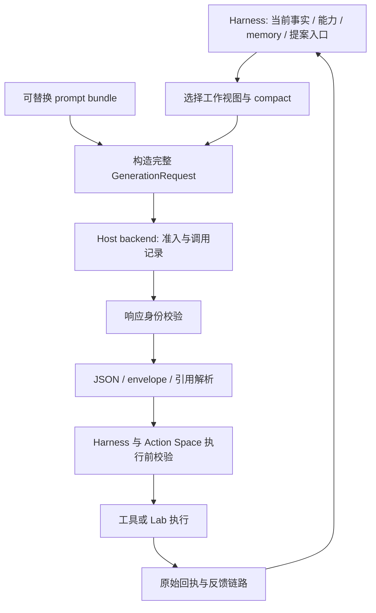

# M03：Meta-agent decision policy 审查

日期：2026-11-04。范围：当前本地工作树的默认 policy、memory-prefix 包装、医疗 policy 适配，
以及 DSH 对该协议的包装边界。这里的 CPU 验证不代表用户已认可 prompt 或研究质量。

## 本次调整

1. 主决策、review、角色、Attempt、停止/调度、摘要和基础纠错的文本拆成九个 prompt 组件，
   通过 `DecisionPrompts` 在装配时替换。默认渲染文本保留原样。
2. 医疗 policy 的规范及兼容动作 envelope 现在保留 `feedback_proposal_ids`，
   不再在进入正式 decision 前拒绝或丢失它。
3. 通用 review 的 invoke parser 接受 schema 已声明的 `feedback_proposal_ids`；
   仍由 harness 在执行前解析真实提案，未知引用不调用工具。
4. 医疗 researcher 模式不再提示可以 `wait`。它与 time 模式共用串行 executor；
   schema 和动作校验本来就禁止模型 wait。researcher 模式仍允许 finish，time 模式由 host 停止。

前两处 metadata 错误均有修改前最小复现：分别抛出 `Unexpected fields in action envelope`
和 `A review invocation requires kind, operation and arguments, with optional reason`。
新回归覆盖真实 parser、动作校验和 review 执行/账本边界。

## 实际链路



模型请求可使用裁剪后的工作视图；parser 的候选和 lineage 校验仍使用完整 `DecisionContext`，
不会把请求中省略的历史误当作不存在。工具参数及权限最终仍由 Action Space/executor 校验。
基础 policy 的纠错范围是解析，不会自动重试所有执行端的操作错误；医疗 policy 才显式把
其当前 action-space 校验纳入三次动作纠正。执行或交付的幂等恢复属于后续 M02/M13。

| 输入 | 提供方 | 应当如何使用 |
| --- | --- | --- |
| objective / project_context | Host 与领域装配 | 目标、范围和资源声明；不是运行时能力授权 |
| operations / directives / modes | 当前授权能力与 catalog | 本次可提交动作及参数 schema；不可从名称推测能力 |
| 原始回执、候选、评测、采纳、live 执行 | Harness 的结构化账本/状态 | 事实来源；candidate、protocol、producer 分别识别 |
| memory / research_state / context_summary | Feedback provider 与 harness 视图 | 派生解释和导航；有疑问时按引用读原文 |
| feedback 提案入口 | Feedback service | 尚未验证的可选改动；引用提案不等于已构建或已应用 |

## 可以逐句检查的 prompt

渲染器：[prompts.py](../../src/rsisys/loops/decision_making/harness/policy/prompts.py)。
原始模板采用 `$name` 占位符，JSON 中的花括号保持字面量；未声明的模板名或占位符在装配时拒绝。

| 组件 | 完整文本 | 需要核对的意思 |
| --- | --- | --- |
| research | [research.txt](../../src/rsisys/loops/decision_making/harness/policy/prompts/research.txt) | meta-agent / Lab、两个 harness、研究自由度、事实与解释边界 |
| decision | [decision.txt](../../src/rsisys/loops/decision_making/harness/policy/prompts/decision.txt) | invoke/explore、参数、输入产物、提案引用、reason、档案导航 |
| review | [review.txt](../../src/rsisys/loops/decision_making/harness/policy/prompts/review.txt) | 只能调用当前许可的操作，或给出 continue/cancel；不能下发新 directive |
| attempt_optional | [attempt_optional.txt](../../src/rsisys/loops/decision_making/harness/policy/prompts/attempt_optional.txt) | 默认不要求模型维护研究分组；反馈的解释 ID 不当作执行 membership |
| attempt_required | [attempt_required.txt](../../src/rsisys/loops/decision_making/harness/policy/prompts/attempt_required.txt) | 仅显式启用旧 admission contract 时要求 membership |
| control / scheduling | [control.txt](../../src/rsisys/loops/decision_making/harness/policy/prompts/control.txt)、[scheduling.txt](../../src/rsisys/loops/decision_making/harness/policy/prompts/scheduling.txt) | 通用库的 finish/wait；领域模式可通过已有 hook 替换 |
| summary | [summary.txt](../../src/rsisys/loops/decision_making/harness/policy/prompts/summary.txt) | 仅归纳本次归档子集，不能把缺失写成未发生；当前结构状态优先 |
| validation_correction | [validation_correction.txt](../../src/rsisys/loops/decision_making/harness/policy/prompts/validation_correction.txt) | 错误作为 user 数据反馈，保持原动作协议 |

```python
from rsisys.loops.decision_making.harness.policy import DecisionPrompts, ModelDecisionPolicy

prompts = DecisionPrompts({'research': replacement_research_instructions})
policy = ModelDecisionPolicy(backend, active_model, prompts=prompts)
```

覆盖字典在构造时捕获，之后修改外部字典不影响已装配 bundle。`manifest()` 提供各组件 SHA256；
最终有效指令仍以完整 request 为准。替换 prompt 不会更改 schema、身份验证、能力、准入或执行规则。
MemoryPrefix policy 继承这个入口；医疗 `ResearchPolicy` 也接受 `prompts=`，同时保留自己的运行模式 hook。
默认本地 snapshot 不序列化任意自定义 prompt：自定义 bundle 需要显式恢复适配，避免恢复时退回默认文本。

医疗 envelope guidance、host-only 控制、response recovery、objective/project_context 仍由领域层装配，
不是以上九个通用文本组件。DSH 还叠加原生 persona 和增量会话包装；没有把它们说成已全部迁移。
这部分完整渲染示例见下方；通用领域 prompt 插件化继续在 M14 审查。

## 输出与模式

普通 decision 的两个执行命名空间：

```json
{"kind":"invoke","operation":"installed_operation","arguments":{},"feedback_proposal_ids":["recorded-proposal-id"],"reason":"公开的简要依据"}
```

```json
{"kind":"explore","mode":"installed_mode","strategy":"具体任务","arguments":{},"input_ids":[],"feedback_proposal_ids":["recorded-proposal-id"]}
```

`reason/strategy` 是公开说明；参数只进入 `arguments`，训练等输入产物走 `input_ids`。
提案引用、decision 依赖、来源和可选执行 Attempt membership 均为 envelope 元数据，不能混入任务 payload。
decision ID 和确认采纳只能由系统/执行回执提供。提案解析成功或普通任务完成不会自动把 `applied` 改为 true。

| 模式 | 普通 decision | 运行中 review |
| --- | --- | --- |
| 通用 ModelDecisionPolicy | 当前 invoke/explore + wait/finish | 当前获准 invoke + review_actions |
| 医疗 time | 当前 invoke/explore；Host 负责停止 | Host 静态 continue，不调用 review 模型 |
| 医疗 researcher | 当前 invoke/explore + finish；无模型 wait | 同上 |
| DSH | 领域 policy 的协议 + 原生会话包装 | 领域 policy 的 review；原生会话管理等待 |

schema 是生成格式约束，不能替代执行前校验。关闭 structured output 仍严格拒绝重复 JSON 键、
非法 lineage、错误身份和其他 parser 错误。没有给模型增加必须完成多少实验、必须成功或固定轮换的方法。

## 重试逐层核对

| 层 | 尝试上限与触发 | 不应重做的事情 |
| --- | --- | --- |
| 通用 decide | 默认 1 次，可配置 1–8；仅解析错误进入纠正 | 传输/模型身份错误不在此循环；不执行工具 |
| 医疗动作纠正 | 总计 3 次；解析和当前 Action Space 校验 | 校验通过前没有执行；不会恢复被撤销的能力 |
| 医疗 response recovery | 每次生成最多额外 2 次，限可恢复格式/截断 | 身份不匹配直接失败；每次调用重入 Host 准入 |
| Compact / feedback | 独立调用；使用同一宿主计费链 | 不把这些调用藏在最终 decision 的单次计数中 |

因此医疗一次动作决策在动作纠错与格式恢复同时触发时，最多会有 `3 × 3 = 9` 次响应生成；
按需 compact/feedback 另计。已有总调用与时间准入仍生效，并非无限重试。
本次没有修改重试上限、训练限额或历史运行配置。

## 用户逻辑核对

- [ ] meta-agent 自主选动作；反馈 memory 与提案供其判断，不替它规定实验顺序。
- [ ] `invoke` 和 `explore` 由真实安装能力决定；两者都可形成研究工作，不用 Attempt 数量代表实验数。
- [ ] 同一模型权重可承担不同上下文的反馈职能；当前 request 的角色名不代表一套新权重。
- [ ] memory/摘要是解释；工具回执、指标与采纳是执行事实。
- [ ] 提案只供选择，正式 decision 负责构建验证；构建完成与版本激活分开。
- [ ] prompt 文本可替换，权限、执行准入与恢复约束仍由实现保证。

## 验证材料与仍未验证的部分

定向验证：126 项全部通过。新回归：[test_m03_decision_policy.py](../../tests/test_m03_decision_policy.py)。
全量运行 1,352 项，1,340 项通过、12 项跳过，耗时 84.126 秒。
日志及当前源码指纹见 [m03-validation.json](repros/m03-validation.json)。

运行 `PYTHONPATH=src /Users/xcx/.local/bin/python3.12 docs/review/repros/m03.py` 可重新导出
八份实际 builder/decide/review 生成的合成请求，包含完整 system、user、schema、ModelRef 和参数：

- [通用 decision](repros/m03/decision.json)、[通用 review](repros/m03/review.json)。
- [显式 required Attempt 的 decision](repros/m03/decision-required-attempt.json)、[review](repros/m03/review-required-attempt.json)。
- [摘要](repros/m03/summary.json)、[基础纠错](repros/m03/validation-correction.json)。
- [医疗 time](repros/m03/medical-time.json)、[医疗 researcher](repros/m03/medical-researcher.json)。
- [请求及源码指纹](repros/m03/manifest.json)。

这些示例仅做 fixture 生成及校验，没有真实模型调用、代码任务执行、训练或服务修改。
此前 62,815-token 常驻状态故障、LangMem 自然语言整理质量、长时研究有效性仍需在 M06/M08/M09
按真实证据独立验收；本次 prompt 组件化和 schema 接线通过不能证明那些问题已经解决。
