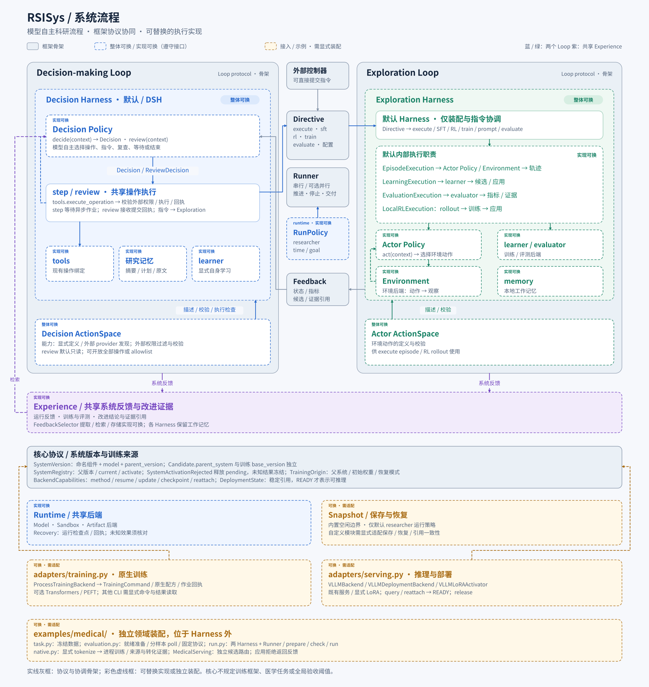

# RSISys 模块审查地图

当前默认（2026-11-06）：一个 meta-agent + Lab + memory 模块；旧整理侧的语义职责合入普通 decision。独立抽取 prompt 仅在显式兼容工作流生效。以下历史审查编号与材料保留当时范围。

更新日期：2026-11-05。术语与职责以[统一术语与架构](../architecture.md)为准；下方历史审查材料保留其版本范围。
本文件是待审查清单，条目列出审查问题和验收材料，不表示已经发现或排除了相应缺陷。

配套：[逐项 prompt 审查地图](prompts.md)、[反馈架构与当前实现边界](../../src/rsisys/loops/decision_making/feedback/README.md)。

2026-11-04 全模块实现审查、缺陷修复和验证材料见 [本轮审查报告](audit-20261104/README.md)。
下方复选框仍留给用户逐项验收；实现回归通过不替代 prompt/架构语义验收。
早期反馈分工与 Lab 数据/训练接口见 [调整记录](m01-feedback-lab-20261104.md)；当前两条正文路径及独立可选能力见[统一架构](../architecture.md)。
CP1 / CP2 确认后的 [接口减负自查](feedback-adaptation-review-20261104.md) 记录原生输出入口及剩余耦合。
进一步按基本职能接入窗口复审的 [Feedback 边界报告](feedback-module-contract-review-20261104.md) 包含具体问题与实现调整建议，尚待逐项 checkpoint。
已落实用户确认的 [Context / Memory 文本窗口](feedback-context-window-20261104.md)，其余可选模块继续逐项审查。
本次 [开放式 Lab 动作出口](open-lab-execution-20261104.md) 将默认决策接到 Lab 声明的工具，
允许模型修改 SFT/RL/评测程序；CPU 链路已验证，生产训练准入与隔离需由 executor 接入。
后续 [模块窗口与运行边界](feedback-module-windows-20261104.md) 落实了原始归档、原生产物/建议、
可选调度和故障策略；算法与 prompt 继续留给逐项语义审查。
最新 [统一模块装配与状态接入](unified-module-assembly-20261104.md) 将 Application、demo、医疗和 Qwen
接到同一装配入口，并提供共享的组件恢复/快照状态端口；第三方模块仍负责自身完整状态与可迁移性。

## 先对齐审查对象

- **meta-agent（decision侧）** 选择行动；**decision** 是具体动作或任务，不是另一个 agent。
- **Meta-agent harness** 组织模型输入、工具调用、状态、检索和 compact，可整体替换。
- **Lab** 是固定目标下的 data/model/harness 研究环境。基础 Lab 契约与 exploration 适配器已补齐；默认跨 Lab 调度尚未迁移，真实能力仍由已安装的后端、工具和领域装配提供。
- **Sandbox** 是执行代码的设施。具体后端的隔离能力应单独核验，不能由名称推定。
- **meta-agent（整理侧）** 使用捕获的 active meta-agent 权重和独立上下文；解释反馈、组织 context/memory，按需提出 harness / policy 建议。确定性的接入和路由不要求额外模型调用。
- **即时 context / memory** 是正文的两条主消费路径；标准医疗 Open Lab 已按用途二选一，通用兼容装配须显式配置。memory 保持可用不等于每条结果都写入。
- **原始归档 / 提案 / 调度** 是独立可选能力；训练数据构建和训练属于 Lab。Host 管理权限、额度、截止时间与生命周期；看板面向人。
- **执行事实、解释、提案、验证、应用** 分别审查。结构化引用有效不等于自然语言结论正确。



两侧的语义职责与 `service.observe` 的持久捕获、入队和后续 tick 分开：接收结果本身
不触发模型推理。标准 Open Lab 用 `ContextOrMemoryAdmission` 决定是否整理；只读查询
和即时结果不会因读取自身再次触发 LangMem。旧装配的直接交付行为仍按各自配置解释。

## 总目录与建议顺序

| ID | 模块 | 本轮审查的核心问题 | 实现状态 |
| --- | --- | --- | --- |
| M01 | 共享契约与系统装配 | 身份、消息、职责和可替换边界是否清晰 | 统一入口、固定轨迹来源、Lab 数据构建契约已接入；跨 Lab 调度待迁移 |
| M02 | Host / Runner / RunPolicy | 谁推进、等待、停止、计费、交付与清理 | 已有；不同模式分别审 |
| M03 | meta-agent（decision侧） | 模型实际收到什么指令，能输出什么动作 | 两层替换接口已修复并离线验收；九个通用 prompt 可替换，待用户逐句核对 |
| M04 | Action Space / 工具 / Sandbox | 声明、授权、校验、执行是否一致 | 开放 Lab 已接线；进程修复、可修正错误回传与生产事件去重已实现 |
| M05 | 决策账本与版本归因 | decision、候选、评测和采纳能否准确追溯 | 已有 |
| M06 | 上下文组装、归档、证据投影与 compact | 哪些状态常驻，何时增长，能否精确读回 | 已有；含本地新重构 |
| M07 | 整理侧的反馈捕获与后台任务 | 正文路由、状态交付、归档、队列、调用及恢复是否可靠 | 交付与推理解耦；只读查询仅归档 |
| M08 | Feedback 解释、Attempt 与指标归属 | 解释是否正确关联事实，是否混淆旧分数 | 已有结构校验；自由文字语义待独立核验 |
| M09 | meta-agent（整理侧）的路由与产物 | 即时 context / memory 如何选择，归档与提案如何独立启用 | 标准 Open Lab 路由已接线；数据构建和训练在 Lab |
| M10 | Lab 当前执行层 / Exploration | 指令如何成为数据构建、训练、评测及回执 | 进程与结果交付已有 CPU 回归；重复读取归档、显式重整，真实训练部署另验收 |
| M11 | 训练、初始化、推理与部署适配 | 真实权重、父版本、initializer 和路由是否一致 | 框架接口及部分真实后端已有 |
| M12 | 评测、比较与候选采纳 | 指标有效性、协议、公平比较和应用是否独立 | 已有通用与医疗实现 |
| M13 | 原始存储、持久恢复与快照 | 事实是否完整，恢复是否重复执行或改变顺序 | 统一状态端口已接入；组件自行实现完整状态适配 |
| M14 | 医疗/Qwen 领域装配与实验控制 | 实际配置是否兑现核心边界和领域限制 | 统一装配入口；领域协议和监控仍由示例保留 |
| M15 | 监控 API、前端与运行可观测性 | 展示是否准确，是否把投影当完整历史 | 独立只读包已有 |

建议先按 **M01 → M03 → M07 → M08 → M09 → M06** 对齐研究与反馈语义，再审
**M04 → M05 → M10 → M11 → M12** 的执行链，最后串联 **M02 / M13 / M14 / M15**。
模块内部仍按下面的子项逐个验收，避免只审目录结构。

## M01：共享契约与系统装配

审查记录：[M01 报告](m01.md)（2026-11-03）。三个 P2 已补修，并补入基础 Lab 契约和本地反馈观察。
请按 [M01 逻辑清单](m01-logic.md) 核对职责与数据流；下列复选框保留为用户验收项。

入口：[contracts](../../src/rsisys/loops/contracts/README.md)、[assembly.py](../../src/rsisys/assembly.py)、
[application.py](../../src/rsisys/application.py)、[DecisionMakingLoop](../../src/rsisys/loops/decision_making/loop.py)、
[ExplorationLoop](../../src/rsisys/loops/exploration/loop.py)。

- [ ] **M01.1 术语与身份**：`ModelRef`、`Decision`、`Directive`、`Feedback`、`JobRef`、`Candidate`、`SystemVersion` 的角色、主键与引用关系逐个列清。
- [ ] **M01.2 两类动作**：本地 `invoke` 与系统 `explore`，以及 Actor 环境动作，是否在 schema、parser、executor 中始终分开。
- [ ] **M01.3 可替换边界**：替换 decision harness / feedback adapter / learner / evaluator 是否需要访问默认私有 state；外部实现的恢复责任是否明确。
- [ ] **M01.4 Lab 边界**：基础任务、目标、生命周期及回执契约是否合理；进程内适配与默认调度、持久恢复、通用代码能力之间的边界是否清楚。
- [ ] **M01.5 改进 Lab 协议**：固定 TrajectoryRef、数据构建请求/报告、显式训练及候选结果是否保持来源身份；构建数据不自动训练，训练不自动激活。
- [ ] **M01.6 薄反馈入口**：Lab 原始文本/JSON/文件引用保持自由格式，执行器补 task/status 等关联；原始业务字段不升级为宿主状态或已验证指标。

核对测试：`test_schema_contracts.py`、`test_backend_contracts.py`、`test_assembly.py`、`test_harness_composition.py`、`test_feedback_decoupling.py`。
本模块没有独立模型 prompt；动作契约会进入 P02 / P04 / P15。

## M02：Host、Runner 与停止控制

入口：[runner.py](../../src/rsisys/runtime/runner.py)、[run_policy.py](../../src/rsisys/runtime/run_policy.py)、
[ExperimentRunPolicy / DecisionBackend](../../examples/medical/experiment.py)。

- [ ] **M02.1 生命周期**：accept → advance/poll → terminal feedback → receive → acknowledge 的所有权、幂等性和崩溃边界。
- [ ] **M02.2 连续研究**：定时模式、researcher 模式、旧 research cycle 的具体差异；模型等待、宿主等待与终止不能混为一谈。
- [ ] **M02.3 执行限额**：模型不用管理预算时，训练/calls/输出/恢复调用仍如何准入和累计；到限额的实际行为。
- [ ] **M02.4 取消与清理**：取消请求、取消确认、UNKNOWN、迟到成功、超时、owned 进程退出如何处理。

核对测试：`test_run_policy.py`、`test_research_cycles.py`、`test_coordination.py`、`test_parallel_experiments.py`、`test_operation_retry.py`。
Prompt：P07 / P09 / P10；普通计时和调度应由执行逻辑负责。

## M03：meta-agent（decision侧）

两层替换边界的后续审查见 [Decision Harness / Policy 接口报告](decision-module-contract-review-20261104.md)：
记录权限、用量、压缩和反馈装配的四类可复现问题及输入契约设计缺口。
对应实现、公开窗口与回归结果见 [Decision 接口修复](decision-module-windows-20261104.md)。

审查记录：[M03 报告、逻辑核对与完整请求](m03.md)（2026-11-04）。通用 prompt 组件化，
补齐医疗与 review 的提案引用，统一医疗串行等待说明。复选框仍保留为用户验收项。

入口：[ModelDecisionPolicy](../../src/rsisys/loops/decision_making/harness/policy/__init__.py)、
[MemoryPrefixDecisionPolicy](../../src/rsisys/loops/decision_making/harness/learning_policy.py)、
[医疗 ResearchPolicy](../../examples/medical/experiment.py)、[DSH 接入](../../src/rsisys/loops/decision_making/harness/dsh.py)。

- [ ] **M03.1 主指令**：角色、优化对象、研究自由度、证据等级、能力限制是否明确；多处拼接的指令有无冲突。
- [ ] **M03.2 动作输出**：JSON envelope、reason、strategy、arguments、input_ids 与 lineage 字段是否各司其职。
- [ ] **M03.3 校验和重试**：格式恢复、动作校验、身份/传输失败的边界，是否在执行前完成，是否形成乘法重试。
- [ ] **M03.4 模式与后端差异**：基础 policy 可有 wait/finish；医疗 time 模式排除二者；DSH 原生会话还会加自己的 persona/增量包装。分别审实际请求。

核对测试：`test_structured_decisions.py`、`test_decision_validation_retry.py`、`test_medical_response_recovery.py`、`test_learning_policy.py`、`test_dsh_harness.py`。
Prompt：P01–P10、P16–P18、P23。

## M04：Action Space、工具与 Sandbox

本项新增 [开放 Lab 接线与验证](open-lab-execution-20261104.md)，审查时先区分
`lab_factory` 的开放程序路径和未迁移 launcher 的旧语义指令路径。
[执行请求与生命周期审查](execution-contract-review-20261104.md) 的 4 项反例已有
[对应修复与回归](execution-contract-fixes-20261104.md)，覆盖上层关闭重试、异常下的取消、
监督设施故障来源及路径错误分类；原审查保留为修复前证据。

入口：[decision action_space](../../src/rsisys/loops/decision_making/action_space/README.md)、
[tools](../../src/rsisys/loops/decision_making/harness/tools/README.md)、
[workspace.py](../../src/rsisys/loops/decision_making/harness/tools/workspace.py)、
[local_process.py](../../src/rsisys/runtime/local_process.py)、[sandbox.py](../../src/rsisys/runtime/sandbox.py)。

- [ ] **M04.1 能力目录**：工具 description/schema 与真实 binding、领域限制及当前资源准入保持一致。
- [ ] **M04.2 代码任务**：读/写/执行代码、产物保存、stdout/stderr、超时、失败和异步续接分别能做什么；本地进程后端的真实隔离边界。
- [ ] **M04.3 授权校验**：工具、directive、review 的读取/写入权限是否在执行前再次核验；不可由模型文本授予权限。
- [ ] **M04.4 回执契约**：`OperationResult.data`、metrics、error、artifact refs 是否可稳定识别；失败是否会伪装成功。

核对测试：`test_open_lab_execution.py`、`test_action_permissions.py`、`test_capability_composition.py`、`test_workspace_tools.py`、`test_operation_execution.py`、`test_evidence_path_recovery.py`。
Prompt：P15；工具输出还会成为 P02 / P11 / P14 的数据输入。

## M05：完整决策账本、依赖和版本归因

入口：[state.py](../../src/rsisys/loops/decision_making/harness/state.py)、
[engine.py](../../src/rsisys/loops/decision_making/harness/engine.py)、
[decision.py](../../src/rsisys/loops/decision_making/harness/decision.py)、
[attempts.py](../../src/rsisys/loops/decision_making/harness/attempts.py)、
[systems.py](../../src/rsisys/runtime/systems.py)。

- [ ] **M05.1 决策关系**：depends_on、source、produced、adopted 是否来自真实校验/回执；待完成依赖如何阻止执行。
- [ ] **M05.2 候选与评测索引**：精确 candidate/protocol/model 归属，多协议和旧评测的覆盖/保留语义。
- [ ] **M05.3 版本与来源**：发出 decision 的模型、执行模型、反馈解释模型、实验父系统与训练 initializer 能否分别追踪。
- [ ] **M05.4 全量与视图**：parser/执行校验是否始终使用全量账本；工作视图和前端裁剪不能改变执行事实。

核对测试：`test_decision_lineage.py`、`test_feedback_candidate_evidence.py`、`test_system_versions.py`、`test_training_origin_flow.py`、`test_ledger_context.py`。
Prompt：P03 / P13 / P15；本模块本身主要提供结构化状态。

## M06：上下文、证据保护、归档与 compact

入口：[engine._context](../../src/rsisys/loops/decision_making/harness/engine.py)、
[research_state.py](../../src/rsisys/loops/decision_making/harness/research_state.py)、
[ledger_context.py](../../src/rsisys/loops/decision_making/harness/ledger_context.py)、
[context.py](../../src/rsisys/loops/decision_making/harness/context.py)、
[ResearchTools](../../src/rsisys/loops/decision_making/harness/tools/research.py)。

- [ ] **M06.1 字段盘点**：逐一审 `DecisionContext` 的输入来源、数量/字节上限、是否累积、是否可归档、恢复后是否一致；不能只看 history。
- [ ] **M06.2 保护理由**：最新回执、指标/失败、live 引用、活跃依赖闭包、最新采纳的保护依据和释放条件；旧失败是否被永久钉住。
- [ ] **M06.3 投影与原文**：事实卡、正文首尾预览、coverage、指纹与 JSON Pointer 读回；有权限但实际无法读回的情况。
- [ ] **M06.4 Compact**：完整请求计量、80k 触发、24/36/48/60k 自适应、summary/source-manifest 占用、失败原子性与必要事实真正过大的行为。
- [ ] **M06.5 摘要与恢复**：旧摘要与 current_state 冲突、缺失不等于未发生、重复结果折叠、restore 后的选择/计量/指纹。
- [ ] **M06.6 增长边界**：常驻 tokens、原始存储大小、遍历/序列化耗时分别量化；常驻视图有界不证明存储和计算有界。

核对测试：`test_context_compaction.py`、`test_adaptive_context_budget.py`、`test_resident_evidence_window.py`、`test_latest_evidence_view.py`、`test_repeated_receipt_compaction.py`、`test_context_ledger_window.py`、`test_ledger_context.py`。
Prompt：P05 / P14 / P15 / P17。摘要语义需要按真实请求/响应人工核对，不能用字节检查替代。

## M07：Feedback 捕获、队列和调用生命周期

入口：[service.py](../../src/rsisys/loops/decision_making/feedback/service.py)、
[learning.py](../../src/rsisys/loops/decision_making/feedback/learning.py)、
[DefaultFeedbackAdapter](../../src/rsisys/loops/decision_making/harness/learning_harness.py)。

- [ ] **M07.1 触发与覆盖**：哪些回执触发 capture；本地操作、失败、取消、代码修复任务是否得到足够反馈；重复交付不重复整理。
- [ ] **M07.2 捕获快照**：raw_input 与模型实际看到的 input 分开；history/evaluations/grouping 的时点、裁剪与 coverage 可追踪。
- [ ] **M07.3 队列与重载**：capture_index、旧 journal fallback、单写者和 worker 分工，重载后顺序及 interrupted 语义。
- [ ] **M07.4 调用与发布**：准入、计费、排队、失败原响应、关闭等待、publication 幂等，以及自定义/DSH adapter 不依赖默认 state。
- [ ] **M07.5 快速交付**：observe 只捕获并排队，慢 memory 不阻塞结果；查询 archive-only 不触发推理，不污染工作视图；最后一份整理未完成的关闭语义。

核对测试：`test_feedback_learning_integration.py`、`test_feedback_learning_evidence.py`、`test_audit_regressions.py`、`test_feedback_decoupling.py`、`test_feedback_projection.py`。
Prompt：P11 / P12 / P13 / P18。

## M08：Feedback 解释、Attempt 和指标语义

入口：[feedback/attempts.py](../../src/rsisys/loops/decision_making/feedback/attempts.py)、
[feedback/evidence.py](../../src/rsisys/loops/decision_making/feedback/evidence.py)、
[validate_proposals / validate_publication](../../src/rsisys/loops/decision_making/feedback/learning.py)。

- [ ] **M08.1 Attempt 两种含义**：执行时显式 membership 与事后解释分组分开；title/相邻时间不能自动证明同一研究想法。
- [ ] **M08.2 修订与证据**：member decision、source refs、base_revision、不可变修订和 stale update 的处理。
- [ ] **M08.3 Evaluation claims**：完整候选 ID、协议、评测来源、指标值与 simulated 是否精确；未评测候选不能继承父候选分数。
- [ ] **M08.4 自由文字**：摘要是否与 claims 一致，是否把训练完成当质量改善、把来源关联当采纳、把局部未观察当全局未发生。

核对测试：`test_attempt_learning.py`、`test_feedback_candidate_evidence.py`、`test_feedback_learning_evidence.py`、`test_research_working_state.py`。
Prompt：P11 / P12 / P13。最后一项须保留人工判例，当前结构校验不覆盖全部自然语言含义。

## M09：整理侧组件、可选建议与后续消费

最新装配与提案引用链路见 [feedback-workflow.md](feedback-workflow.md)。整理侧的接入设施提供原始归档，
Lab 接固定来源构建数据并显式训练；通用 harness 激活/回滚及实际数据 recipe 仍未提供。

入口：[knowledge.py](../../src/rsisys/loops/decision_making/feedback/knowledge.py)、
[service.py](../../src/rsisys/loops/decision_making/feedback/service.py)、
[learning_harness.py](../../src/rsisys/loops/decision_making/harness/learning_harness.py)、
[decision learner](../../src/rsisys/loops/decision_making/harness/learner/README.md)。

| 路线 | 当前产物/接线 | 需单独审查或补齐的消费链 |
| --- | --- | --- |
| 即时 context | Lab / 工具真实结果记账后按路由进入 decision 的工作视图，不经模型改写；memory 路径即时返回状态与整理确认 | 持久捕获失败时重试交付，不重复执行 |
| context / memory（必须激活，实现可替换） | 可注入 `ContextMemoryOrganizer`；默认提供事实 context、可选解释及分页入口；harness 消费视图 | 提炼、更新、冲突/失效、检索；如何避免兼容 episodic memory 重复常驻 |
| 原始轨迹归档（默认开启，可关闭或替换） | 索引及 `/trajectory_snapshot` 不可变捕获，固定 archive/id/digest；旧 segment 仅组合查看 | 补齐原始决策模型交换；Lab recipe 负责聚合、过滤、标注和质量门槛 |
| 改进任务提案（可选） | harness_change / policy_training，带 subject、来源和验证计划，由 meta-agent（decision侧）引用 | 构建/训练分别是正式 Lab 任务；验证、采纳、激活各自验收 |

- [ ] **M09.1 组件与提案**：context/memory 必须激活但实现可替换，轨迹默认开启并可关闭/替换；二者不依赖 proposals；`kind → target`、`subject=meta_agent/lab/unspecified`、旧 `training_data/system_change` 的兼容不混淆归档和训练。
- [ ] **M09.2 知识生命周期**：最新 Attempt 优先、活跃项优先、未归组观察、字节上限、来源分页、兼容副本去重及旧 memory 保留。
- [ ] **M09.3 Harness 路线**：`proposed/validated/applied` 谁推进；当前返回 `proposed/applied=false` 能否避免被展示为已应用改进。
- [ ] **M09.4 轨迹到训练**：原始归档不夹带模型生成标签；固定来源、缺失范围、Lab recipe、数据产物和质量门槛；fixture 不等于真实数据训练流程通过。

核对测试：`test_feedback_knowledge.py`、`test_feedback_required_outputs.py`、`test_learning_policy.py`、`test_feedback_decoupling.py`、`test_researcher_integration.py`。
Prompt：P11–P14；harness 应用和 researcher 轨迹训练目前没有可据实列出的完整生产 prompt 流程。

## M10：当前 Lab 执行层与 Exploration

本轮 [执行与交付审查](lab-execution-review-20261104.md) 已修复三处进程层缺陷；
用户确认的 [错误继续与重复结果整理语义](lab-delivery-semantics-20261104.md) 已落地，原审查作为历史记录保留。
[生命周期审查](execution-contract-review-20261104.md) 的 4 项反例已在
[生命周期修复](execution-contract-fixes-20261104.md) 逐项验证；真实训练部署及部署隔离仍需单独验收。

开放程序实现见 [LocalProcessLab](../../src/rsisys/adapters/local_lab.py)，不经过下列旧研究命令目录。
既有领域 launcher 仍需单独迁移，不能将 CPU fixture 视作真实训练链路验收。

入口：[exploration harness](../../src/rsisys/loops/exploration/harness/README.md)、
[commands.py](../../src/rsisys/loops/exploration/harness/commands.py)、
[environment](../../src/rsisys/loops/exploration/harness/environment/README.md)、
[ActorPolicy](../../src/rsisys/loops/exploration/harness/policy/__init__.py)、
[rl.py](../../src/rsisys/loops/exploration/harness/rl.py)、
[改进 Lab 能力](../../src/rsisys/adapters/improvement.py)、
[数据构建契约](../../src/rsisys/loops/contracts/improvement.py)。

- [ ] **M10.1 指令分派**：execute/train/sft/rl/evaluate/configure_prompt/apply_candidate 的具体 handler、状态和终态回执。
- [ ] **M10.2 Actor 与 Lab harness**：哪些路径调用 Actor，哪些直接调用 learner/evaluator；Lab prompt 与 meta-agent prompt 不混用。
- [ ] **M10.3 任务上下文**：观察、动作、history、Actor memory、instructions 的范围和容量。
- [ ] **M10.4 失败与并发**：job 归属、操作幂等、取消、局部失败、并行隔离及未来统一代码任务回执的扩展点。
- [ ] **M10.5 改进 Lab**：build_decision_dataset 与 train_decision_policy 是独立任务；只公布已安装后端；来源/recipe/base/角色不符必须拒绝，未知提交和取消不重做副作用。

核对测试：`test_exploration_execution.py`、`test_loop_internals.py`、`test_system_directives.py`、`test_parallel_experiments.py`、`test_backend_training.py`、`test_improvement_lab.py`、`test_feedback_lab_boundaries.py`。
Prompt：P19 / P20；RL 的接口和 mock 测试不证明某次实验进行了真实 RL。

## M11：训练、初始化、推理与部署

入口：[adapters/training.py](../../src/rsisys/adapters/training.py)、[adapters/serving.py](../../src/rsisys/adapters/serving.py)、
[training contracts](../../src/rsisys/loops/contracts/training.py)、[backend contracts](../../src/rsisys/loops/contracts/backend.py)、
[medical/native.py](../../examples/medical/native.py)、[transformers_runtime.py](../../examples/medical/transformers_runtime.py)、
[ascend_runtime.py](../../examples/medical/ascend_runtime.py)、[sglang_runtime.py](../../examples/medical/sglang_runtime.py)。

- [ ] **M11.1 训练输入**：原始数据、tokenized 数据、recipe、completion mask、截断、steps/曝光/loss 的实际语义。
- [ ] **M11.2 初始化链**：experimental parent 与 initial_model 分离；restart/weights_only/full_state 的承诺；第一 LoRA 后的后续训练兼容。
- [ ] **M11.3 真实进程**：argv/env、PID/start identity、幂等 submit、reattach、未知状态、取消和产物验证。
- [ ] **M11.4 推理路由**：产物存在、部署 ready、角色切换分别证明什么；请求/响应模型身份、别名与权重验证的区别。
- [ ] **M11.5 传输**：chat template、token counter、canonical/wire schema、portable profile、输出截断与 usage。

核对测试：`test_framework_adapters.py`、`test_training_origin_flow.py`、`test_model_activation.py`、`test_medical_transformers.py`、`test_medical_ascend.py`、`test_structured_transport.py`、`test_live_generation.py`。
Prompt：P09 / P21 / P25；fixture、只读预检、实际训练分别验收。

## M12：评测、比较与采纳

入口：[EvaluationExecution](../../src/rsisys/loops/exploration/harness/evaluation/__init__.py)、
[medical/evaluation.py](../../examples/medical/evaluation.py)、[systems.py](../../src/rsisys/runtime/systems.py)、
[医疗候选应用](../../examples/medical/run.py)。

- [ ] **M12.1 指标有效性**：NaN/Inf、类型、缺失值、异常后端结果必须在成功缓存/持久化前处理。
- [ ] **M12.2 冻结协议**：candidate/parent/incumbent/initial anchor 分开，题目、合法标签、分母和 failure 的评分契约一致。
- [ ] **M12.3 比较与应用**：Pareto、guardrail、部署可用性和版本冲突分别校验；负结果/拒绝不能自动当 bug。
- [ ] **M12.4 回传**：evaluation → Feedback → 候选索引 → evaluation_claims → memory/前端的数字和来源一致。

核对测试：`test_evaluation_inputs.py`、`test_audit_regressions.py`、`test_candidate_application.py`、`test_system_adoption.py`、`test_medical_example.py`、`test_feedback_candidate_evidence.py`。
Prompt：P12 / P20；评分和采纳规则应核对代码与原始结果，不能只审 prompt。

## M13：原始存储、恢复与快照

入口：[experience](../../src/rsisys/experience/README.md)、[MemoryBuffer](../../src/rsisys/loops/_memory.py)、
[ResearchAgenda](../../src/rsisys/loops/decision_making/harness/research.py)、
[runtime/recovery.py](../../src/rsisys/runtime/recovery.py)、[snapshot](../../src/rsisys/snapshot/README.md)、
[artifacts.py](../../src/rsisys/runtime/artifacts.py)。

- [ ] **M13.1 存储分工**：Experience、原始 history、Memory、agenda、feedback journal、模型产物各自的 authority 和写入者。
- [ ] **M13.2 一致性**：同 ID 幂等/冲突、原子写、分页 digest、capture order、原文完整性与修改隔离。
- [ ] **M13.3 原地恢复**：意图与回执边界、结果不明时的 reconcile、不重复副作用、预算/队列/模型身份恢复。
- [ ] **M13.4 独立快照**：内置默认路径与显式组件状态端口；空闲/可迁移声明、运行预算、外部权重、在途任务和自定义 harness 的明确限制。

核对测试：`test_memory.py`、`test_durable_recovery.py`、`test_exploration_recovery.py`、`test_external_artifacts.py`、`test_research_agenda.py`、`test_feedback_knowledge.py`。
没有独立推理 prompt；为 P02 / P05 / P11 / P14 / P15 提供来源和恢复状态。

## M14：领域装配与实验启动控制

入口：[medical/experiment.py](../../examples/medical/experiment.py)、[medical/run.py](../../examples/medical/run.py)、
[medical/task.py](../../examples/medical/task.py)、[prepare_benchmarks.py](../../examples/medical/prepare_benchmarks.py)、
[qwen_toy/run.py](../../examples/qwen_toy/run.py)、[config.py](../../src/rsisys/config.py)、[cli.py](../../src/rsisys/cli.py)。

- [ ] **M14.1 实际选项**：从启动参数追到 policy/harness/backend/feedback 的真实实例；默认值不等于历史 run 的生效值。
- [ ] **M14.2 数据边界**：固定 train/dev/protected、排除和曝光，不能把公开视图的删减当原数据变化。
- [ ] **M14.3 自主研究约束**：模型不管理预算的配置是否只对指定装配/模式生效；Qwen toy 与医疗路径分别审。
- [ ] **M14.4 启动器边界**：历史 `.local` supervisor/start/finalize/tunnel 是操作者装配，未统一为核心模块；审某个 run 时补该 run 的 state、OPERATIONS、冻结 revision/manifest 和 launcher。

核对测试：`test_medical_experiment.py`、`test_medical_project_context.py`、`test_medical_preparation.py`、`test_medical_dsh.py`、`test_qwen_run_policy.py`、`test_run_provenance.py`。
Prompt：P07–P10 / P20–P25；不启动实验也可以完成静态装配和请求重放审查。

## M15：监控 API、前端与运行可观测性

入口：[monitor producer](../../examples/qwen_toy/monitor.py)、[rsimonitor/server.py](../../src/rsimonitor/server.py)、
[app.js](../../src/rsimonitor/static/app.js)、[decisions.js](../../src/rsimonitor/static/decisions.js)、
[i18n.js](../../src/rsimonitor/static/i18n.js)、[Monitor README](../../src/rsimonitor/README.md)。

- [ ] **M15.1 生产投影**：run/project/decision/Attempt、执行状态、actor_revision、loss/metrics 和原始证据是否对应。
- [ ] **M15.2 展示含义**：训练、预检、query、Attempt、提案、采纳分别展示；公开快照的 300 条上限不代表完整历史。
- [ ] **M15.3 页面与 API**：项目列表、run 详情、图表范围、错误显示、刷新状态和中英文本；前端不可用时区分服务与隧道。
- [ ] **M15.4 可复核性**：从页面定位原始 request/response/receipt，不能靠摘要证明训练、部署或系统已改进。

核对测试：`test_monitor.py`、`test_monitor_projects.py`、`test_medical_monitor_identity.py`、`test_monitor_lineage.py`、`tests/monitor_frontend/`。
本模块没有研究模型 prompt；UI 文字另按展示语义审查。

## 信息类型与审查责任

| 信息 | 主责任模块 | Authority / 写入者 | 审查重点 |
| --- | --- | --- | --- |
| 原始执行回执、指标、错误、产物 | M04/M10/M11/M12/M13 | executor/backend 的执行记录 | 完整性、身份、状态、有限数值、来源 |
| 完整 decision/candidate/lineage 账本 | M05/M13 | 默认 harness 接纳经校验回执 | 不把模型声称当确认关系，恢复不变 |
| 原始历史和兼容 Memory | M06/M09/M13 | 各 harness / feedback publisher | 档案与常驻区分、重复与冲突 |
| Attempt、解释和知识卡 | M08/M09 | meta-agent（整理侧），标记未验证 | 分组/版本/语义/coverage、不过度常驻 |
| 研究笔记与待办 | M06/M13 | 模型通过 research_patch 编辑 | 不覆盖执行事实、修订和分页 |
| 滚动摘要 | M06 | compactor / 摘要模型 | 局部历史范围、current_state、一致性 |
| Harness / weights / system 提案 | M09 | meta-agent（整理侧）提出 | proposed 不等于 applied，草稿不等于训练样本 |
| 前端公开 snapshot | M15 | producer 与只读 server 投影 | 不是原始完整账本，不补造缺失事实 |

## 每个审查点统一交付

后续可直接说“审 M07.2”或“逐句审 P11”。每项保留以下记录：

```text
审查 ID / 当前 revision 与工作树差异：
职责与非职责；上游 / 下游：
实际代码入口 / 配置 / prompt 与 schema ID：
最小输入与期望输出（含模型和候选身份）：
状态读写 / 副作用 / 幂等键 / 恢复边界：
正常、负结果、非法结果、超长输入、重试、重载场景：
静态结论 / 测试证明 / 真实 run 证据（分别记录）：
发现与复现 / 严重性 / 修复建议：
结论：待审查 | 通过 | 有问题 | 未实现 | 证据不足
```

建议每次审一个子职责，并同时看其 prompt、schema、parser、executor 和一组真实回执。
仅“prompt 写了要求”或“fixture 通过”不足以关闭语义与真实执行方面的审查项。
