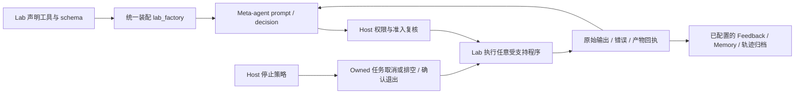

# M04：开放式 Lab 动作出口

> 历史记录：原始探针、日志和请求已转入[归档说明](README.md#archived-evidence)；本文命令描述当时的工作，不作为当前可执行教程。

用户确认：meta-agent 在环境权限内自由编写、修改、执行程序；SFT、RL、evaluate 的实现也可修改。
本次实现不再要求开放式 Lab 注册这些研究类别。目标、资源准入和验收权限由 host / Lab 管理。

## 接口与实际接线

新端口 [LabExecution](../../src/rsisys/loops/contracts/execution.py) 只要求两个方法：

```python
describe() -> tuple[OperationSpec, ...]
execute(OperationCall) -> OperationResult | JobRef
```

Lab 提供工具 description/schema 和执行；参数语义校验属于 Lab，必须在产生副作用前完成。
默认适配器只检查 JSON 调用封装和名称；schema 负责描述，不冒充完整 JSON Schema 校验器。
无需提供 Actor、训练枚举、内部 validator 类、memory 布局或完整 exploration 生命周期。
工具可以叫任何名称，也可以只暴露一个通用程序执行入口。
目录在装配时捕获一次，模型按当前已授权目录使用工具；程序实现可在运行中修改。
需要动态增加工具的部署可替换 action space / harness，本实现不自动刷新目录或发现网络服务。



[Application](../../src/rsisys/application.py) 与 [build_demo](../../src/rsisys/config.py)
统一通过 [assemble_loops](../../src/rsisys/assembly.py) 装配；使用 `lab_factory(context)` 后：

- 默认 decision 读取 Lab 的工具并保留默认研究记录工具，不推断 `sft/rl/evaluate` 模式。
- 不构造默认 Actor，不调用 exploration 的内部能力推断；配置只需要 decision_maker 角色。
- 保留真实模型身份、权限复核、决策账本、operation 回执和既有反馈入口。
- 同步 provider 只实现两个方法即可；持有后台任务的 provider 应提供可选 `shutdown(mode) -> bool`、`close()`。
- `shutdown` 是有界非阻塞检查，host 在后续 tick 重复调用；取消请求被接受不等于退出。
- `close` 自动加入统一资源管理；只关闭这个 Lab 所有的任务，不关闭共享服务。

旧 JSON/医疗配置和未传入 `lab_factory` 的旧 exploration 路径保持兼容，仍使用原有语义命令。
本次没有迁移冻结医疗 launcher，没有启动远端任务。
自定义工厂接管 decision harness 时，仍负责兑现同样的权限、回执、反馈与清理边界。

## 可运行的本地实现

[LocalProcessLab](../../src/rsisys/adapters/local_lab.py) 复用已有 LocalProcessBackend：

| 工具 | 能力 / 结果性质 |
| --- | --- |
| lab_write_file | 写入或替换程序和配置，算法没有固定分类 |
| lab_read_file | 按字节分页读取文件；UTF-8 边界使用替换字符 |
| lab_export | 将文件保存到 host ArtifactStore，供 workspace 清理后读取 |
| lab_start | argv 执行已安装程序；幂等 key 防重复启动；仅确认提交 |
| lab_poll | 观察 owned job 的 stdout/stderr、状态、退出码；只读查询归档 |
| lab_result | 收集终态结果并交付普通反馈路径，供 context/memory 整理；不是评测有效性背书 |
| lab_cancel | 请求取消；后续 poll / host shutdown 确认退出 |

`lab_poll` 的只读查询不会递归生成 memory 整理任务；`lab_result` 记录结果收集状态，
进入已配置的反馈流水线。所有调用仍直接返回 Decision 的 context。
进程日志终态自动保存为 artifact，代码和其他输出文件需要显式 export。
本地实现不自动冻结代码树；argv 本身不证明执行期间的完整代码/权重版本。
需要精确实验身份时，由模型或生产 executor 保存代码、权重、协议版本与产物引用。
重复 start 的同 key/同请求返回同 job；改参数复用 key 被拒绝。索引是进程内的，不承诺跨崩溃恢复。

工具文件访问拒绝绝对路径、`..` 和父目录符号链接，读写有字节上限。
执行器允许一般程序执行：这是受信本机进程，**没有 OS 沙箱隔离**；程序本身可访问 host UID 的资源。
正式训练需在真正限制设备、数据、文件系统和网络权限的 executor 内部署。
执行器不会自动加载训练库、安装依赖、选择设备或解析 stdout 为可信指标。

## Prompt 改动

- [decision.txt](../../src/rsisys/loops/decision_making/harness/policy/prompts/decision.txt)：
  去掉“没有 directive_modes 就不能发起新实验”的错误表述；明确 Lab operations 可编辑和执行程序，
  包括自行实现 SFT、RL、evaluate；提交不等于完成。
- [research.txt](../../src/rsisys/loops/decision_making/harness/policy/prompts/research.txt)：
  允许修改算法和评测实现；记录版本、数据、协议。同协议比较有效，不把换评测后的分数直接比较，
  不允许模型以改代码的方式改变 host 的目标/验收权限。
- 继续通过 DecisionPrompts 组件替换；本次未加入必须训练、必须轮换方法等流程。

## Host 与恢复边界

权限回调能在执行前审查工具参数。模型不能通过 prompt 开放未安装能力。
本地实现有 host 设置的每命令超时、并发/提交数量和文件字节上限；模型不管理剩余额度。
这些限制不是对任意程序内部训练 steps、样本曝光、设备内存的自动计量。
既有语义训练命令的“最多几次 SFT”不自动覆盖通用代码路径；正式任务必须在 executor
完成资源隔离、训练准入和用量观测，不能据此宣称仍维持旧医疗任务的约束。
模型调用计费仍由所选 decision/feedback backend 与 host 负责。

Runner 到停止条件时调用 Lab 的 drain/cancel，只有确认退出才报告 shutdown_complete；
清理超时会标记 unresolved_execution。调用者仍需持续驱动 tick 并关闭 Application。
纯同步自定义 execute 必须自行设置有界传输/执行超时；host 无法抢占任意阻塞的 Python 方法。
普通 invoke 的 JobRef 仍使用既有外部 resume；本地 Lab 通过 start/poll/result 工具实现非阻塞工作，
不会把 JobRef 当作已完成或偷偷重启。

Lab 自有状态尚未接入 durable snapshot：明确拒绝自动快照与恢复，不丢弃 executor 后恢复成旧默认组件。
工作区记录 lab_execution.json；去掉 factory 后恢复也会拒绝。
本地 workspace 在 close 时删除，需长期保留的文件必须先 export；较大权重产物应由生产 executor
使用持久 artifact 引用，不通过默认小文件出口传输。

## 验证

新增 [test_open_lab_execution.py](../../tests/runtime/test_open_lab_execution.py) 验证两套装配、实际传入模型的
schema/prompt、任意命名、权限与参数准入、真实 CPU 程序修改/失败/修复、幂等、输出归档、
终态反馈到 memory/轨迹、到期取消和 owned 清理，以及不支持的恢复被明确拒绝。
运行 [open_lab.py](../../examples/components/open_lab.py) 可复现开放代码路径；使用确定性 policy fixture，
不做真实模型推理、SFT、RL 或医学评测，不把 CPU 验证称为自主研究效果。
完整运行结果与 SHA 清单写入 [validation](README.md#archived-evidence)。
最终全量回归 1578 项：1566 通过、12 跳过，零失败；其中新增 23 项。
本地 CPU fixture 通过，确认真实进程执行和 owned 退出；没有真实模型推理或训练效果结论。
