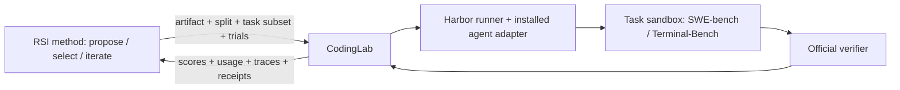

# Coding task environment

`CodingLab` is a reusable task-scene environment. Any RSI method can submit an
immutable agent artifact, evaluate it on frozen coding tasks, and inspect the
result. The method owns proposal generation, search, selection and stopping.
The Lab owns task bindings, artifact snapshots, trial scheduling and measurement
receipts. `HarborTrialRunner` launches and recovers individual sandbox trials;
each benchmark supplies its own verifier. The host sets budgets and controls
access to sealed tasks.



The bundled [coding_meta_agent](../../../algorithms/coding_meta_agent/README.md)
composes this environment with its own instruction-search and sealed-selection
policy. It is one client; another method does not need its candidate registry,
minimum round count or finalization protocol.

## Runtime requirements

Use Linux, working Docker/Compose and BuildKit/Buildx, benchmark task assets,
enough image storage, and a deployed inference endpoint. Install the optional
worker dependencies with `pip install -e '.[coding]'`. Core imports and registry
inspection do not import Harbor or OpenAI. Only executing a trial requires them.
The default adapter uses an OpenAI-compatible endpoint supporting JSON responses;
other adapters may use their own model protocol.

Prepare tasks using their benchmark's official Harbor integration. The Lab does
not download datasets, launch model servers or repair benchmark images. A model
revision, inference settings and task/image provenance must be recorded by the
host. Changing those inputs requires a new experiment binding. Before scoring,
calibrate the official reference solutions in a separate host-only job; keep
calibration evidence separate from model measurements. Preserve failures caused
by unavailable sites, expired certificates or other environment limitations.
Version any task repairs before freezing a new experiment.

## Connect a benchmark

1. Prepare the official Harbor tasks for the benchmark and revision you want.
2. Write a JSON manifest with named, nonempty splits and task file hashes.
3. List the manifests to use in the Lab's `benchmarks` config. The key is the
   benchmark name used in its rows and in `by_benchmark`:

```toml
[framework.method.config.labs.coding.benchmarks]
swebench-verified = { manifest = "/data/benchmarks/swebench-verified.json" }
"terminal-bench-2.1" = { manifest = "/data/benchmarks/terminal-bench-2.1.json" }
```

Include only the benchmarks you want to run. Splits with the same name are
merged, in benchmark name order with task order preserved within each manifest.
Assign roles with `split_roles` (for example, `{"development": "dev", "final":
"sealed"}`). For an existing combined manifest, use `manifest` instead of
`benchmarks`. See the [complete method config](../../../algorithms/coding_meta_agent/configs/coding.toml)
for model, method, and Lab settings together.

The manifest uses this shape:

```json
{
  "splits": {
    "development": [{
      "id": "task-name",
      "benchmark": "terminal-bench-2.1",
      "path": "/absolute/path/to/official/task",
      "files": {
        "task.toml": "sha256-of-task-toml",
        "instruction.md": "sha256-of-instruction"
      }
    }]
  }
}
```

Include hashes for **all** task files, pin upstream revisions and image digests.
The two displayed files are mandatory. Duplicate `(benchmark, id)` entries across
splits are rejected, as is a task directory reused across splits under different
names. Top-level `search`/`heldout` lists are accepted too.
For framework-routed calls, the host enforces sealed split roles. If calling
`CodingLab` directly in Python, the caller is responsible for withholding the
final split until selection. Subset scores are development measurements, not
full leaderboard scores.

This scene takes task manifests for evaluation and has no training dataset
operation. A method that trains weights should bind training inputs to its
training Lab. See the [Lab template](../../_template/README.md) for a minimal
example that binds training and development inputs separately.

Required config: `experiment_dir`, one of `benchmarks` or `manifest`, `python`
(absolute virtualenv interpreter), `endpoints` (nonempty URL list), and explicit `model`. Optional:
`workers=14`, `max_steps=48`, `max_tokens=4096`, `total_tokens=98304`,
`agent_timeout=1800`, `verifier_timeout=1800`, `seed=73`, `thinking=false`.
Candidate data cannot change host budgets. The adapter must honor the budgets
bound to its arguments; Harbor enforces the agent/verifier timeouts. Use the
virtualenv interpreter path directly: resolving its symlink can select the system
Python. Model services and GPU allocation belong to deployment configuration.

## Data bindings

Coding Lab declares one `DatasetBinding` per merged split. Each binding
includes the split role, manifest source, schema version, provenance, and a
content digest over the task IDs, benchmark names, and frozen file hashes. For
sealed splits, the host records only the logical identifiers and a binding
fingerprint. `coding_meta_agent` forwards these bindings and uses `search=dev`
and `heldout=sealed`.

The manifest must list every file in each task directory. The Lab rejects
unlisted files, symlinks, and special files. The `coding-environment/v7`
binding records the selected manifests, their checksums and the merged task list.
Use a new `experiment_dir` for earlier runs or a different benchmark selection.

## Public interface

```python
from rsisys.api import CodingLab, CodingArtifact, OperationCall

lab = CodingLab(context=None, config=host_config)
artifact = CodingArtifact.from_path('/absolute/path/to/instruction.json')
# Default adapter expects {"instruction": "..."}.
small = lab.evaluate(artifact, 'development', task_ids=['task-name'])
full = lab.evaluate(artifact, 'development')
repeated = lab.evaluate(artifact, 'development', trials=2)
# Equivalent controller/Lab protocol:
result = lab.execute(OperationCall('evaluate', {
    'artifact': artifact.to_json(), 'split': 'development', 'trials': 1,
}))
trace = lab.read_trace(full['evaluation_id'], index=0, offset=0)
```

The operations are `inspect({})`, `evaluate({artifact, split, trials?, task_ids?})`
and `read_trace({evaluation, split, index, offset})`. `trials` is 1–16; task IDs must be
unambiguous within the split. Subsets follow manifest order, with stable task and
trial seeds. Identical requests reuse summaries. Expanding a subset or increasing
trials reuses completed individual trials and schedules only missing ones.
Use a new seed binding for a new independent experiment.

The Lab declares `coding-task/v1` and `MetricSpec(task_reward, maximize,
harbor-official-reward/task-mean/v1)`; results carry the value in
`quality_metrics.task_reward`. Configure `split_roles` using named profile roles;
test/heldout/sealed default to sealed and other splits to dev. The host restricts
sealed operations until finish, hides their task IDs in inspect, and checks the
trace's actual split against every requested trace split.

Results contain `evaluation_id`, the frozen `request`, per-task `tasks`,
`by_benchmark`, `samples`, mean trial `score`, token `cost`, aggregation `timing`,
`dataset_sha256`, and `protocol_fingerprint`. All measured zeros count. The
method may compute a different objective, such as equal benchmark-family weights.
Cost is recorded usage for the referenced measured trials, including reused ones;
it is not an incremental bill for the current API call and excludes incomplete
infrastructure attempts. These attempts retain their separate receipts/logs.
Trace pages contain up to 6000 characters and return `next_offset`.

## Plugging in a method or coding agent

A method imports framework symbols through `rsisys.api` and can bind the shared
scene directly; its controller submits `Decision.invoke(OperationCall('coding.evaluate', ...))`:

```python
from rsisys.api import CodingLab, MethodDefinition

registry.register_method('my_coding_method', MethodDefinition.from_factories(
    controller=MyController,
    labs={'coding': CodingLab},
    version='1',
    validate_labs={'coding': CodingLab.validate_config},
))
```

For explicit controller/Lab composition, the global Lab name is `coding`.
Published algorithms still need a method adapter translating their candidate and
feedback conventions to this interface; registering this scene alone does not
reproduce those algorithms.

To search harness settings, keep the instruction fixed and evaluate a separate
artifact for each setting, using the same development task IDs and trial count.
For example, the installed agent supports a bounded observation setting:

```json
{
  "instruction": "Inspect the project, make a minimal fix, and run relevant tests.",
  "harness": {"stdout_tail_chars": 8000}
}
```

Compare `quality_metrics.task_reward` in the search method. `stdout_tail_chars`
accepts integers from 2000 to 20000 and defaults to 20000. It changes the amount
of command output sent back to the model; the sandbox, verifier and execution
budgets come from the same host config as instruction search.

Artifacts can be files (instructions, agent configs, model references) or source
directories. The host selects an agent runtime once in its trusted factory:

```python
from rsisys.api import CodingLab, HarborCodingAgent

def build_coding_lab(context, config):
    return CodingLab(context, config, agent=HarborCodingAgent(
        import_path='my_harness:Agent', version='pinned-harness-revision',
        bindings={'config_path': 'artifact', 'base_url': 'endpoint',
                  'max_steps': 'max_steps', 'seed': 'seed'},
        kwargs={'temperature': 0},
    ))
```

Here `my_harness` is installed on the worker host and implements Harbor's agent
interface. Set `bindings` and `kwargs` explicitly for
that agent's constructor. Allowed bindings: `artifact`, `artifact_dir`, `endpoint`,
`model`, `max_steps`, `max_output_tokens`, `total_output_tokens`, `seed`, `thinking`.
A host-installed adapter's version must pin its external implementation and
dependencies. Candidate JSON cannot select imports or override the adapter.
Harbor imports custom agents on the worker host. If a trusted factory uses
`artifact_python_paths`, the imported source must also be trusted to run on the
host. Submit generated harness settings as data, as in the example above.

## Evidence and recovery

Artifacts are copied into a content-addressed store before execution. Source
snapshots exclude `.git`, `__pycache__` and `.pyc`; symlinks and special files are
rejected. Hashes are checked before use and after execution. Task manifests,
source hashes, adapter settings, endpoints and budgets are bound to the experiment.
Use a new directory after changing this binding; old experiment archives are not
migrated or rewritten.

`evaluations/evaluation-*/summary.json` holds each request's result;
`measurements/<hash>/` holds shared task receipts, submissions, original Harbor
results and agent logs. Reattaching the same experiment reuses valid receipts.
Each submission is journaled before spawn. Recovery matches its trial name and
receipt path against the Linux process, and does not replay a live worker.
Uncertain leftover containers require host reconciliation before resubmission.
Missing or infrastructure-failed grades get two attempts per invocation, then
remain incomplete. An exhausted agent time budget with an official valid reward
is a measured result. A filesystem lock serializes mutation of one environment.
`close()` preserves journaled workers for explicit reattachment.
