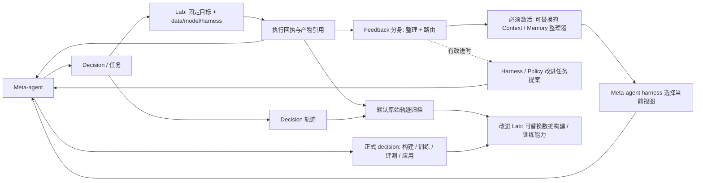

# Meta-agent 的反馈整理与路由

可选入队策略 `FeedbackAdmissionPolicy.admit(event, pending)` 可在昂贵整理前跳过或合并
排队事件；原始回执、即时 context、context observer 和轨迹仍保留，running 任务与预算不可修改。
不配置时保留原行为。医疗默认实现跳过 busy/提交确认等重复状态，优先整理终态证据。
LangMem 在完整原生请求组装后计量，容量错误结束该 job，不进入 patch 修复循环。
详见[夜间实测修复](../../../../../docs/review/lion-followup-repair-20261105.md)。

这里负责记录 decision / Lab 原始回执，并整理研究记忆及可选改进提案。
Context / Memory 的公开出口已收敛为 `context(query) -> str`；
[接口、SDK 适配与实际请求接线](../../../../../docs/review/feedback-context-window-20261104.md)
记录本次实现，三方法是兼容实现细节。
[模块窗口规范](../../../../../docs/review/feedback-module-windows-20261104.md) 进一步定义原始归档、
原生产物/提案与调度接口；旧 job、Memory 和处理结果协议隔离在适配器内。
真实执行结果在记账、持久捕获后直接交回 decision，不等待 memory 或提案模型。
反馈分身是同一个 meta-agent
在独立上下文中承担反馈职能，共享当前权重；反馈调用仍接入宿主的准入、
计费和生命周期。它不依赖默认 meta-agent harness 的 state、会话格式或 compact 算法。

## 统一命名与边界

| 概念 | 职责 | 现有实现映射 |
| --- | --- | --- |
| Meta-agent | 选择研究动作、写代码/修代码方案或完整自动化任务 | `decision_maker` 角色及其可替换 DecisionHarness |
| Decision | 带身份、理由、参数和来源的具体动作或任务；不是模型本身 | `Decision`；当前区分 `invoke` 本地能力与 `explore` 下发指令 |
| Lab | 固定目标与评测契约下的研究环境，包含 data、model、harness；支持已安装的代码执行、SFT、RL、推理、评测能力 | `LabSpec / LabTask / Lab` 提供基础契约，`ExplorationLab` 适配现有 exploration；默认 Runner 尚未迁移为跨 Lab 调度器 |
| Sandbox | Lab 执行代码时使用的运行/隔离设施 | 具体后端；不是 Lab 的同义实现 |
| Feedback 分身 | 同权重、独立上下文；整理执行证据、关联 decision，决定信息的去向 | `FeedbackLearningService` + `FeedbackAdapter` + 独立 worker；不是另训一个反馈模型 |
| Meta-agent harness | 装配当前上下文、检索、compact、调度与执行校验 | 默认、DSH 或其他实现；与 lab 内的 harness 分开 |

保留现有角色名和消息协议，避免靠批量改名破坏旧日志、后端和恢复行为。
基础 Lab 接口复用 Directive 和现有 handlers；增加接口不会安装通用编程 agent、训练算法
或隔离设施。适配器任务索引仅在当前进程有效，持久恢复需要显式集成。



只有 context/memory 整理能力必须激活，实现可替换；其他组件按需装配：

| 产物 | 现在提供什么 | 后续消费边界 |
| --- | --- | --- |
| 即时 context | 直接交付 Lab / 工具的真实结果、错误、指标和产物引用；不经反馈模型改写 | Decision 的 last_feedback / operation_results 及账本 |
| context/memory（必须激活，实现可替换） | `context(query) -> str` 或函数；可选 observe 接收新反馈。默认 journal/LangMem 由适配器接入 | 当前文本替换 DecisionContext.memory_context，内部格式、检索与存储属于实现 |
| 原始轨迹（默认开启，可关闭或替换） | write(event)/read(reference)；Journal 默认经适配器导出索引/固定捕获 | Lab 通过 TrajectorySource / TrajectoryRef 读固定来源，不在反馈端构建样本 |
| 改进任务提案（可选） | propose(event, model) 返回原生建议；内置适配器生成结构化提案 | 主 decision 和具体消费者决定正式构建、训练与验证 |

原 `training_data` / `target=weights` 仍兼容为未验证草稿，不要求每次生成 input/target。
执行/反馈交付 journal 在模型整理前记录事实；它用于查询和恢复，与可选研究轨迹产物分开。
关闭轨迹产物不删除这些原始事实；模型失败或队列/调用准入拒绝也不删除原始片段。
当前 observer 未捕获原 meta-agent 模型的完整 prompt/response，
轨迹索引明确 `complete_conversation=false` 及缺失范围，不能称为完整会话轨迹。

默认 adapter 在每次新捕获时读取 meta-agent 当前 ModelRef，版本变化后新任务自动跟随；
安装时的 `model=` 若提供必须匹配当前引用，不能固定成另一个反馈模型。已捕获任务保留
其快照版本，历史 issuing 模型另行记录。第三方 adapter 的 `model()` 也应提供 active
meta-agent 引用；实际权重及跨服务身份仍由后端兑现。

`subject` 另外区分 `meta_agent`、`lab` 与 `unspecified`。特别是两个 harness：
优化 lab 的推理 harness 不等于改进 meta-agent 的研究 harness。
旧 proposal 没有这个字段时保持 `unspecified`，不猜测归属。历史 `system_change`
暂单独映射为 `target=system`，不强行归并为 researcher 训练或 harness 改进。
当前上下文不注入明确标记为 `subject=lab` 的 memory 草稿；这些草稿仍可查询。

## 当前组合链路

研究任务统一使用 [research.py](../../../research.py) 的 `ResearchAssembly / assemble_research`：
必需 context/memory、默认原始轨迹归档、可选改进提案分别记录状态。
LangMem 可以组合 `improvement_proposals=ModelImprovementProposer(...)`；memory 算法仍由
整理器负责。旧 `harness_proposals=ModelHarnessProposer(...)` 仅生成 harness 提案，与新选项互斥。
主 meta-agent 在正常 decision 的 `feedback_proposal_ids` 引用建议，执行前校验来源；
构建/训练由 Lab 的正式任务负责，回执再次进入 feedback。
`service.trajectory_snapshot(job_id)` / `/trajectory_snapshot` 提供不可变原始来源。
`extract_trajectory` / `/trajectory_segment` 保留旧组合视图，包含后来完成的反馈交换，不能用作固定训练来源。
完整 workflow、装配例子和边界见[链路文档](../../../../../docs/review/feedback-workflow.md)。
Application / Demo 通过 `research=` 接入；医疗控制器始终经过统一入口。启动即记录组件配置，
恢复拒绝更换组件；配置 schema_version=4 记录公开协议、组件、依赖与故障策略，并保留 archive_only、direct_before_processing 和 Lab 数据归属，
不静默迁移旧 journal。底层 enable_* 及旧组合解释入口保留兼容。

## 实现分工

- [service.py](service.py)：`observe(ExecutionReceipt, evidence=...)` 只持久捕获并排队，
  `archive(...)` 只归档；后续 `refresh()` 非等待地推进任务并发布已完成结果。
  保留旧 `receive_feedback` 入口；第三方 harness 不需要默认 state。
  Adapter 只要求 `model/install`；`publish/decision_ids/evidence` 是兼容或补充接点；
  通用 observe 可直接传入 FeedbackEvidence，或由可选 `receipt_evidence` 提供。
- [learning.py](learning.py)：单写者 journal、调用准入、有界证据输入、输出校验、分页读取。
- [ContextMemory 协议](../../contracts/feedback_context.py)：公开文本窗口和独立反馈事件。
  [context_memory.py](context_memory.py) 对接回调/SDK，并隔离旧三方法；
  [components.py](components.py) 保留默认 journal 组件，兼容旧实现。
- [可选模块协议](../../contracts/feedback_modules.py)：归档、产物/提案、模型能力和调度选择。
  [archive.py](archive.py)、[stages.py](stages.py) 隔离旧 journal/workflow；
  [scheduling.py](scheduling.py) 提供默认 FIFO，host 继续控制容量和停止。
- [legacy.py](legacy.py) 与 [兼容 prompt](prompts/legacy_feedback.txt)：旧解释器组件及覆盖入口。
- [pipeline.py](pipeline.py)：memory 与可选提案的组合、分产品状态及恢复；
  [proposals.py](proposals.py) 与 [改进任务 prompt](prompts/improvement_proposals.txt) 只生成任务提案，
  不生成训练样本；[旧 prompt](prompts/harness_proposals.txt) 保留 harness-only 选项。
- [attempts.py](attempts.py)：基于已观察引用增量更新 Attempt，保留不可变修订；不按同名或时间相邻归组。
- [evidence.py](evidence.py)：精确绑定候选 ID、协议、指标、来源和 simulated；不验证自由文字的含义。
- [knowledge.py](knowledge.py)：默认实现从 journal 派生按 Attempt 组织的记忆、分类提案和轨迹索引；
  不新增存储或模型调用。外部整理器可以替换记录、工作视图与发布，不必调用这些函数。
- [默认适配器](../harness/learning_harness.py)：把上述中立视图接入默认/DSH harness；
  [证据投影](../harness/research_state.py)、[账本选择](../harness/ledger_context.py)
  和 [compact](../harness/context.py) 属于 harness。
- [Lab 数据契约](../../contracts/improvement.py)、[固定来源适配](../../../adapters/trajectory.py)
  和 [Lab 能力装配](../../../adapters/improvement.py)：把原始归档接到可替换的数据构建与训练后端，
  使用现有 submit/poll/cancel 生命周期；返回数据集/候选，不修改当前 policy。

执行回执是执行事实的依据；Attempt、memory 和摘要是可修订解释。结构化校验通过，
只表示引用/指标符合来源，不表示解释正确、提案有效或改进已应用。
`view=proposals` 返回稳定 proposal ID、subject、target、来源快照及精确输出读取入口，
明确 `status=proposed, training_ready=false, applied=false`。这里尚未实现验证/应用状态机。
默认 adapter 将正式决策引用写入账本，`service.proposals()` 附带 decision_links；
关联及成功执行不被自动解释成 harness 激活。

## 统一执行观察

[ExecutionReceipt](../../contracts/receipts.py) 保留任务/决策/Lab 身份、发起模型、原始请求与
终态结果。Lab 结果与本地操作共用观察入口；发起模型与反馈模型分别记录，不猜测未知身份。
新 Lab 可直接使用 service.observe_output(native_output, task_id=..., status=...)，
或 ExecutionReceipt.from_output；任务与状态由执行设施提供，原生文本/JSON/文件引用自由。
无须预先构造统一指标、候选、summary/error 或 Directive / Feedback。
FeedbackEvidence 可选；native 入口不强制读取默认 harness 的研究历史或领域目录。
原始 payload 中的 status、metric 等字段保持普通内容，只有显式业务适配器才建立相应语义。
大 native payload 提供有界预览和精确原文入口，原始档案不改写。
默认 adapter 在本地非只读操作完成并记账后观察；异步提交 JobRef 不算完成，resume 到终态
才整理。只读导航及被权限拒绝的读取只归档，不创建 memory/proposer 模型任务，避免递归整理查询。
归档查询不注入常驻 working memory；轨迹关闭时不额外归档这些查询。
独立接入方可选择自己需要整理的任务；这不改变执行授权或模型可选的研究动作。

```python
service.observe(receipt, evidence=FeedbackEvidence(history=history, evaluations=evaluations))
# 后续 Harness tick；不会等待尚未完成的 worker。
service.refresh()
```

同一身份和内容重送只补交付，不重做工具操作；同一身份换结果会被拒绝。原始回执与
模型看到的有界投影分开保存。exploration 原文在 `/receipt/directive`、`/receipt/feedback`；
本地原文在 `/receipt/operation`、`/receipt/result`，身份在 `/receipt/task`。
通用本地指标位于 `result.data` 下的三组标准 metrics；它们不会自动构成某候选/协议的独立评测。
实际发出的反馈请求（含 system/prompt/schema）在提交前持久化；`/feedback_request`、
`/feedback_response` 分页读取这次交换。没有提交或历史未记录的交换明确报未记录，不用当前
代码重新生成“历史 prompt”。轨迹中的 execution_status 与 feedback_status 分开。
快速交付仍要求持久捕获成功；落盘失败由交付重试处理，不重新执行任务。
关闭时未提交的整理任务会取消，原始捕获保留，不保证最后一份结果已完成模型整理。

可选 [FeedbackDelivery](../../contracts/delivery.py) 用生产事件 ID 关联不同收集 decision。
[delivery.py](delivery.py) 只使用该元数据及原始结果 SHA-256 校验：同一 Lab/run/event 的结果变更是身份冲突；
原文的每次读取保留独立 journal/轨迹，重复结果记 `archive_only` 和 `duplicate_of`，
不再次通知 context observer、调用 memory processor 或生成提案。只读归档不占用首次处理机会。
`reprocess=True` 允许新收集 decision 显式再整理，仍遵守调用、并发和队列限额，不重启原始工作。
首次处理失败或结果未知也不因重复读取自动重试，需显式请求。
没有该元数据的模块保持原行为；output/data 中的同名字段都是原生内容，不控制路由。
重新加载 feedback journal 后保留去重关系；这不表示开放 Lab 本身已支持恢复。

## Context 与完整档案分开

可选的 [LangMem 原生接入](langmem.py) 同时替换整理流程和工作视图，通过
`ResearchAssembly.langmem(...)` 显式选择；底层 enable_langmem_feedback 保留兼容。
基础环境不加载其依赖，配置不创建数据库；缺少依赖/native tool calling 时启动报错。其 `FeedbackProcessor` 直接运行
上游 MemoryStoreManager / Trustcall，不先重复调用兼容解释 prompt。
每次反馈触发原生抽取和 consolidation，内部生成仍经共享 backend 准入与调用记录。
实际 messages/tools 和响应可从 `/context_memory/model_exchanges` 分页读取；该模式的
`/feedback_request` 是工作流描述，`/feedback_response` 为处理结果。
当前 SQLite 按最近更新检索，未启用向量检索。真实回放仍有无关记忆删除和文字归因缺口，
尚未设为默认；[采用记录与实际 prompt](../../../../../docs/review/feedback-oss-adoption.md) 保留失败证据。

启用此反馈链路时，装配必须提供有效 context/memory 整理器，省略配置采用内置实现；
显式 `None` 或缺少接口的对象会在推理前被拒绝。轨迹默认开启，显式 `None` 关闭：

```python
enable_feedback_learning(loop, backend=backend, adapter=adapter,
    context_memory=external_organizer, trajectory_archive=None)
```

新整理器只需实现 `context(ContextQuery) -> str`，也可直接使用函数。查询提供当前目标和最近
非归档反馈的公开内容；可选 `observe(FeedbackContextEvent)` 在后续 refresh 接收一次更新通知。
SDK 可通过 `CallbackContextMemory(render, on_feedback=...)` 接入自己的 API。
普通组件无需 journal、Attempt、内部 Memory 或 recover 方法；context 更新替换当前视图。
通知状态持久化，失败/未知副作用不自动重放；renderer 类型错误或异常显式失败。
旧 `record / working_memory / memory` 经内部适配器继续兼容；它们不再是所有插件的要求。
归档实现 `records(jobs, research_attempt_id=...) -> list[dict]`，未过滤时每 job 对应一个片段，
可替换默认索引；可选 `snapshot(job) -> dict` 提供不可变来源，没有该能力时明确拒绝固定来源导出。
跨 job 聚合、筛选、标注和格式转换属于 Lab 的 dataset builder。发布前核心仍校验模型的引用/指标，
兼容 Memory 发布失败只重试发布，不重做模型调用或执行任务。读取方法可能重复调用，实现需保持稳定身份。
重新装配/恢复时必须重新提供相应组件及其外部状态；journal 不保存任意插件对象。

以下具体记忆选择规则描述内置实现。

`service.context(ContextQuery(...))` 是通用文本出口；默认 Harness 直接消费该出口。
`service.working_memory(active_decision_ids=..., policy=...)` 保留为旧结构化检查入口；
新组件在该兼容入口返回 `{'context': text}`。以下字节选择规则仅用于内置 journal/LangMem 适配。
`WorkingMemoryPolicy(max_bytes=12000, recent=8, summary_characters=600)` 是宿主选择的常驻
视图策略，不是模型管理的实验预算。每次加入卡片都检查编码后的 UTF-8 总字节，
限制适用于派生知识部分；harness 添加的事实保护元数据及整个请求另外计量。

同一 Attempt 只展示最新解释卡，不重复注入已归组 job 的整段 memory。
成员和 source_refs 的完整列表不常驻，卡片保留数量、版本和精确查询入口；预览明确标记为摘录。
未归组观察保留其 canonical decision/Attempt ID、模型身份与部分来源，完整记录仍在 journal。
按捕获顺序选取，优先活跃 Attempt；遗漏数量明确记录。没有出现在视图中不表示未评测、成功或不相关。

兼容的 `feedback-learning:<job_id>` episodic Memory 仍发布到 adapter，保留现有外部消费方。
它是逐 job 档案，不是默认研究上下文的规范组织方式。默认适配器仅在原文可读、指纹完全
匹配时从工作视图移除这个重复副本；独立修改过的 Memory 不会被误删。原存储不删除。

候选、评测、模型来源和决策图也遵循同一分层：完整执行账本负责校验与恢复；harness
在具备只读 archive 能力时提供当前/活跃/近期选择，旧条目按 ID 读回。活跃依赖闭包完整保留；
已完成历史的边可以指向归档，不要求每次递归展开。单条必要事实或真正活跃依赖仍可能过大，
此时应明确报错，不承诺任意输入都能无损塞入固定窗口。

## 读取示例

默认适配器注册 `feedback_learning_read`，自定义 harness 也可直接调用 `service.learning.read`，
或把这些读取参数映射为自己的工具。返回 JSON 文本片段需拼接完成再解析。

```json
{"view":"attempts","research_attempt_id":"attempt-...","offset":0,"limit":8}
```

```json
{"view":"proposals","target":"harness","offset":0,"limit":8}
```

```json
{"view":"trajectories","offset":0,"limit":8}
```

指定 job 后读取 `/context_memory` 查看兼容整理器的记录，或新组件的反馈通知状态；
新组件当前检索文本以实际 decision 请求的 memory_context 为准。`/trajectory` 只在归档启用时可用；
`/trajectory_snapshot` 是固定来源，`/trajectory_segment` 是兼容组合视图。
job 元信息的 `trajectory.enabled` 与轨迹列表的 `enabled` 显式标记配置，关闭时列表为空且
单条轨迹读取报不可用。长正文仍通过带指纹的 JSON 文本页读取。

后续页传回 `next_offset` 并把第一页 `sha256` 放进 `expected_digest`；期间内容变化时拒绝混页。
`view=attempts` 是最新版本目录，旧版本通过所属 job 的 `/attempt_revisions` 查询。

```json
{"job_id":"...","evidence_path":"/proposals/0","offset":0,"limit":8}
```

`/proposals`、`/attempt_revisions` 是解释输出命名空间；`/receipt`、`/history` 等属于捕获
的原始输入，空指针读取该 job 原始输入根节点。两者 authority 不同，读取也不扩大模型当时的 coverage。

## 后续迁移

这一阶段落实四条反馈链路、固定来源契约，以及 Lab 数据构建/训练能力适配。
具体数据 recipe、真实训练后端、独立 policy 评测与激活仍由相应实现提供。
默认跨 Lab 调度、任务索引持久恢复及通用代码能力尚需继续迁移，harness 提案的验证/应用流程也未补齐。
不能将接口草图、fixture、一次整理调用或已有的 actor SFT 计为完成了这些能力。
